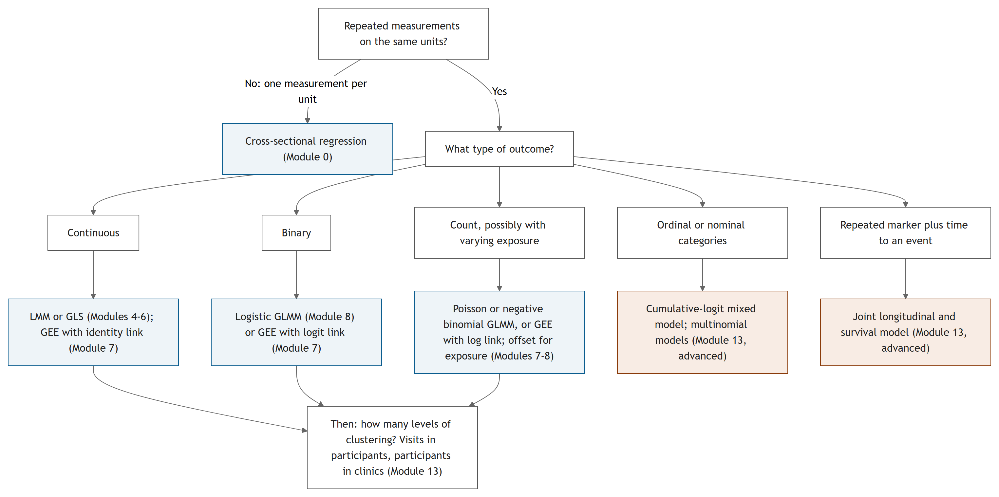
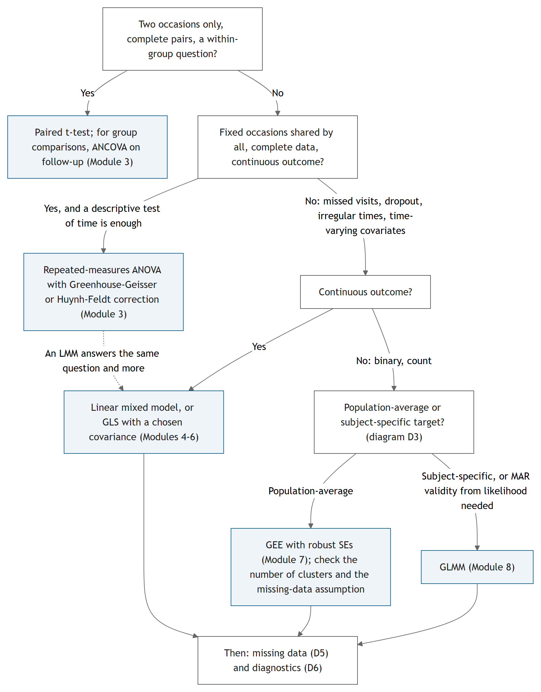
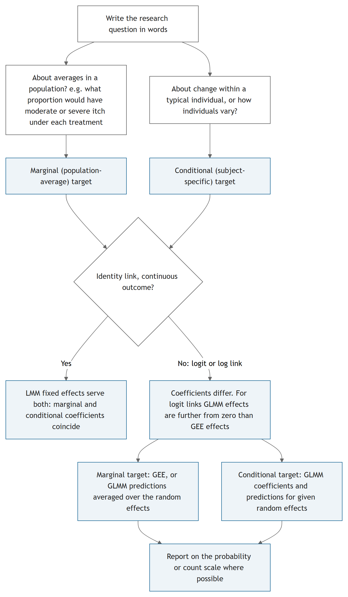
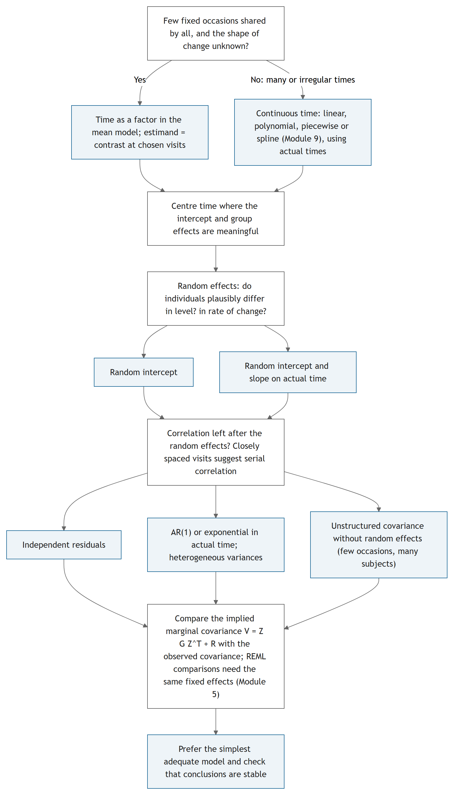
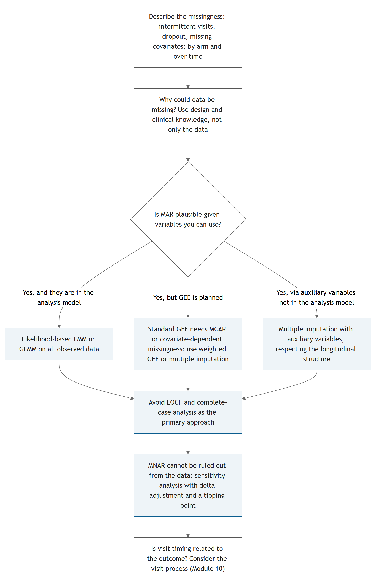
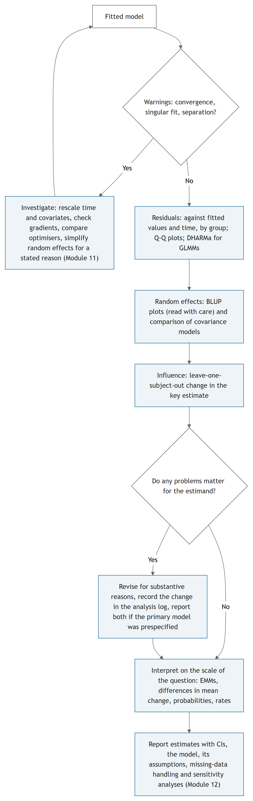

# Choosing a method {#sec-choosing}

This appendix collects the questions and diagrams used throughout the book to reason about the choice of method. They are guides to reasoning, not automatic rules. Editable Mermaid sources are in `diagrams/` of the course repository.

## Five questions to ask before choosing

1. **What is the estimand?** Write it down: the population, the outcome variable, the time point or summary of change, how intercurrent events such as dropout or treatment change are handled, and the summary measure (difference in means, odds ratio, rate ratio).
2. **Population average or subject specific?** For continuous outcomes with an identity link the two coincide. For binary and count outcomes they do not, so choose deliberately (diagram D3).
3. **How are the data structured?** Fixed or irregular occasions; number of participants (clusters); further levels such as clinics; time-varying covariates.
4. **Why are data missing?** If dropout may depend on earlier outcomes, use a likelihood-based model or multiple imputation (MAR) and plan a sensitivity analysis. Standard GEE and complete-case methods need stronger assumptions (diagram D5).
5. **What will you report?** Choose a method that produces the estimand directly with a confidence interval, on a scale your readers understand.

## Method-selection diagrams

These six diagrams set out the questions an analyst asks when planning a longitudinal analysis. They do not choose a model for you. A diagram cannot know your research question, your design, the reason data are missing or the conventions of your field. Use them to structure your reasoning and to check that you have considered each decision, then justify the final choice in words.

### D1. Outcome type and data structure

The first question is what kind of outcome you have and how the observations are grouped. Remember that the outcome type narrows the choice of model family. It does not settle the choice.

{.diagram width=95%}

### D2. Paired tests, repeated-measures ANOVA, LMM, GEE and GLMM

Traditional methods suit only narrow situations. They need complete data, fixed occasions and continuous outcomes. As soon as visits are missed or irregular, or covariates change over time, model-based approaches are needed.

{.diagram width=95%}

### D3. Population-average or subject-specific?

This question decides between GEE and GLMM for non-continuous outcomes. Answer it from the research question before fitting anything.

{.diagram width=95%}

### D4. Time, random effects and residual correlation

These three choices interact. Together they determine the implied marginal covariance $V_i = Z_i G Z_i^\top + R_i$ (Module 5).

{.diagram width=95%}

### D5. Missing data

No analysis can confirm that data are missing at random. Background knowledge about why data are missing matters as much as any statistic.

{.diagram width=95%}

### D6. Diagnostics and interpretation

Diagnostics exist to find problems that affect the estimand. Use them to understand your model, never to search for a model that gives the result you hoped for.

{.diagram width=95%}
