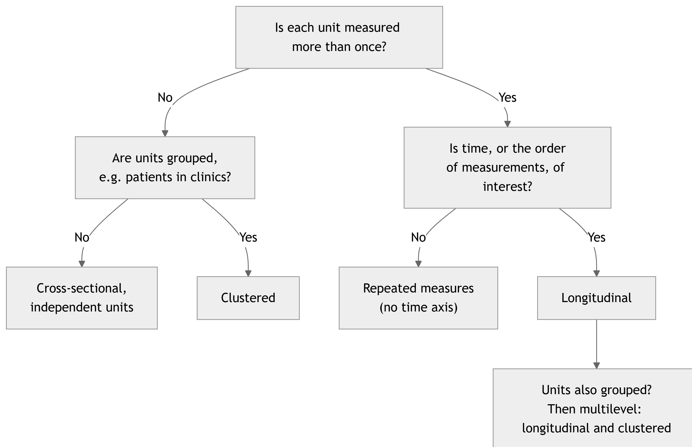

# Foundations of longitudinal data {#sec-m01}

```{r}
#| include: false
here::i_am("book/en/chapters/01-foundations.qmd")
options(width = 76)
```


```{r}
#| label: setup
#| include: true
source(here::here("R", "setup.R"))
walk   <- load_walk()
kidney <- load_kidney()
```

Longitudinal data follow the same people over time. That simple fact gives them their power: they show how outcomes change, whether change differs between groups, and how individuals differ from one another in the way they change. It also creates their main difficulty. Measurements on the same person resemble each other, so they are not independent pieces of information, and in real studies the timing and number of measurements vary from person to person. This module builds the vocabulary and intuition for the rest of the course. It classifies study designs, takes a longitudinal dataset apart into subjects, observations, visits and measurement occasions, measures how much of the variation in blood pressure in WALK lies between people and how much within them, sets out the kinds of research question longitudinal data can answer, and shows by simulation what goes wrong when repeated measurements are analysed as if they were independent. Mixed models appear here only informally; Module 4 develops them properly.

## Learning outcomes {.unnumbered}

By the end of this module you will be able to:

1. **1.1** Classify a study design as longitudinal, repeated-measures, clustered or cross-sectional, and justify the classification.
2. **1.2** Identify the subject, the observation, the visit and the measurement occasion in a given dataset.
3. **1.3** Distinguish within-subject from between-subject variation, and estimate each from the WALK data.
4. **1.4** Describe balanced and unbalanced designs, irregular visit times and unequal follow-up, and how each affects the choice of analysis.
5. **1.5** State a research question about change, about group differences in change, or about individual trajectories, together with its estimand.
6. **1.6** Use a simulation to show how ignoring within-subject correlation changes standard errors, and explain the direction of the error for between-subject and within-subject comparisons.

## Prerequisites {.unnumbered}

Module 0 (Foundations refresher), or equivalent confidence with linear regression, interactions, confidence intervals and the `dplyr`/`ggplot2` workflow.

::: {.callout-warning title="Simulated data"}
All examples use simulated data from fictional studies. Results illustrate methods; they are not empirical findings.
:::

## Kinds of study design

Statistical methods follow from the structure of the data, and that structure follows from the design. Four designs are worth distinguishing at the outset.

A **cross-sectional** study measures each unit once. The WALK baseline file from Module 0 is cross-sectional: 360 people, one blood pressure each. Comparisons are between people, and if the people were sampled independently the observations are independent.

A **longitudinal** study measures the same units repeatedly over time, and time is a variable of interest. WALK as a whole is longitudinal: each participant's systolic blood pressure (SBP) was scheduled to be measured at months 0, 1, 3, 6, 9 and 12. The order of the measurements matters, the spacing between them matters, and questions are typically about change.

**Repeated measures** is the broader term for any design in which the same unit is measured more than once. All longitudinal data are repeated measures, but not all repeated measures are longitudinal. Measuring a participant's blood pressure in the left and right arm at one visit, or under three randomly ordered postures in a single session, gives repeated measures with no meaningful time axis. The term is also used, especially in experimental psychology and agriculture, for short designs with a few fixed conditions per subject, analysed with repeated-measures ANOVA (Module 3).

A **clustered** design has units grouped within higher-level units: patients within clinics, pupils within schools, teeth within mouths. Members of a cluster resemble one another, so they are not independent either, but there is no time order among them. WALK is clustered as well as longitudinal: participants were recruited at 8 clinics. A longitudinal study is in fact a special case of clustered data in which the cluster is the person and the members are the measurements, ordered in time. That is why the same models (mixed models, generalized estimating equations) serve both. What longitudinal data add is the time axis, which brings questions about change and correlation structures that depend on how far apart in time two measurements are.

```{r}
#| label: fig-m01-schematic
#| fig-cap: "Four data structures. Each row is a unit (a person, or for clustered data a cluster); each filled tile is one measurement. In the unbalanced longitudinal panel, some units miss occasions or stop early."
#| fig-width: 10
#| fig-height: 3.2
schematic <- bind_rows(
  expand.grid(unit = 1:6, time = 1) |> mutate(design = "Cross-sectional"),
  expand.grid(unit = 1:6, time = 1:5) |> mutate(design = "Longitudinal (balanced)"),
  data.frame(unit = rep(1:6, c(5, 3, 5, 2, 4, 5)),
             time = c(1:5, 1:3, 1:5, 1:2, c(1, 2, 4, 5), 1:5)) |>
    mutate(design = "Longitudinal (unbalanced)"),
  expand.grid(unit = 1:6, time = 1:3) |> mutate(design = "Clustered (no time order)")
) |>
  mutate(design = factor(design, levels = c("Cross-sectional",
                                            "Longitudinal (balanced)",
                                            "Longitudinal (unbalanced)",
                                            "Clustered (no time order)")))
ggplot(schematic, aes(time, factor(unit))) +
  geom_tile(fill = "#0072B2", colour = "white", linewidth = 1, alpha = 0.8) +
  facet_wrap(~ design, nrow = 1) +
  scale_x_continuous(breaks = 1:5) +
  labs(x = "Measurement occasion (or member of cluster)", y = "Unit") +
  theme(panel.grid = element_blank())
```

The decision can be summarised as a short sequence of questions.

{width=95%}

The four course datasets illustrate the range. WALK is a longitudinal randomised trial with scheduled visits, also clustered by clinic. CLEAR is a longitudinal trial with a binary and ordinal outcome. DIARY records counts of migraine days over successive 28-day periods, a longitudinal design whose observations are counts over periods of varying length. KIDNEY is an observational cohort whose visits happen at irregular times chosen by the clinic. All four violate the independence assumption of Module 0, and all four need methods that respect it.

::: {.callout-note title="Why this matters"}
The classification decides what "independent unit" means. In WALK the independent units are the 360 participants (or, if clinic effects are important, the 8 clinics), not the 1,897 measurements. Every standard error in the course is ultimately a statement about how much information the independent units carry.
:::

## The anatomy of a longitudinal dataset

### Subjects, observations, visits and measurement occasions

Four words recur throughout the course, and it pays to use them precisely.

- A **subject** (in WALK, a **participant**) is the unit that is measured repeatedly and that is assumed independent of other subjects. In notation, subjects are indexed $i = 1, \dots, N$.
- An **observation** is one measurement of the outcome: one row of a long-format dataset. Within subject $i$, observations are indexed $j = 1, \dots, n_i$, and the outcome is $y_{ij}$.
- A **visit** is a scheduled contact defined by the study protocol, such as "month 6". Visits belong to the design; they exist whether or not the participant attends.
- A **measurement occasion** is the time at which a measurement was actually taken, $t_{ij}$. Its value depends on when the participant came in.

WALK keeps the last two distinct. `month_sched` holds the scheduled time of the visit (0, 1, 3, 6, 9 or 12) and `month` holds the actual time, months since randomisation.

```{r}
#| label: anatomy
walk |>
  filter(id %in% c("W001", "W002")) |>
  select(id, arm, visit, month_sched, month, sbp)
```

Participant W001 attended all six visits; the month-12 visit actually took place at month `r walk$month[walk$id == "W001" & walk$visit == 6]`. Participant W002 was seen only at baseline and month 1 and then dropped out, so W002 contributes $n_i = 2$ observations. The data are in **long format**: one row per observation, with the subject identifier repeated on each row. Time-invariant characteristics such as `arm`, `age` and `sex` are repeated on every row of a participant; time-varying ones such as `steps` and `sbp` change from row to row. Module 2 covers reshaping between long and **wide format** (one row per subject).

The `check_long()` helper gives a quick audit of the structure:

```{r}
#| label: check-walk
check_long(walk, id, month_sched, "sbp")
```

There are `r nrow(walk)` observations on `r n_distinct(walk$id)` participants, between 1 and 6 per participant, with no duplicated participant–visit combinations and no missing outcome values in the rows present. Missed visits are absent rows, not rows with `NA`.

### Scheduled versus actual time

Participants rarely arrive exactly on schedule. @fig-m01-timing plots every observation's actual time against its scheduled visit.

```{r}
#| label: fig-m01-timing
#| fig-cap: "Actual visit times in WALK by scheduled visit. Orange marks show the scheduled time. Points are jittered vertically."
ggplot(walk, aes(month, visit_f)) +
  geom_jitter(height = 0.15, width = 0, alpha = 0.25, size = 0.8) +
  geom_point(data = distinct(walk, month_sched, visit_f),
             aes(month_sched, visit_f), shape = 124, size = 8, colour = "#D55E00") +
  scale_x_continuous(breaks = c(0, 1, 3, 6, 9, 12)) +
  labs(x = "Actual time of visit (months since randomisation)",
       y = "Scheduled visit (month)")
```

```{r}
#| label: timing-table
timing <- walk |>
  group_by(month_sched) |>
  summarise(n = n(), min_actual = min(month), max_actual = max(month),
            sd_deviation = sd(month - month_sched))
timing
```

The spread of actual times grows with follow-up: the SD of the deviation from schedule is `r round(timing$sd_deviation[2], 2)` months at month 1 and `r round(timing$sd_deviation[6], 2)` months at month 12, and the "month-12" visit happened anywhere between month `r timing$min_actual[6]` and month `r timing$max_actual[6]`. For the primary analysis of WALK, the scheduled visit defines the **estimand** (the mean at "month 12" as the protocol defines it) while actual time is used where the model needs a continuous clock, such as the random slope in the primary model. Using scheduled time in place of actual time is harmless when the deviations are small relative to the speed of change, and misleading when they are not.

## Balanced and unbalanced designs

A design is **balanced** when every subject is measured at the same set of times, and **complete** when no planned measurements are missing. Balance matters because the classical methods of Module 3 (paired comparisons, repeated-measures ANOVA, analyses of change scores) need it: they compare the same occasions across all subjects and drop anyone with an incomplete record. The models of Modules 4 onwards do not need balance.

WALK is balanced by design and unbalanced in practice, in three ways.

1. **Missed visits.** About 5% of follow-up visits were missed at random and the participant returned later (intermittent missingness).
2. **Dropout.** Some participants stopped attending altogether. Dropout depends on the most recently observed SBP (Module 10), so the people still observed late in the study are not a random subset.
3. **Irregular timing.** Even attended visits did not happen at the scheduled time.

```{r}
#| label: obs-per-person
walk |> count(id, name = "n_obs") |> count(n_obs, name = "participants")
visit_flow(walk, id, month_sched, arm) |>
  pivot_wider(names_from = arm, values_from = n_seen)
```

```{r}
#| label: balance-numbers
#| include: false
n_obs_tab <- walk |> count(id, name = "n_obs") |> count(n_obs, name = "participants")
n_complete <- n_obs_tab$participants[n_obs_tab$n_obs == 6]
n_m12 <- sum(walk$month_sched == 12)
```

Only `r n_complete` of 360 participants (`r round(100 * n_complete / 360)`%) have all six measurements, and `r n_m12` were seen at month 12. An analysis restricted to complete records would discard `r 360 - n_complete` participants and, because dropout depends on SBP, would describe a selected group.

KIDNEY shows the other end of the spectrum. It is an observational cohort with no visit schedule: eGFR was measured whenever the participant attended clinic.

```{r}
#| label: check-kidney
check_long(kidney, id, years, "egfr")
kidney_fu <- kidney |> group_by(id) |> summarise(n_visits = n(), follow_up = max(years))
summary(kidney_fu$follow_up)
```

Participants have between `r min(kidney_fu$n_visits)` and `r max(kidney_fu$n_visits)` visits, and follow-up ranges from `r round(min(kidney_fu$follow_up), 2)` to `r max(kidney_fu$follow_up)` years (median `r round(median(kidney_fu$follow_up), 1)`): **unequal follow-up**, because people entered at different times, reached kidney failure or were lost. There is no meaningful "visit 3" in KIDNEY, only times since entry.

```{r}
#| label: fig-m01-visits
#| fig-cap: "Measurement times for 15 randomly chosen participants in each study. WALK follows a schedule with small deviations; KIDNEY visits are irregular in timing and number, and follow-up length varies."
#| fig-width: 9
#| fig-height: 4
set.seed(4)
ids_w <- sample(unique(walk$id), 15)
ids_k <- sample(unique(kidney$id), 15)
timing_df <- bind_rows(
  walk |> filter(id %in% ids_w) |>
    transmute(study = "WALK (scheduled visits)", id, t = month / 12),
  kidney |> filter(id %in% ids_k) |>
    transmute(study = "KIDNEY (routine clinic visits)", id, t = years)
) |>
  mutate(study = factor(study, levels = c("WALK (scheduled visits)",
                                          "KIDNEY (routine clinic visits)")))
ggplot(timing_df, aes(t, reorder(id, t, max))) +
  geom_line(aes(group = id), colour = "#D9D9D9") +
  geom_point(size = 1.4) +
  facet_wrap(~ study, scales = "free") +
  labs(x = "Years since entry", y = "Participant") +
  theme(axis.text.y = element_blank(), axis.ticks.y = element_blank())
```

Irregular timing is not always innocent. In KIDNEY, clinicians see patients more often when their kidney function is poor:

```{r}
#| label: kidney-gaps
kidney_gaps <- kidney |>
  arrange(id, years) |>
  group_by(id) |>
  mutate(gap_months = 12 * (years - lag(years)), prev_egfr = lag(egfr)) |>
  ungroup() |>
  filter(!is.na(gap_months)) |>
  group_by(previous_egfr_below_30 = prev_egfr < 30) |>
  summarise(n_gaps = n(), mean_gap_months = mean(gap_months))
kidney_gaps
```

After an eGFR below 30 the next visit came on average `r round(kidney_gaps$mean_gap_months[2], 1)` months later, compared with `r round(kidney_gaps$mean_gap_months[1], 1)` months otherwise. The visit process depends on the outcome history. Sicker patients contribute more measurements, so a naive average over all measurements over-represents low eGFR. This is **informative visit timing**, and Module 10 discusses its consequences.

How each feature affects the choice of analysis:

| Feature | Example | Consequence for analysis |
|---|---|---|
| Balanced and complete | Rare in practice | Classical methods (Module 3) are possible, though still not ideal |
| Missed visits, dropout | WALK | Complete-case methods discard data and can be biased; likelihood-based mixed models use all observed data and are valid under MAR (Modules 4, 10) |
| Irregular actual times | WALK, KIDNEY | Model time as continuous, using actual times; correlation models that depend on time gaps (Modules 5, 9) |
| Unequal follow-up | KIDNEY | Subjects contribute different amounts of information; models must not assume a common set of occasions |
| Outcome-dependent visits | KIDNEY | Even mixed models may be biased; specialist methods may be needed (Modules 10, 13) |

## Within-subject dependence and between-subject variation

### The research question and estimand

How similar are repeated SBP measurements on the same person, and how much of the total variation in SBP lies between people rather than within them? The estimands are two **variance components**: the between-subject variance $\tau_0^2$, describing how much people's typical SBP levels differ, and the within-subject (residual) variance $\sigma^2$, describing how much a person's measurements fluctuate around their own level. Their ratio gives the **intraclass correlation (ICC)**, $\rho_I = \tau_0^2/(\tau_0^2 + \sigma^2)$: the proportion of the total variance that lies between subjects, which is also the correlation between two measurements on the same subject under this model.

### Data structure and outcome types

Long-format WALK data: `r nrow(walk)` SBP measurements (continuous, mmHg) nested within `r n_distinct(walk$id)` participants, with scheduled visit and arm as fixed characteristics of each observation.

### Intuition

Look at a few participants at once. @fig-m01-spread shows every measurement for 25 participants who attended all six visits, ordered by their own mean.

```{r}
#| label: fig-m01-spread
#| fig-cap: "SBP measurements for 25 participants who attended all six visits, ordered by their own mean SBP (orange bars). The dashed line is the overall mean."
set.seed(21)
ids_b <- sample(unique(walk$id[walk$visit == 6]), 25)
spread_df <- walk |>
  filter(id %in% ids_b) |>
  group_by(id) |>
  mutate(person_mean = mean(sbp)) |>
  ungroup()
ggplot(spread_df, aes(reorder(id, person_mean), sbp)) +
  geom_hline(yintercept = mean(walk$sbp), linetype = "dashed") +
  geom_point(alpha = 0.5, size = 1.4) +
  geom_point(aes(y = person_mean), shape = 95, size = 8, colour = "#D55E00") +
  labs(x = "Participant (ordered by own mean SBP)", y = "SBP (mmHg)") +
  theme(axis.text.x = element_blank(), axis.ticks.x = element_blank())
```

The orange bars, each person's own mean, range over about 45 mmHg. The points around each bar, a person's six measurements, spread over a much narrower range. Most of the variation in SBP is **between** people: some people have high blood pressure and some low, and they keep it. The rest is **within** people: visit-to-visit fluctuation, measurement error and any real change over the year. Because a person's measurements cluster around their own level, knowing one of them tells you a lot about the others. That is within-subject dependence.

A spaghetti plot tells the same story in time order: lines rarely cross much, because people who start high tend to stay high.

```{r}
#| label: fig-m01-spaghetti
#| fig-cap: "SBP trajectories for 45 randomly chosen WALK participants, by arm, against actual time."
#| fig-width: 9
#| fig-height: 4
plot_spaghetti(walk, month, sbp, id, group = arm, n_show = 45) +
  labs(x = "Months since randomisation", y = "SBP (mmHg)")
```

#### The observed correlation matrix

The most direct description of within-subject dependence is the correlation between measurements at each pair of visits, computed across participants who attended both.

```{r}
#| label: cor-matrix
cor_walk <- visit_correlation(walk, id, month_sched, sbp)
round(cor_walk, 2)
```

```{r}
#| label: fig-m01-cor
#| fig-cap: "Observed correlation of SBP between scheduled visits in WALK (pairwise complete observations)."
#| fig-width: 6
#| fig-height: 5
cor_long <- as.data.frame(as.table(cor_walk)) |>
  setNames(c("row", "col", "r")) |>
  mutate(row = factor(row, levels = rev(colnames(cor_walk))))
ggplot(cor_long, aes(col, row, fill = r)) +
  geom_tile(colour = "white") +
  geom_text(aes(label = sprintf("%.2f", r)), size = 3.5) +
  scale_fill_gradient(low = "#F2F2F2", high = "#0072B2", limits = c(0.5, 1),
                      name = "Correlation") +
  labs(x = "Scheduled month", y = "Scheduled month") +
  theme(panel.grid = element_blank())
```

Every correlation is large, between `r round(min(cor_walk), 2)` and `r round(max(cor_walk[upper.tri(cor_walk)]), 2)`. Two further features are visible. Correlations are highest for adjacent visits (`r round(cor_walk["0", "1"], 2)` between baseline and month 1, `r round(cor_walk["9", "12"], 2)` between months 9 and 12) and lower for visits far apart (`r round(cor_walk["0", "12"], 2)` between baseline and month 12). And they do not fall towards zero: even a year apart, measurements remain strongly correlated. A large, persistent component (each person's own level) plus a smaller component that fades with the time gap is the typical pattern of longitudinal data, and Module 5 models it explicitly. (These correlations pool the three arms, whose means change differently over time. Computed within each arm, the correlations show the same overall picture of high values that decline with the gap between visits, with some variation between arms, since each arm contributes only about 100 participants to each pair of visits. Exercise 3 in the workbook asks you to check this.)

#### A simple descriptive decomposition

One crude way to separate the two sources is to compute each person's mean and each observation's deviation from it.

```{r}
#| label: decomp
decomp <- walk |>
  group_by(id) |>
  mutate(person_mean = mean(sbp), deviation = sbp - person_mean) |>
  ungroup()
descriptive <- c(total = var(walk$sbp),
                 between_person_means = var(distinct(decomp, id, person_mean)$person_mean),
                 within_deviations = var(decomp$deviation))
round(descriptive, 1)
```

The variance of person means (`r round(descriptive[2], 1)` mmHg²) is much larger than the variance of deviations around them (`r round(descriptive[3], 1)` mmHg²). This decomposition is only approximate. Each person mean is itself estimated from a few noisy measurements, so the variance of person means includes part of the within-person variance; and deviations from a mean computed from the same data are smaller than deviations from the true personal level. Both biases matter most for people with few observations. A model separates the components properly.

### The model

The simplest model that represents "each person has their own level" is the **random-intercept model**:

$$
y_{ij} = \mathbf{x}_{ij}^\top\boldsymbol\beta + b_{0i} + \varepsilon_{ij},
\qquad b_{0i} \sim N(0, \tau_0^2), \qquad \varepsilon_{ij} \sim N(0, \sigma^2),
$$

with all $b_{0i}$ and $\varepsilon_{ij}$ independent of each other.

- $y_{ij}$ is the SBP of participant $i$ at occasion $j$.
- $\mathbf{x}_{ij}^\top\boldsymbol\beta$ is the mean structure, the **fixed effects**: here a separate mean for each combination of scheduled visit and arm, so that the treatment-related changes over time are not counted as within-person "noise".
- $b_{0i}$ is the **random intercept**: how far participant $i$'s personal level sits above or below the mean for their arm and visit. It is the same at every occasion, which is what makes measurements on the same person alike.
- $\tau_0^2$ is the between-subject variance of these personal levels.
- $\varepsilon_{ij}$ is the **residual error**, the within-subject deviation at occasion $j$, with variance $\sigma^2$.

Two measurements on the same person share $b_{0i}$, so their covariance is $\tau_0^2$ and their correlation is $\rho_I = \tau_0^2/(\tau_0^2 + \sigma^2)$, the ICC. Measurements on different people share nothing and are independent. This is the first **linear mixed model** of the course: "mixed" because it contains both fixed effects ($\boldsymbol\beta$) and random effects ($b_{0i}$). Module 4 develops it fully.

### Assumptions and limitations

The model assumes that the random intercepts and residuals are normally distributed with constant variances, and that participants are independent. Its most restrictive assumption is about correlation: every pair of measurements on a person has the same correlation $\rho_I$, whether they are one month or twelve months apart. This pattern is called **compound symmetry**. The observed matrix above shows that this is only an approximation for WALK, since correlations decline with the time gap. Adding a random slope or a serial correlation term relaxes it (Modules 4 and 5). Here we use the random-intercept model for what it does well: a first, interpretable split of the variance.

### Fitting the model in R

```{r}
#| label: fit-ri
m_ri0 <- lmer(sbp ~ 1 + (1 | id), data = walk, control = lmer_ctrl)
m_ri  <- lmer(sbp ~ visit_f * arm + (1 | id), data = walk, control = lmer_ctrl)
VarCorr(m_ri)
```

`(1 | id)` asks for a random intercept for each value of `id`. `m_ri0` has only an overall mean; `m_ri` has the visit-by-arm means. `VarCorr()` shows the estimated standard deviations of the random intercept and the residual. Fitting is by restricted maximum likelihood (REML), explained in Module 4.

### Interpreting the output

```{r}
#| label: ri-numbers
vc <- rbind(
  data.frame(model = "Intercept only", varcomp_table(m_ri0), icc = icc_lmer(m_ri0)),
  data.frame(model = "Visit x arm means", varcomp_table(m_ri), icc = icc_lmer(m_ri))
)
vc
```

```{r}
#| label: ri-extract
#| include: false
sd_b  <- vc$value[vc$model == "Visit x arm means" & vc$grp == "id"]
sd_e  <- vc$value[vc$model == "Visit x arm means" & vc$grp == "Residual"]
sd_b0 <- vc$value[vc$model == "Intercept only" & vc$grp == "id"]
sd_e0 <- vc$value[vc$model == "Intercept only" & vc$grp == "Residual"]
icc1  <- icc_lmer(m_ri)
icc0  <- icc_lmer(m_ri0)
f1 <- function(x) formatC(x, format = "f", digits = 1)
```

| Output | Meaning | Estimate (visit × arm model) |
|---|---|---|
| `id (Intercept)` SD | Between-participant SD of personal SBP levels, $\hat\tau_0$ | `r f1(sd_b)` mmHg |
| `Residual` SD | Within-participant SD around one's own level, $\hat\sigma$ | `r f1(sd_e)` mmHg |
| ICC | Share of variance between participants; correlation of two measurements on one person | `r round(icc1, 2)` |

People's typical SBP levels vary with an SD of about `r round(sd_b)` mmHg: roughly 95% of participants have a personal level within ±`r round(1.96 * sd_b)` mmHg of the mean for their arm and visit. A single person's measurements fluctuate around their level with an SD of about `r round(sd_e, 1)` mmHg. The ICC of `r round(icc1, 2)` says that `r round(100 * icc1)`% of the variance in SBP, after accounting for the visit and arm means, is between participants.

In the intercept-only model the residual SD is larger (`r round(sd_e0, 1)` mmHg) and the ICC smaller (`r round(icc0, 2)`), because the changes in mean SBP over time and between arms are then counted as within-person variation. The between-person SD is similar in both (`r f1(sd_b0)` and `r f1(sd_b)` mmHg). Which mean structure to adjust for depends on the question: for "how much do people differ beyond what the design explains?", the visit-by-arm model is the right one.

Because the data are simulated, the generating values are known: a between-participant intercept SD of 11 mmHg (plus a clinic SD of 3 mmHg, which this model absorbs into the participant level, giving $\sqrt{11^2 + 3^2} \approx 11.4$), a serially correlated residual with SD 5 mmHg and measurement error with SD 4 mmHg, so a total within-person SD of $\sqrt{5^2+4^2} \approx 6.4$ mmHg. The estimates (`r f1(sd_b)` and `r f1(sd_e)` mmHg) are close. Individual slopes also vary in the generating model, which pushes some time-varying person-specific variation into each component.

### Checking the model

The key check for this model is whether its implied correlation, a single value of `r round(icc1, 2)` for every pair of visits, matches the observed correlations.

```{r}
#| label: fig-m01-cor-check
#| fig-cap: "Observed correlation between pairs of visits against the time between them, with the constant correlation implied by the random-intercept model (dashed line)."
#| fig-height: 4
lag_df <- as.data.frame(as.table(cor_walk)) |>
  setNames(c("t1", "t2", "r")) |>
  mutate(t1 = as.numeric(as.character(t1)), t2 = as.numeric(as.character(t2))) |>
  filter(t1 < t2) |>
  mutate(gap = t2 - t1)
ggplot(lag_df, aes(gap, r)) +
  geom_hline(yintercept = icc1, linetype = "dashed", colour = "#0072B2") +
  geom_point(size = 2) +
  scale_y_continuous(limits = c(0.6, 0.9)) +
  labs(x = "Months between scheduled visits", y = "Observed correlation")
```

Visits a month or two apart are more highly correlated than the model implies, and visits nine to twelve months apart less so. The decline is gradual, so the random-intercept model captures the dominant feature (a high, persistent correlation) and misses a secondary one (decay with the time gap). For the purpose of this module, separating between- from within-person variance, that is acceptable. For the final analysis of WALK it is not, and Modules 4 and 5 add a random slope and serial correlation. The usual residual checks of Module 0 also apply, now at two levels (residuals and predicted random intercepts); Module 11 covers them.

### Reporting

::: {.callout-tip title="Reporting example"}
SBP measurements were strongly correlated within participants: observed correlations between scheduled visits ranged from `r round(min(cor_walk), 2)` (baseline and month 12) to `r round(max(cor_walk[upper.tri(cor_walk)]), 2)`, declining as the time between visits increased. In a linear mixed model with a random intercept for participant and fixed effects for scheduled visit, arm and their interaction, the between-participant SD was `r f1(sd_b)` mmHg and the within-participant residual SD was `r round(sd_e, 1)` mmHg, giving an intraclass correlation of `r round(icc1, 2)`.
:::

### Common mistakes

::: {.callout-important title="Common mistakes"}
- **Computing the ICC without adjusting for the mean structure.** Changes over time and differences between arms then inflate the within-person variance. State which fixed effects the ICC is conditional on.
- **Reading the variance of person means as the between-person variance.** It includes part of the within-person variance, especially when people have few observations. Use a model.
- **Assuming the ICC describes every pair of visits.** Under compound symmetry it does; in real longitudinal data correlations usually decline with the time gap. Look at the observed matrix.
- **Calling high within-person correlation a problem to be removed.** It is information. It is what makes within-person comparisons (change) precise.
:::

## Research questions and their estimands

An **estimand** is the precise quantity a study aims to estimate: what is compared, in whom, at which times and on what scale. Stating it before choosing a model prevents the common situation in which a model is fitted and then a question is found for its coefficients. Longitudinal studies ask three main kinds of question [@fitzmaurice2011; @singer2003].

```{r}
#| label: fig-m01-means
#| fig-cap: "Observed mean SBP (with 95% CIs) by arm and scheduled visit in WALK. These are averages of the participants seen at each visit, not model estimates."
plot_observed_means(walk, month_sched, sbp, arm) +
  scale_x_continuous(breaks = c(0, 1, 3, 6, 9, 12)) +
  labs(x = "Scheduled month", y = "Observed mean SBP (mmHg)")
```

### Questions about change

*How does mean SBP change over 12 months in people offered the enhanced programme?* The estimand is the **mean change from baseline** in one group,

$$
\Delta_{\text{EP}}(12) = E(Y_{i,12} - Y_{i,0} \mid \text{EP}),
$$

the average over the population of EP participants of each person's change from month 0 to month 12. Since the expectation of a difference is the difference of expectations, it equals $\mu_{\text{EP}}(12) - \mu_{\text{EP}}(0)$, the difference between mean SBP at the two times. In WALK the true value, known only because the data are simulated, is −10.2 mmHg. A continuous-time version is the mean rate of change (mmHg per month) under a linear trajectory. In an observational cohort, a question about change might be: *how fast does eGFR decline on average in KIDNEY, and does it decline faster in people with diabetes?*

Change within one arm of a trial is not a treatment effect: SBP may fall in everyone through regression to the mean, seasonal variation or the attention that comes with being in a study. In WALK the true usual-care change is −2.1 mmHg.

### Questions about group differences in change

*Does the enhanced programme reduce SBP more than usual care?* This is the question a trial is designed to answer, and it is an interaction between group and time: the **difference in mean change**,

$$
\delta_{\text{EP}} = \Delta_{\text{EP}}(12) - \Delta_{\text{UC}}(12) = [\mu_{\text{EP}}(12) - \mu_{\text{EP}}(0)] - [\mu_{\text{UC}}(12) - \mu_{\text{UC}}(0)].
$$

This is the course's **primary estimand** for WALK, for each programme against usual care. The true values are −4.6 mmHg (SP) and −8.1 mmHg (EP). Because WALK is randomised, $\mu_{\text{EP}}(0) = \mu_{\text{UC}}(0)$ in the population, so this is also the difference in mean SBP at month 12; analyses that exploit this (ANCOVA, constrained baseline models) are discussed in Module 3.

As a preview, here is the estimate from the course's primary model, which Modules 4 and 6 develop fully. In a model with scheduled visit as a factor interacted with arm, the coefficient `visit_f12:armEP` is exactly $\delta_{\text{EP}}$.

```{r}
#| label: primary-preview
m_primary <- lmer(sbp ~ visit_f * arm + (1 + month | id), data = walk,
                  control = lmer_ctrl)
primary <- fixef_table(m_primary) |>
  filter(term %in% c("visit_f12:armSP", "visit_f12:armEP")) |>
  mutate(true_value = c(-4.6, -8.1))
primary
```

The estimated difference in mean change at month 12 is `r fmt_ci(primary$estimate[1], primary$lower[1], primary$upper[1])` mmHg for SP and `r fmt_ci(primary$estimate[2], primary$lower[2], primary$upper[2])` mmHg for EP compared with usual care. Both true values lie inside their intervals. Do not worry yet about how the model works: the point here is that the estimand was defined first, and the model was chosen so that one of its parameters (or a combination, computed with `emmeans`) equals it.

### Questions about individual trajectories

*How much do participants differ in their rate of change, and what is a particular participant's likely trajectory?* Here the target is not a mean but the variation around it. With a linear trajectory for each person,

$$
y_{ij} = (\beta_0 + b_{0i}) + (\beta_1 + b_{1i})\,t_{ij} + \varepsilon_{ij},
$$

the estimand is the variance of the individual slopes, $\tau_1^2$ (the **random slope** variance), or a prediction of a particular person's slope $\beta_1 + b_{1i}$. In WALK the true SD of individual linear slopes is 0.35 mmHg/month; in KIDNEY a clinician may want each patient's predicted eGFR decline to judge when kidney failure is likely. The spaghetti plot (@fig-m01-spaghetti) shows the raw material: lines with different levels and, to a lesser extent, different slopes. Modules 4 and 6 estimate these quantities and explain why individual predictions are "shrunk" towards the mean.

| Question type | Example | Estimand | Where in the course |
|---|---|---|---|
| Change | Mean change in SBP in EP | $\mu_{\text{EP}}(12) - \mu_{\text{EP}}(0)$ | Modules 3, 4, 6 |
| Group difference in change | EP vs UC in WALK | $[\mu_{\text{EP}}(12) - \mu_{\text{EP}}(0)] - [\mu_{\text{UC}}(12) - \mu_{\text{UC}}(0)]$ | Modules 3–6 (primary) |
| Individual trajectories | Variation in eGFR decline in KIDNEY | $\tau_1^2$; predicted $\beta_1 + b_{1i}$ | Modules 4, 6, 9, 13 |

Two further distinctions shape the estimand. **Population-average (marginal)** questions concern the mean outcome in a population ("how much lower is mean SBP in EP?"); **subject-specific (conditional)** questions concern an individual's expected outcome given their own random effects. For continuous outcomes with linear models the two coincide for the fixed effects; for binary and count outcomes they do not (Modules 7 and 8). And because WALK has dropout, the estimand must say whether it refers to everyone randomised, as if they had all been measured at month 12 (the course's choice), or only to those who remained (Module 10).

::: {.callout-important title="Common mistakes"}
- **Reporting the change within the treated arm as the treatment effect.** The control arm also changes. The effect is the difference in change.
- **Comparing "significant change in EP, no significant change in UC".** A difference in significance is not a significant difference. Estimate the difference in change directly.
- **Using observed visit means as the estimand.** With outcome-dependent dropout, observed means at late visits describe a selected group (Module 2).
- **Fitting a model and then interpreting whatever coefficients appear.** Write the estimand first; then make sure a parameter or contrast of the model equals it.
:::

## Why ignoring the dependence misleads

### The research question and estimand

If repeated measurements are analysed with ordinary least squares (OLS) as though every row were independent, how wrong are the standard errors, and in which direction? The quantity of interest here is a property of a method, not of a population: the ratio of the standard error a method reports to the true sampling standard deviation of its estimate. A ratio of 1 means honest standard errors; below 1 means overconfidence.

### Data structure and outcome types

Two-arm longitudinal trials with a continuous outcome, five scheduled occasions (months 0, 3, 6, 9, 12) and 50 participants per arm, simulated many times so that the true sampling distribution of each estimate can be seen. We also compare the two approaches on the real (simulated) WALK data.

### Intuition

Think of two kinds of comparison.

A **between-subject** comparison contrasts different people: arm A against arm B, or women against men. Its precision depends on the number of independent people and on how much people differ. If each person is measured five times and their measurements are highly correlated, those five rows carry little more information about that person's level than one row would. OLS counts them as five independent pieces of evidence and so overstates the information: **its standard errors are too small**. With $m$ measurements per person and intraclass correlation $\rho_I$, the variance of a between-person comparison is inflated by roughly the **design effect** $1 + (m-1)\rho_I$ relative to what OLS assumes.

A **within-subject** comparison contrasts measurements on the same person: month 12 against month 0, or the slope over time. Each person serves as their own control, so the large between-person differences in level cancel out. The relevant noise is only the within-person variance $\sigma^2$. OLS does not know this: it treats the between-person variance as noise too, so **its standard errors are too large**. Under a random-intercept model with balanced data the OLS variance for a time effect is too large by the factor $1/(1-\rho_I)$.

So ignoring the correlation does not simply make all standard errors too small. It gets between-person comparisons wrong in one direction and within-person comparisons wrong in the other. A model that represents the correlation, such as a mixed model, gets both right.

### The model

Each simulated trial follows the data-generating model of `sim_two_arm()`:

$$
y_{ij} = \beta_0 + (\beta_1 + \delta\,\text{Trt}_i)\,t_{j} + b_{0i} + b_{1i}\,t_j + \varepsilon_{ij},
\qquad \mathbf{b}_i \sim N(\mathbf{0}, G), \qquad \varepsilon_{ij} \sim N(0, \sigma^2),
$$

where $\text{Trt}_i$ indicates the treated arm, $\delta$ is the difference in mean slope, $G$ contains the random-intercept and random-slope variances $\tau_0^2$, $\tau_1^2$ and covariance $\tau_{01}$, and $t_j$ are the scheduled times.

- **Scenario A (random intercept only).** $\tau_0 = 11$, $\tau_1 = 0$, $\sigma = 6$ mmHg, $\beta_0 = 150$, $\beta_1 = -0.5$ mmHg/month, $\delta = 0$, and no difference between arms at any time. The implied ICC is $11^2/(11^2 + 6^2) = `r round(121/157, 2)`$. Each trial is analysed with OLS `lm(y ~ time + trt)` and with a mixed model `lmer(y ~ time + trt + (1 | id))`. The arm coefficient is a between-subject comparison (true value 0); the time coefficient is a within-subject comparison (true value −0.5).
- **Scenario B (random intercept and slope).** The `sim_two_arm()` defaults: $\tau_0 = 11$, $\tau_1 = 0.4$ mmHg/month, correlation −0.2, $\sigma = 6$, $\beta_1 = -0.2$, $\delta = -0.5$ mmHg/month. Each trial is analysed with OLS `lm(y ~ time * trt)` and with `lmer(y ~ time * trt + (time | id))`. The target is the arm-by-time interaction $\delta$: a difference between groups in within-person change.

For each estimate we record the OLS standard error, the mixed-model standard error, and the estimates themselves. The standard deviation of the estimates across replicates is the true sampling SD, the benchmark against which both reported SEs are judged.

### Assumptions and limitations

The simulation is honest only about the scenarios it covers: normal random effects and errors, balanced times, no missing data, 100 participants. Conclusions about direction are general (they follow from the algebra above); the size of the error depends on the ICC, the number of occasions and, for slopes, on how much individual slopes vary. With a finite number of replicates every summary has **Monte Carlo error**, which we report following @morris2019. For a standard deviation estimated from $R$ replicates the Monte Carlo SE is approximately $\text{SD}/\sqrt{2(R-1)}$; for a coverage proportion $p$ it is $\sqrt{p(1-p)/R}$.

### Fitting the model in R

The functions below simulate one trial and return the estimates and standard errors from both analyses. The same code, seeds and numbers of replicates are used in `scripts/01b_independence_simulation.R`. (The chunks are cached because the simulation takes a few minutes.)

```{r}
#| label: sim-functions
sim_once_ri <- function() {
  d <- sim_two_arm(n_per_arm = 50, times = c(0, 3, 6, 9, 12),
                   b0 = 150, b_time = -0.5, delta = 0,
                   sd_int = 11, sd_slope = 0, cor_int_slope = 0, sd_resid = 6)
  ols <- coef(summary(lm(y ~ time + trt, data = d)))
  lmm <- coef(summary(lmer(y ~ time + trt + (1 | id), data = d,
                           control = lmer_ctrl)))
  c(arm_est = ols["trt", 1], arm_se_ols = ols["trt", 2],
    arm_se_lmm = lmm["trt", 2], arm_est_lmm = lmm["trt", 1],
    time_est = ols["time", 1], time_se_ols = ols["time", 2],
    time_se_lmm = lmm["time", 2], time_est_lmm = lmm["time", 1])
}

sim_once_rs <- function(sd_slope = 0.4) {
  d <- sim_two_arm(n_per_arm = 50, sd_slope = sd_slope)
  ols <- coef(summary(lm(y ~ time * trt, data = d)))
  lmm <- coef(summary(suppressMessages(
    lmer(y ~ time * trt + (time | id), data = d, control = lmer_ctrl))))
  c(int_est = ols["time:trt", 1], int_se_ols = ols["time:trt", 2],
    int_se_lmm = lmm["time:trt", 2], int_est_lmm = lmm["time:trt", 1])
}

summarise_se <- function(est, se_ols, est_lmm, se_lmm, truth, label) {
  R <- length(est)
  cov_ols <- mean(abs(est - truth) <= 1.96 * se_ols)
  cov_lmm <- mean(abs(est_lmm - truth) <= 1.96 * se_lmm)
  data.frame(
    estimand = label, replicates = R, true_value = truth,
    mean_estimate = mean(est), empirical_sd = sd(est),
    mcse_sd = sd(est) / sqrt(2 * (R - 1)),
    mean_se_ols = mean(se_ols), mean_se_lmm = mean(se_lmm),
    ratio_ols = mean(se_ols) / sd(est), ratio_lmm = mean(se_lmm) / sd(est_lmm),
    coverage_ols = cov_ols, coverage_lmm = cov_lmm,
    mcse_coverage_ols = sqrt(cov_ols * (1 - cov_ols) / R),
    mcse_coverage_lmm = sqrt(cov_lmm * (1 - cov_lmm) / R))
}
```

```{r}
#| label: sim-run
#| cache: true
set.seed(20261)
res_a <- as.data.frame(t(replicate(1000, sim_once_ri())))
set.seed(20262)
res_b <- as.data.frame(t(replicate(500, sim_once_rs())))
```

Scenario A uses 1,000 replicates. Scenario B uses 500, because random-slope models take longer to fit; its Monte Carlo errors are correspondingly a little larger.

### Interpreting the output

```{r}
#| label: sim-summary
sim_summary <- rbind(
  summarise_se(res_a$arm_est, res_a$arm_se_ols, res_a$arm_est_lmm,
               res_a$arm_se_lmm, 0, "A: arm difference (between-subject)"),
  summarise_se(res_a$time_est, res_a$time_se_ols, res_a$time_est_lmm,
               res_a$time_se_lmm, -0.5, "A: time slope (within-subject)"),
  summarise_se(res_b$int_est, res_b$int_se_ols, res_b$int_est_lmm,
               res_b$int_se_lmm, -0.5, "B: arm-by-time interaction")
)
sim_summary |>
  select(estimand, mean_estimate, empirical_sd, mcse_sd, mean_se_ols,
         mean_se_lmm, coverage_ols, coverage_lmm) |>
  mutate(across(where(is.numeric), \(x) round(x, 3)))
```

```{r}
#| label: sim-extract
#| include: false
s <- sim_summary
f3 <- function(x) formatC(x, format = "f", digits = 3)
f2 <- function(x) formatC(x, format = "f", digits = 2)
pc <- function(x) formatC(100 * x, format = "f", digits = 1)
de <- 1 + (5 - 1) * 121 / 157
```

Read the table one row at a time.

**Arm difference (between-subject).** Across `r s$replicates[1]` trials the OLS estimates of the arm difference averaged `r f3(s$mean_estimate[1])`, close to the true value of 0: ignoring the correlation does not bias the estimate here. But their true sampling SD was `r f2(s$empirical_sd[1])` mmHg (Monte Carlo SE `r f3(s$mcse_sd[1])`), while OLS reported an average SE of only `r f2(s$mean_se_ols[1])`: `r round(100 * s$ratio_ols[1])`% of the truth, **too small**. The ratio agrees with the design-effect prediction, $1/\sqrt{1 + 4 \times `r round(121/157, 3)`} = `r f2(1/sqrt(de))`$. Consequently, the nominal 95% OLS confidence intervals contained the true value in only `r pc(s$coverage_ols[1])`% of trials (Monte Carlo SE `r pc(s$mcse_coverage_ols[1])` percentage points), so a test of "no arm difference" at the 5% level would reject a true null roughly `r round(100 * (1 - s$coverage_ols[1]))`% of the time. The mixed model reported an average SE of `r f2(s$mean_se_lmm[1])`, `r round(100 * s$ratio_lmm[1])`% of the true SD, with coverage `r pc(s$coverage_lmm[1])`%.

**Time slope (within-subject).** The OLS estimates of the slope were unbiased (mean `r f3(s$mean_estimate[2])`, truth −0.5) with true sampling SD `r f3(s$empirical_sd[2])`. OLS reported `r f3(s$mean_se_ols[2])`, about `r f2(s$ratio_ols[2])` times the truth: **too large**, close to the predicted factor $1/\sqrt{1-\rho_I} = `r f2(1/sqrt(1 - 121/157))`$. The OLS intervals were far too wide and covered the truth in `r pc(s$coverage_ols[2])`% of trials instead of 95%. Overcoverage sounds harmless, but it means a real change over time is much less likely to be detected: OLS throws away the advantage of each person being their own control. The mixed model's SE averaged `r f3(s$mean_se_lmm[2])` (`r round(100 * s$ratio_lmm[2])`% of the truth), with coverage `r pc(s$coverage_lmm[2])`%.

**Arm-by-time interaction (scenario B).** The difference in slopes between arms is a between-group comparison of within-person change. Its true sampling SD was `r f3(s$empirical_sd[3])` (Monte Carlo SE `r f3(s$mcse_sd[3])`). OLS reported `r f3(s$mean_se_ols[3])`, **too large** by a factor of `r f2(s$ratio_ols[3])`, with coverage `r pc(s$coverage_ols[3])`%; the mixed model with a random intercept and slope reported `r f3(s$mean_se_lmm[3])` (`r round(100 * s$ratio_lmm[3])`% of the truth), with coverage `r pc(s$coverage_lmm[3])`%. Here the random slopes add genuine between-person variation in change, which OLS partly ignores, but in this scenario the between-person intercept variance, which OLS wrongly counts as noise, dominates. If individual slopes varied much more, the two errors could cancel or reverse; Exercise 9 in the workbook explores this. The direction for within-person comparisons is therefore reliable when people differ mainly in level, and must be checked when they differ substantially in their rate of change.

```{r}
#| label: fig-m01-sim
#| fig-cap: "Sampling distributions of the OLS estimates in scenario A across 1,000 simulated trials (histograms), with normal curves centred on the truth whose SDs equal the average SE reported by OLS (orange) and by the mixed model (blue). The blue curves match the histograms; the orange curves are too narrow for the arm difference and too wide for the time slope."
#| fig-width: 9
#| fig-height: 4
plot_df <- rbind(
  data.frame(estimand = "Arm difference (between-subject)", est = res_a$arm_est,
             truth = 0, se_ols = mean(res_a$arm_se_ols), se_lmm = mean(res_a$arm_se_lmm)),
  data.frame(estimand = "Time slope (within-subject)", est = res_a$time_est,
             truth = -0.5, se_ols = mean(res_a$time_se_ols), se_lmm = mean(res_a$time_se_lmm))
)
curves <- plot_df |>
  group_by(estimand) |>
  summarise(truth = first(truth), se_ols = first(se_ols), se_lmm = first(se_lmm)) |>
  rowwise() |>
  reframe(estimand = estimand,
          x = seq(truth - 4.5 * max(se_ols, se_lmm), truth + 4.5 * max(se_ols, se_lmm),
                  length.out = 200),
          `Naive OLS SE` = dnorm(x, truth, se_ols),
          `Mixed-model SE` = dnorm(x, truth, se_lmm)) |>
  pivot_longer(c(`Naive OLS SE`, `Mixed-model SE`), names_to = "curve",
               values_to = "density")
ggplot(plot_df, aes(est)) +
  geom_histogram(aes(y = after_stat(density)), bins = 40, fill = "#D9D9D9", colour = "white") +
  geom_line(data = curves, aes(x, density, colour = curve), linewidth = 0.8) +
  facet_wrap(~ estimand, scales = "free") +
  scale_colour_manual(values = c(`Naive OLS SE` = "#D55E00", `Mixed-model SE` = "#0072B2"),
                      name = NULL) +
  labs(x = "Estimate across 1,000 simulated trials", y = "Density")
```

#### The same pattern in WALK

The same comparison on the WALK data uses the course's linear-time model, `lmer(sbp ~ month * arm + (1 + month | id))`, against its OLS counterpart.

```{r}
#| label: walk-ols-lmm
m_ols <- lm(sbp ~ month * arm, data = walk)
m_lin <- lmer(sbp ~ month * arm + (1 + month | id), data = walk, control = lmer_ctrl)
se_compare <- data.frame(term = names(coef(m_ols)),
                         est_ols = coef(m_ols), se_ols = coef(summary(m_ols))[, 2],
                         est_lmm = fixef(m_lin), se_lmm = coef(summary(m_lin))[, 2],
                         row.names = NULL) |>
  mutate(se_ratio = se_ols / se_lmm)
se_compare |> mutate(across(where(is.numeric), \(x) round(x, 3)))
```

```{r}
#| label: walk-se-extract
#| include: false
sc <- se_compare
```

The pattern repeats. For the arm terms, which compare different people at month 0, the OLS standard errors (`r f2(sc$se_ols[3])` and `r f2(sc$se_ols[4])`) are about two thirds of the mixed-model ones (`r f2(sc$se_lmm[3])`, `r f2(sc$se_lmm[4])`). For the month slope and the arm-by-month interactions, which rest on within-person change, the OLS standard errors are about `r f2(mean(sc$se_ratio[5:6]))` times the mixed-model ones. In WALK the arm-by-month interaction is the treatment comparison, so naive OLS would understate the evidence for a programme effect; for a baseline group comparison it would overstate it. We cannot compare with a "true" SE in a single dataset, but the simulation shows which of the two to trust.

### Checking the model

The check in a simulation study is internal consistency: the mean of the model-based SEs should match the empirical SD of the estimates, and nominal 95% intervals should cover the truth about 95% of the time, within Monte Carlo error. The mixed models pass both checks in all three rows of the table (coverage `r pc(min(s$coverage_lmm))`% to `r pc(max(s$coverage_lmm))`%), and OLS fails both. Two further checks are worth making whenever you run a simulation: that the estimates are unbiased (the mean estimates are close to the true values in every row), and that the conclusions do not hinge on an unusual seed (rerunning with another seed changes the numbers only within their Monte Carlo errors).

### Reporting

::: {.callout-tip title="Reporting example"}
We simulated `r s$replicates[1]` two-arm trials (50 participants per arm, five occasions, random-intercept SD 11 mmHg, residual SD 6 mmHg). Treating repeated measurements as independent (OLS) gave standard errors for the between-arm difference that averaged `r round(100 * s$ratio_ols[1])`% of the empirical SD of the estimates (`r f2(s$mean_se_ols[1])` vs `r f2(s$empirical_sd[1])` mmHg; Monte Carlo SE of the SD `r f3(s$mcse_sd[1])`), and 95% confidence intervals covered the true value in `r pc(s$coverage_ols[1])`% of trials. For the within-subject time slope, OLS standard errors were `r f2(s$ratio_ols[2])` times the empirical SD (coverage `r pc(s$coverage_ols[2])`%). A random-intercept mixed model gave standard errors within `r round(100 * max(abs(1 - s$ratio_lmm[1:2])))`% of the empirical SD for both comparisons, with coverage of `r pc(s$coverage_lmm[1])`% and `r pc(s$coverage_lmm[2])`%.
:::

### Common mistakes

::: {.callout-important title="Common mistakes"}
- **Believing that ignoring correlation always makes SEs too small.** It does for between-subject comparisons. For within-subject comparisons the naive SEs are usually too large.
- **Thinking that more rows means more information.** Information about between-person comparisons comes from people. A sixth measurement on the same person adds little.
- **Fixing the problem by averaging each person's measurements.** That is valid for some between-person questions but discards information about change and handles unequal numbers of observations poorly.
- **Reporting a simulation without Monte Carlo error.** Every simulated proportion and SD is an estimate; give its Monte Carlo SE and the number of replicates.
- **Generalising a simulation beyond its scenario.** The size of the error depends on the ICC, the number of occasions and the slope variance.
:::

## Summary {.unnumbered}

Longitudinal data are repeated measurements on the same subjects over time, a special case of clustered data with a time order. Each observation belongs to a subject, is linked to a scheduled visit and was taken at an actual measurement occasion; WALK keeps scheduled and actual times separate, while KIDNEY has only irregular actual times and unequal follow-up. Most of the variation in SBP in WALK lies between people (ICC about `r round(icc1, 2)` after adjusting for visit and arm), so measurements on the same person are strongly correlated, with correlations that decline slowly as visits get further apart. Research questions about change, group differences in change and individual trajectories each correspond to a distinct estimand, and the WALK primary estimand is the difference in mean change from baseline to month 12. Analysing repeated measurements as independent gives standard errors that are too small for comparisons between people and usually too large for comparisons within people, as the simulation shows; models that represent the dependence, beginning with the mixed models of Module 4, get both right.

## Further reading {.unnumbered}

- @fitzmaurice2011, chapters 1–2: longitudinal designs, their advantages and the consequences of correlation.
- @diggle2002, chapters 1–2: why repeated measurements need special methods, and how correlation affects the precision of between- and within-subject comparisons.
- @singer2003, chapters 1–2: research questions about within-person change and between-person differences in change.
- @verbeke2000, chapters 2–3: example longitudinal studies and the structure of the linear mixed model.
- @morris2019: how to design, run and report simulation studies, including Monte Carlo error.

## Exercises {.unnumbered}

The workbook `workbook/wb01-foundations.qmd` contains guided and independent exercises on classifying designs, identifying the elements of a dataset, estimating variance components, writing estimands and running your own simulation. Worked solutions are in `answer-key/ak01-foundations.qmd`, and the knowledge check is `assessments/kc01-foundations.qmd`.
