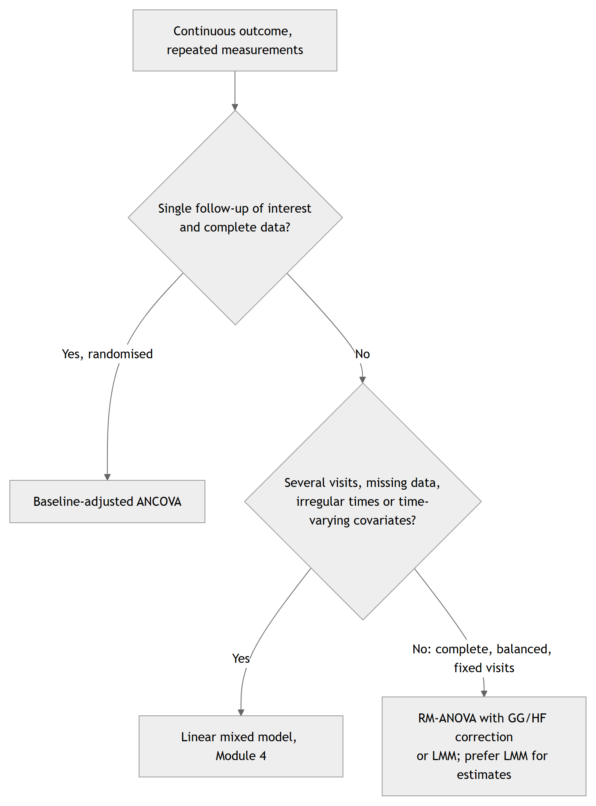

# Statistical foundations and traditional approaches {#sec-m03}

```{r}
#| include: false
here::i_am("book/en/chapters/03-traditional-methods.qmd")
options(width = 76)
```


```{r}
#| label: setup
#| include: true
source(here::here("R", "setup.R"))
walk <- load_walk()
wide <- load_walk("wide")
```

```{r}
#| label: helpers
#| include: false
# Small formatting helpers used only in this document
f1 <- function(x) formatC(x, format = "f", digits = 1)
f2 <- function(x) formatC(x, format = "f", digits = 2)
f3 <- function(x) formatC(x, format = "f", digits = 3)
yv <- paste0("sbp_m", c(0, 1, 3, 6, 9, 12))
truth <- readRDS(here("data", "walk_truth.rds"))
```

Before mixed models existed in standard software, analysts of repeated measurements had a toolbox of simpler methods: a regression that treats every observation as independent, a paired t-test of baseline against follow-up, a repeated-measures analysis of variance, an analysis of the last visit adjusted for baseline, or a separate test at every visit. These methods are still everywhere in published papers, in reviewers' requests and in statistical analysis plans. Some of them remain the best tool for a narrow question. Others give answers that look plausible but rest on assumptions that longitudinal data rarely meet. This module reviews the regression ideas the rest of the course builds on, works through each traditional method with the WALK trial, and shows exactly where each one stops being adequate. By the end you should be able to read an analysis that uses these methods, judge whether it answers the stated question, and explain why the course moves on to linear mixed-effects models in Module 4.

### Learning outcomes {.unnumbered}

By the end of this module participants will be able to:

1. **3.1** Interpret regression coefficients, interaction terms, confidence intervals and residuals in models that include time.
2. **3.2** Carry out and interpret a paired comparison and a repeated-measures ANOVA, and state their assumptions.
3. **3.3** Explain sphericity, apply the Greenhouse–Geisser and Huynh–Feldt corrections, and list the limitations of repeated-measures ANOVA (complete cases, fixed occasions, no time-varying covariates).
4. **3.4** Compare follow-up-only analysis, change-score analysis and baseline-adjusted ANCOVA, and choose between them according to the research question and design.
5. **3.5** Explain why separate tests at each visit are inefficient and inflate the number of comparisons.

### Prerequisites {.unnumbered}

Module 0 (regression and R refresher) or equivalent knowledge of linear regression, Module 1 (foundations of longitudinal data: within- and between-subject variation, estimands) and Module 2 (long and wide formats, exploring WALK).

::: {.callout-warning title="Simulated data"}
All examples use simulated data from fictional studies. Results illustrate methods; they are not empirical findings.
:::

### The WALK data used in this module {.unnumbered}

WALK is a fictional three-arm randomised trial of a community walking programme in `r n_distinct(walk$id)` adults with raised blood pressure: usual care (UC), a standard programme (SP) and an enhanced programme (EP), 120 participants per arm. Systolic blood pressure (SBP, mmHg) is measured at scheduled visits at months 0, 1, 3, 6, 9 and 12, but the actual visit times (`month`) scatter around the schedule (`month_sched`). The long file has `r nrow(walk)` observations because some visits were missed and some participants dropped out. Dropout depends on the last observed SBP and on arm, so the data are missing at random (MAR) given the observed history.

The traditional methods in this module mostly work with the **wide format** (one row per participant, one column per scheduled visit), because that is how they were designed. The long format (one row per observation) is used for the regression review.

```{r}
#| label: fig-m03-walk-means
#| fig-cap: "Observed mean SBP (95% CI) by arm and scheduled visit, using all available observations. The arms start together, which randomisation leads us to expect, and separate over the first six months."
plot_observed_means(walk, month_sched, sbp, arm) +
  labs(x = "Scheduled month", y = "Mean SBP (mmHg)")
```

```{r}
#| label: completeness
n_complete <- sum(complete.cases(wide[, yv]))
n_m12 <- sum(!is.na(wide$sbp_m12))
c(participants = nrow(wide), complete_all_six = n_complete, seen_at_m12 = n_m12)
```

Only `r n_complete` of the `r nrow(wide)` participants (`r round(100 * n_complete / nrow(wide))`%) have all six visits, and `r n_m12` have a month-12 measurement. Keep these numbers in mind: several of the methods below can use only some of the participants.

## Part 1. Regression foundations in a longitudinal context

### Regression with time and an arm-by-time interaction

This section revisits ordinary linear regression with the WALK data. The model is not a good final analysis, because it treats every observation as independent, but every later model in the course shares its mean structure and the way its coefficients are read. Getting the interpretation right here pays off in every later module.

#### The research question and estimand

"Does the rate of change in SBP over the first year differ between each walking programme and usual care?" If we assume that mean SBP changes linearly with time in each arm, the estimand is the **difference in mean slope** (mmHg per month) between SP and UC, and between EP and UC. Multiplying by 12 gives the implied difference in mean change over a year.

#### Data structure and outcome types

The outcome SBP is continuous. The data are in long format with one row per observation; each participant contributes between one and six rows. Time is the actual visit time `month`, a continuous variable. Arm is a three-level factor with UC as the reference level.

#### Intuition

Fit a straight line through the SBP measurements of each arm. The intercept of each line is the mean SBP at month 0 and the slope is the mean change per month. An **interaction** between arm and month lets the slopes differ between arms; without it the lines would be forced to be parallel, and the model could only say that one arm is higher than another by the same amount at every time. In a randomised trial the question is precisely whether the lines diverge, so the interaction terms carry the treatment effect.

#### The model

$$
y_{ij} = \beta_0 + \beta_1 t_{ij} + \beta_2 \text{SP}_i + \beta_3 \text{EP}_i + \beta_4\, t_{ij}\text{SP}_i + \beta_5\, t_{ij}\text{EP}_i + \varepsilon_{ij},
\qquad \varepsilon_{ij} \sim N(0, \sigma^2) \text{ independent}.
$$

Here $y_{ij}$ is the SBP of participant $i$ at occasion $j$ and $t_{ij}$ is the actual time of that occasion in months. $\text{SP}_i$ and $\text{EP}_i$ are indicators (1 if participant $i$ is in that arm, 0 otherwise), so UC is the reference. $\beta_0$ is the mean SBP in UC at month 0; $\beta_1$ is the mean change per month in UC; $\beta_2$ and $\beta_3$ are the differences in mean SBP from UC at month 0; $\beta_4$ and $\beta_5$ are the differences in slope from UC, so the SP slope is $\beta_1 + \beta_4$ and the EP slope is $\beta_1 + \beta_5$. The residual error $\varepsilon_{ij}$ has variance $\sigma^2$, and ordinary least squares assumes that residuals are independent of one another, including those from the same participant.

#### Assumptions and limitations

The assumptions are linearity of the mean in time within each arm, constant residual variance, approximately normal residuals (important for small samples) and, crucially, **independence** of the residuals. The last assumption is false for repeated measurements. Participants who start high tend to stay high, so two residuals from the same participant are positively correlated. Module 1 showed by simulation what this does: the standard error of a between-subject comparison (such as the arm difference at month 0) is too small, and the standard error of a within-subject comparison (such as a slope) is usually too large, because the model does not know that each participant acts as their own control. A linear mean is also only an approximation for WALK, where most of the fall in SBP occurs in the first six months.

#### Fitting the model in R

```{r}
#| label: ols-fit
m_ols <- lm(sbp ~ month * arm, data = walk)
summary(m_ols)
```

```{r}
#| label: ols-ci
ols_tab <- fixef_table(m_ols)
ols_tab
b <- coef(m_ols)
```

#### Interpreting the output

The formula `month * arm` expands to the main effects of `month` and `arm` plus their interaction `month:arm`. The table below reads the key lines.

| Output line | What it means | Value here |
|---|---|---|
| `(Intercept)` | Mean SBP in UC at month 0 | `r f1(b["(Intercept)"])` mmHg |
| `month` | Mean change per month in UC | `r f2(b["month"])` mmHg/month |
| `armSP`, `armEP` | Difference from UC at month 0 | `r f2(b["armSP"])`, `r f2(b["armEP"])` mmHg |
| `month:armSP` | Extra change per month in SP compared with UC | `r f2(b["month:armSP"])` mmHg/month |
| `month:armEP` | Extra change per month in EP compared with UC | `r f2(b["month:armEP"])` mmHg/month |
| Residual standard error | Estimate of $\sigma$ | `r f1(sigma(m_ols))` mmHg |

The main effect of arm is the arm difference **at month 0 only**, because that is where the interaction terms are zero. It is close to zero, as randomisation should make it. A common error is to call `armEP` "the effect of the enhanced programme". The programme effect is in the interaction: SBP in the EP arm falls by an extra `r f2(-b["month:armEP"])` mmHg per month compared with UC (95% confidence interval `r f2(ols_tab$lower[6])` to `r f2(ols_tab$upper[6])`). Over 12 months that is an extra fall of `r f1(-12 * b["month:armEP"])` mmHg. The slope in UC itself is `r f2(b["month"])` mmHg per month, close to zero. The 95% confidence interval is the range of slope differences compatible with the data under the model: if we repeated the trial many times, intervals built in this way would contain the true value 95% of the time, *provided the model's assumptions hold*. That proviso is the problem here, as the next subsection shows.

Predictions follow from the coefficients. For an EP participant at month 12 the model predicts $\hat\beta_0 + 12\hat\beta_1 + \hat\beta_3 + 12\hat\beta_5$ = `r f1(b[1] + 12 * b[2] + b[4] + 12 * b[6])` mmHg; for UC it predicts `r f1(b[1] + 12 * b[2])` mmHg. The `predict()` function does the same arithmetic with standard errors.

#### Checking the model

The usual residual-versus-fitted plot (@fig-m03-ols-res) looks unremarkable: no curvature, no funnel. It cannot reveal the main problem, because that problem is about pairs of residuals from the same person. To see it, reshape the residuals to wide format and correlate them across scheduled visits.

```{r}
#| label: fig-m03-ols-res
#| fig-cap: "Residuals against fitted values from the ordinary least squares model. The plot shows no obvious curvature or change in spread, but it cannot show correlation between residuals of the same participant."
walk$res_ols <- resid(m_ols)
ggplot(walk, aes(fitted(m_ols), res_ols)) +
  geom_point(alpha = 0.25, size = 0.8) +
  geom_hline(yintercept = 0, colour = "#888888") +
  labs(x = "Fitted SBP (mmHg)", y = "Residual (mmHg)")
```

```{r}
#| label: ols-res-cor
res_cor <- visit_correlation(walk, id, month_sched, res_ols)
round(res_cor, 2)
```

The correlations between residuals of the same participant at different visits range from `r f2(min(res_cor[upper.tri(res_cor)]))` to `r f2(max(res_cor[upper.tri(res_cor)]))`. Independence would require them to be near zero. This single table is the reason ordinary regression is not an acceptable final analysis of longitudinal data: its standard errors, confidence intervals and p-values are based on a variance formula that does not apply. Notice also that the correlation is highest between neighbouring visits (`r f2(res_cor["0", "1"])` between months 0 and 1) and lower for visits further apart (`r f2(res_cor["0", "12"])` between months 0 and 12). We will meet this pattern again when we discuss sphericity.

#### Reporting

::: {.callout-tip title="Reporting example"}
We would not report this model as a primary analysis. If it were shown for illustration, an honest description would be: "An ordinary least squares regression of SBP on month, arm and their interaction, ignoring within-participant correlation, gave a difference in slope between the enhanced programme and usual care of `r f2(b["month:armEP"])` mmHg per month (95% CI `r f2(ols_tab$lower[6])` to `r f2(ols_tab$upper[6])`). Residuals from the same participant were strongly correlated (`r f2(min(res_cor[upper.tri(res_cor)]))` to `r f2(max(res_cor[upper.tri(res_cor)]))`), so these intervals are not valid; the primary analysis uses a linear mixed model."
:::

#### Common mistakes

::: {.callout-important title="Common mistakes"}
- **Reading the arm main effect as the treatment effect.** With an interaction in the model, `armEP` is the arm difference at month 0. The treatment effect on change is in `month:armEP`.
- **Dropping the interaction to "simplify" the model.** Without it the arm lines are parallel and the model cannot detect a treatment effect on change.
- **Trusting `lm()` standard errors for repeated measurements.** They assume independent observations. Check the within-participant residual correlation; it is almost never zero.
- **Using scheduled time when actual time is available.** The regression above uses `month`; using `month_sched` would ignore the real timing of visits.
:::

## Part 2. Comparing two occasions

### The paired t-test: baseline versus month 12 within an arm

#### The research question and estimand

"By how much does mean SBP change from baseline to month 12 among participants in the enhanced programme?" The estimand is the **mean within-person change** $\mu_d = E(Y_{i,12} - Y_{i,0})$ in one arm. This is a **within-group** question. It says nothing about whether the programme caused the change, because the change in a single arm mixes the programme effect with everything else that happens over a year: regression to the mean (participants were recruited because their blood pressure was raised), seasonal effects, the attention of being in a trial, and changes in medication.

#### Data structure and outcome types

A continuous outcome measured on the same participants at two occasions. Each participant contributes a pair $(y_{i,0}, y_{i,12})$; only participants with both values can be used. In WALK the pairs come from the wide file.

#### Intuition

Measuring the same person twice removes the large differences between people from the comparison. Instead of comparing two groups of measurements, we compute each person's difference $d_i = y_{i,12} - y_{i,0}$ and ask whether the mean difference is zero. Because baseline and month-12 SBP are strongly positively correlated, the differences vary much less than the raw values, and the comparison is precise.

#### The model

$$
d_i = y_{i,12} - y_{i,0}, \qquad d_i \sim N(\mu_d, \sigma_d^2) \text{ independently}, \qquad
t = \frac{\bar d}{s_d / \sqrt{n}} \sim t_{n-1} \text{ under } H_0: \mu_d = 0 .
$$

$\bar d$ is the mean of the $n$ differences and $s_d$ their standard deviation. The variance of a difference is $\sigma_d^2 = \sigma_0^2 + \sigma_{12}^2 - 2\rho\,\sigma_0\sigma_{12}$, where $\rho$ is the correlation between baseline and month-12 SBP. The larger $\rho$ is, the smaller $\sigma_d^2$, which is why pairing helps.

#### Assumptions and limitations

The differences must be independent across participants and approximately normal (or $n$ large enough for the central limit theorem, which with about 90 pairs it comfortably is). Only complete pairs are used, which is a complete-case analysis: if dropout before month 12 depends on SBP, as it does in WALK, the participants who remain are not a random sample of those randomised. The test uses only two of the six visits. Most importantly, it answers a within-group question; a between-arm comparison of change needs a two-sample analysis (Part 4).

#### Fitting the model in R

```{r}
#| label: paired-fit
ep <- wide |> filter(arm == "EP", !is.na(sbp_m0), !is.na(sbp_m12))
tt_ep <- t.test(ep$sbp_m12, ep$sbp_m0, paired = TRUE)
tt_ep
```

#### Interpreting the output

Among the `r nrow(ep)` EP participants with both measurements, SBP fell by a mean of `r f1(-tt_ep$estimate)` mmHg (95% CI for the mean change `r f1(tt_ep$conf.int[1])` to `r f1(tt_ep$conf.int[2])`; t = `r f1(tt_ep$statistic)` on `r tt_ep$parameter` degrees of freedom, `r fmt_p(tt_ep$p.value)`). The sign convention matters: the first argument minus the second, so a negative difference is a fall.

It is tempting to stop here and declare the programme effective. Run the same test in usual care:

```{r}
#| label: paired-uc
uc <- wide |> filter(arm == "UC", !is.na(sbp_m0), !is.na(sbp_m12))
tt_uc <- t.test(uc$sbp_m12, uc$sbp_m0, paired = TRUE)
c(mean_change = unname(tt_uc$estimate), lower = tt_uc$conf.int[1],
  upper = tt_uc$conf.int[2], p = tt_uc$p.value)
```

In UC the mean change is `r f1(tt_uc$estimate)` mmHg (95% CI `r f1(tt_uc$conf.int[1])` to `r f1(tt_uc$conf.int[2])`). The programme effect is the *difference* between these changes, and a pair of within-group tests does not estimate it or test it. A significant change in one arm and a non-significant change in another does not show that the arms differ; the difference between "significant" and "not significant" is not itself statistically significant [@vickers2001]. Part 4 estimates the between-arm difference directly.

Because the data are simulated we can compare with the truth, which is possible only for simulated data: the true mean change to month 12 is `r f1(subset(truth$true_change, arm == "EP" & month == 12)$change)` mmHg in EP and `r f1(subset(truth$true_change, arm == "UC" & month == 12)$change)` mmHg in UC.

#### Checking the model

Check the distribution of the differences, not of the raw values.

```{r}
#| label: fig-m03-paired-diff
#| fig-cap: "Distribution of within-person change from baseline to month 12 in the enhanced programme (left) and a normal Q-Q plot of the same differences (right)."
p1 <- ggplot(ep, aes(sbp_m12 - sbp_m0)) +
  geom_histogram(bins = 20, fill = "#D55E00", colour = "white") +
  labs(x = "Change in SBP, month 12 minus baseline (mmHg)", y = "Participants")
p2 <- ggplot(ep, aes(sample = sbp_m12 - sbp_m0)) +
  stat_qq(size = 1) + stat_qq_line(colour = "#888888") +
  labs(x = "Normal quantiles", y = "Observed change (mmHg)")
p1 + p2
```

The differences are roughly symmetric with no extreme values, so the normality assumption is reasonable. Independence between participants follows from the design. The assumption that cannot be checked from these data alone is that the `r nrow(ep)` completers represent all `r sum(wide$arm == "EP")` EP participants.

#### Reporting

::: {.callout-tip title="Reporting example"}
"Among participants in the enhanced programme with SBP recorded at baseline and month 12 (n = `r nrow(ep)`), mean SBP fell by `r f1(-tt_ep$estimate)` mmHg (95% CI `r f1(-tt_ep$conf.int[2])` to `r f1(-tt_ep$conf.int[1])`) between baseline and month 12. This within-arm change does not estimate the effect of the programme, which is reported as the difference in mean change against usual care."
:::

#### Common mistakes

::: {.callout-important title="Common mistakes"}
- **Using a within-arm paired test to claim a treatment effect.** It measures change, not the effect of the intervention. Compare arms.
- **Comparing p-values between arms** ("significant in EP, not in UC") instead of estimating the difference between arms.
- **Running an unpaired two-sample t-test on paired data.** It ignores the correlation and is far less precise.
- **Forgetting which way the difference is taken.** State "month 12 minus baseline" explicitly.
:::

## Part 3. Repeated-measures ANOVA

### Repeated-measures ANOVA on completers

#### The research question and estimand

Repeated-measures analysis of variance (RM-ANOVA) answers three omnibus questions about mean SBP at the six scheduled visits: does the mean differ between arms when averaged over visits (the **between-subject** effect of arm), does the mean change across visits when averaged over arms (the **within-subject** effect of visit), and does the pattern of change differ between arms (the **arm-by-visit interaction**)? In a randomised trial the interaction is the question of interest. Note that these are F-tests of "no difference anywhere", not estimates of a clinically interpretable quantity with a confidence interval. RM-ANOVA does not directly deliver the difference in mean change at month 12; that has to come from follow-up contrasts.

#### Data structure and outcome types

A continuous outcome measured at the same fixed set of occasions on every participant, with one or more between-subject factors (here arm). The method requires a **balanced, complete** design: every participant must have all six measurements. The univariate version uses long data; the multivariate version uses wide data with one column per visit.

#### Intuition

RM-ANOVA splits the total variation in SBP into a between-participant part and a within-participant part. The between-participant part tests arm, using the variation between participant averages as its error term. The within-participant part tests visit and arm-by-visit, using the variation of each participant's measurements around their own average as its error term. Taking out each participant's average removes the large stable differences between people, so the within-participant tests are sensitive. The price is an assumption about how the within-participant errors are correlated, called **sphericity**.

#### The model

For participant $i$ in arm $g$ at scheduled visit $j$ ($j = 1, \dots, 6$):

$$
y_{ij} = \mu + \alpha_g + \gamma_j + (\alpha\gamma)_{gj} + b_{0i} + \varepsilon_{ij},
\qquad b_{0i} \sim N(0, \tau_0^2), \quad \varepsilon_{ij} \sim N(0, \sigma^2),
$$

with $b_{0i}$ and $\varepsilon_{ij}$ independent. $\mu$ is the overall mean, $\alpha_g$ the effect of arm $g$, $\gamma_j$ the effect of visit $j$ and $(\alpha\gamma)_{gj}$ the interaction (each set constrained, for example to sum to zero). $b_{0i}$ is a participant effect that makes all of participant $i$'s measurements share a common shift, and $\varepsilon_{ij}$ is the residual error. This is a random-intercept model, the simplest mixed model of Module 4, written with visit as a categorical factor. It implies **compound symmetry**: every measurement has variance $\tau_0^2 + \sigma^2$ and every pair of measurements from the same participant has covariance $\tau_0^2$, whatever the gap between them. The F-tests remain valid under the slightly weaker condition of sphericity, discussed below.

#### Assumptions and limitations

RM-ANOVA assumes independent participants, normal errors, equal covariance matrices across arms and sphericity. Its limitations for longitudinal data are serious:

1. **Complete cases only.** Any participant with a missed visit is deleted entirely (listwise deletion). In WALK this removes `r nrow(wide) - n_complete` of `r nrow(wide)` participants (`r round(100 * (nrow(wide) - n_complete) / nrow(wide))`%). When dropout depends on observed SBP (MAR), completers are a selected group and the estimates can be biased; Module 10 returns to this.
2. **Fixed occasions.** Visits are treated as identical categories for everyone. The actual visit times, which in WALK vary around the schedule, are discarded.
3. **No time-varying covariates.** Daily steps, measured at each visit, cannot enter the model.
4. **No individual trajectories.** There are no participant-specific slopes; the only participant effect is a shift in level. The heterogeneity in rates of change, which Module 4 models with random slopes, is pushed into the error.
5. **Omnibus tests rather than estimates.** The interaction F-test says that the arms differ somewhere, not by how much at month 12.

#### Fitting the model in R

First, build the complete-case data. The long version is needed for `aov()`.

```{r}
#| label: rm-data
cc <- wide[complete.cases(wide[, yv]), ]
table(cc$arm)
lc <- cc |>
  select(id, arm, all_of(yv)) |>
  pivot_longer(all_of(yv), names_to = "visit", values_to = "sbp") |>
  mutate(visit = factor(visit, levels = yv), id = factor(id))
```

The **univariate approach** uses `aov()` with an `Error()` term. `Error(id/visit)` tells R that participants are the experimental units for arm and that visit varies within participants, so two error strata are formed.

```{r}
#| label: rm-aov
rm_aov <- aov(sbp ~ arm * visit + Error(id / visit), data = lc)
summary(rm_aov)
s_aov <- summary(rm_aov)
btw <- s_aov[["Error: id"]][[1]]
wth <- s_aov[["Error: id:visit"]][[1]]
```

The **multivariate approach** fits a multivariate linear model to the wide data: the response is a matrix of six columns, one per visit. `anova()` with `X = ~1` and `test = "Spherical"` then tests the within-subject effects using contrasts orthogonal to the constant, which is exactly the RM-ANOVA, and adds the Greenhouse–Geisser and Huynh–Feldt corrections. `mauchly.test()` tests sphericity.

```{r}
#| label: rm-mlm
Y <- as.matrix(cc[, yv])
rm_mlm <- lm(Y ~ arm, data = cc)
idata <- data.frame(visit = factor(yv, levels = yv))
rm_sph <- anova(rm_mlm, X = ~1, idata = idata, test = "Spherical")
rm_sph
mau <- mauchly.test(rm_mlm, X = ~1, idata = idata)
mau
```

```{r}
#| label: rm-eps
#| include: false
# Extract the epsilons printed in the heading of the Spherical table
hd <- attr(rm_sph, "heading")
eps_gg <- as.numeric(sub(".*: *", "", grep("Greenhouse", hd, value = TRUE)))
eps_hf <- as.numeric(sub(".*: *", "", grep("Huynh", hd, value = TRUE)))
```

#### Interpreting the output

In the multivariate table, the row labelled `(Intercept)` tests the effect of **visit** (the within-subject contrasts averaged over arms) and the row labelled `arm` tests the **arm-by-visit interaction**. The labels look odd because the model is fitted to the visit contrasts: the intercept of the contrasts is the average pattern over visits, and the arm terms are differences in that pattern. The F statistics agree with `aov()`.

| Output line | What it means | Value here |
|---|---|---|
| `Error: id`, `arm` | Arms differ in SBP averaged over all six visits? | F = `r f2(btw["arm", "F value"])` on `r btw["arm", "Df"]` and `r btw["Residuals", "Df"]` df, `r fmt_p(btw["arm", "Pr(>F)"])` |
| `Error: id:visit`, `visit` | Mean SBP changes across visits? | F = `r f2(wth[1, "F value"])` on `r wth[1, "Df"]` and `r wth[3, "Df"]` df, `r fmt_p(wth[1, "Pr(>F)"])` |
| `Error: id:visit`, `arm:visit` | Pattern over visits differs between arms? | F = `r f2(wth[2, "F value"])` on `r wth[2, "Df"]` and `r wth[3, "Df"]` df, `r fmt_p(wth[2, "Pr(>F)"])` |
| Greenhouse–Geisser epsilon | Estimated departure from sphericity (1 = none) | `r f3(eps_gg)` |
| Huynh–Feldt epsilon | Less conservative estimate of the same | `r f3(eps_hf)` |
| `G-G Pr`, `H-F Pr` | p-values with degrees of freedom multiplied by epsilon | interaction: `r fmt_p(rm_sph["arm", "G-G Pr"])` (GG) |
| Mauchly's W | Test of sphericity | W = `r f2(mau$statistic)`, `r fmt_p(mau$p.value)` |

The arm-by-visit interaction is strong: the arms follow different patterns over the year. The between-subject test of arm is not significant, which may seem surprising given @fig-m03-walk-means. It is not a contradiction. That test averages SBP over all six visits, including baseline and month 1 when the arms hardly differ, and its error term is the large between-participant variation. The arm main effect is therefore the wrong test for a treatment effect on change, exactly as the arm main effect in Part 1 was the wrong coefficient.

Mauchly's test rejects sphericity firmly, so the uncorrected p-values for the within-subject effects are too small. After correction the interaction remains highly significant. With `r nrow(cc)` participants the conclusion here is not in doubt; with smaller samples the correction can change it.

#### Checking the model

The key check for RM-ANOVA is sphericity, followed by the usual checks of normality and of equal covariance matrices across arms.

##### Sphericity and the corrections

**Sphericity** is the condition that the variance of the difference between any two visits is the same for every pair of visits:

$$
\operatorname{Var}(y_{ij} - y_{ik}) = \text{constant for all } j \neq k .
$$

The within-subject F-tests compare variation in these differences, so they need the differences to be equally variable. Compound symmetry (equal variances, equal correlations) is sufficient for sphericity; sphericity is slightly more general but in practice rarely holds when compound symmetry fails. Longitudinal data typically violate it, because measurements close in time are more alike than measurements far apart.

We can see this in the observed covariance matrix of the completers.

```{r}
#| label: rm-cov
S_cc <- cov(Y)
round(S_cc, 1)
```

```{r}
#| label: fig-m03-rm-cor
#| fig-cap: "Observed correlation of SBP between scheduled visits among the completers. Correlations are highest next to the diagonal and decline as visits get further apart, a pattern that compound symmetry does not allow."
cor_long <- as.data.frame(as.table(round(cov2cor(S_cc), 2)))
levels(cor_long$Var1) <- levels(cor_long$Var2) <- c(0, 1, 3, 6, 9, 12)
ggplot(cor_long, aes(Var1, Var2, fill = Freq)) +
  geom_tile(colour = "white") +
  geom_text(aes(label = sprintf("%.2f", Freq)), size = 3.2) +
  scale_fill_gradient(low = "#F2F2F2", high = "#0072B2", name = "Correlation") +
  labs(x = "Scheduled month", y = "Scheduled month") +
  theme(panel.grid = element_blank())
```

The variances on the diagonal range from `r f1(min(diag(S_cc)))` to `r f1(max(diag(S_cc)))` mmHg$^2$, and the correlations from `r f2(min(cov2cor(S_cc)[upper.tri(S_cc)]))` to `r f2(max(cov2cor(S_cc)[upper.tri(S_cc)]))`. Sphericity is about the differences, so compute the variance of every pairwise difference, $s_{jj} + s_{kk} - 2 s_{jk}$:

```{r}
#| label: rm-diffvar
pairs <- t(combn(6, 2))
dv <- data.frame(
  pair = paste0("m", c(0, 1, 3, 6, 9, 12)[pairs[, 1]], " vs m",
                c(0, 1, 3, 6, 9, 12)[pairs[, 2]]),
  var_diff = S_cc[cbind(pairs[, 1], pairs[, 1])] +
    S_cc[cbind(pairs[, 2], pairs[, 2])] - 2 * S_cc[pairs])
dv$var_diff <- round(dv$var_diff, 1)
dv[order(dv$var_diff), ]
```

If sphericity held, these `r nrow(dv)` variances would be roughly equal. They range from `r f1(min(dv$var_diff))` (`r dv$pair[which.min(dv$var_diff)]`) to `r f1(max(dv$var_diff))` (`r dv$pair[which.max(dv$var_diff)]`), a ratio of about `r round(max(dv$var_diff) / min(dv$var_diff), 1)`. Differences between adjacent visits vary least; differences between distant visits vary most.

When sphericity fails, the F statistic does not follow the F distribution with the nominal degrees of freedom, and the test rejects too often. @greenhouse1959 showed that a good approximation is obtained by multiplying both degrees of freedom by a factor $\epsilon$ between $1/(k-1)$ and 1, where $k$ is the number of occasions. Let $C$ be a $k \times (k-1)$ matrix of orthonormal contrasts (for example polynomial contrasts) and $S$ the pooled within-arm covariance matrix. With $\lambda_1, \dots, \lambda_{k-1}$ the eigenvalues of $C^\top S C$,

$$
\hat\epsilon_{\text{GG}} = \frac{\left(\sum_r \lambda_r\right)^2}{(k-1)\sum_r \lambda_r^2} .
$$

If all eigenvalues are equal (perfect sphericity) $\hat\epsilon_{\text{GG}} = 1$. We can reproduce the value R printed:

```{r}
#| label: rm-gg-hand
S_pool <- estVar(rm_mlm)          # pooled within-arm covariance matrix
C <- contr.poly(6)                # orthonormal contrasts
lam <- eigen(t(C) %*% S_pool %*% C)$values
sum(lam)^2 / (5 * sum(lam^2))
```

$\hat\epsilon_{\text{GG}}$ is known to be conservative (biased downwards) when the true $\epsilon$ is near 1. @huynh1976 proposed a less conservative estimator, $\hat\epsilon_{\text{HF}}$, which is never smaller than $\hat\epsilon_{\text{GG}}$ and is truncated at 1. Here $\hat\epsilon_{\text{GG}}$ = `r f3(eps_gg)` and $\hat\epsilon_{\text{HF}}$ = `r f3(eps_hf)`, so the corrected interaction test uses about `r round(eps_gg * 10, 1)` and `r round(eps_gg * wth[3, "Df"])` degrees of freedom (Greenhouse–Geisser) instead of `r wth[2, "Df"]` and `r wth[3, "Df"]`. A common rule of thumb is to report Greenhouse–Geisser when $\hat\epsilon$ is below about 0.75 and Huynh–Feldt otherwise; many analysts simply report Greenhouse–Geisser always. Mauchly's test is not a good guide on its own: it has low power in small samples and rejects trivially in large ones, so look at $\hat\epsilon$ instead.

The corrections fix the p-values. They do not fix the other limitations, and they do not turn the omnibus tests into estimates of a treatment effect.

##### Normality and equal covariance matrices

Beyond sphericity, check normality of the within-participant residuals and the equality of covariance matrices across arms.

```{r}
#| label: fig-m03-rm-check
#| fig-cap: "Normal Q-Q plot of residuals from the multivariate linear model (all six visits pooled, left) and the variance of SBP by visit and arm among completers (right)."
r_long <- data.frame(res = as.vector(resid(rm_mlm)))
q1 <- ggplot(r_long, aes(sample = res)) + stat_qq(size = 0.6, alpha = 0.5) +
  stat_qq_line(colour = "#888888") +
  labs(x = "Normal quantiles", y = "Residual (mmHg)")
q2 <- lc |> group_by(arm, visit) |> summarise(v = var(sbp)) |>
  mutate(month = as.numeric(sub("sbp_m", "", visit))) |>
  ggplot(aes(month, v, colour = arm)) + geom_line() + geom_point() +
  scale_colour_arm(name = NULL, labels = walk_arm_labels) +
  labs(x = "Scheduled month", y = "Variance of SBP (mmHg²)")
q1 + q2
```

The residuals are close to normal. Variances are broadly similar across arms and tend to increase over time, consistent with participants changing at different rates, which is exactly what a random-slope model captures.

#### Reporting

::: {.callout-tip title="Reporting example"}
"Among the `r nrow(cc)` participants with SBP at all six scheduled visits (`r round(100 * n_complete / nrow(wide))`% of those randomised), a repeated-measures ANOVA showed that the pattern of SBP over time differed between arms (arm-by-visit interaction F = `r f2(wth[2, "F value"])`, Greenhouse–Geisser $\hat\epsilon$ = `r f2(eps_gg)`, corrected `r fmt_p(rm_sph["arm", "G-G Pr"])`). Mauchly's test indicated departure from sphericity (W = `r f2(mau$statistic)`, `r fmt_p(mau$p.value)`). Because this analysis excludes `r nrow(wide) - n_complete` participants with incomplete data and ignores actual visit times, it is presented for comparison only; the primary analysis is a linear mixed model using all available data."
:::

#### Common mistakes

::: {.callout-important title="Common mistakes"}
- **Reporting uncorrected within-subject p-values** when sphericity fails. Use the Greenhouse–Geisser or Huynh–Feldt p-values and report $\hat\epsilon$.
- **Interpreting the between-subject arm test as the treatment effect.** It averages over visits, including baseline. The interaction is the relevant test.
- **Not stating how many participants were excluded.** Listwise deletion is easy to miss; report the number analysed and the number randomised.
- **Using RM-ANOVA when visit times vary or covariates change over time.** Use a mixed model (Module 4).
- **Stopping at the omnibus F-test.** Report an estimate with a confidence interval for the contrast that answers the question.
:::

::: {.callout-note title="Why this matters"}
RM-ANOVA is a special case of the linear mixed model with a random intercept, categorical time and complete data. Module 4 relaxes each restriction: it uses every available observation, uses actual times, allows random slopes so that variances and correlations can change over time, and delivers estimates of the difference in mean change with confidence intervals.
:::

### Multivariate tests as an alternative to sphericity [Advanced]{.advanced-tag}

This extension is needed only if you must analyse complete balanced data without assuming sphericity at all and without a mixed model. The multivariate approach (profile analysis, MANOVA) treats the six visits as a vector with an unstructured covariance matrix, so sphericity is not required. The same `anova()` call gives it with a different `test`:

```{r}
#| label: rm-pillai
anova(rm_mlm, X = ~1, idata = idata, test = "Pillai")
```

The multivariate test spends degrees of freedom estimating every variance and covariance, so it loses power when the number of participants is not large relative to the number of occasions, and it still requires complete data. The unstructured covariance model of Module 5, fitted by REML to all available data, is the modern equivalent.

## Part 4. Baseline and one follow-up: three analyses

### Follow-up only, change score and ANCOVA at month 12

Many trials name a single primary time point. For WALK suppose it is month 12. There are three common ways to compare arms using baseline and month-12 SBP, and they do not give the same answer.

#### The research question and estimand

"What is the effect of each walking programme, compared with usual care, on SBP at month 12?" In a randomised trial this estimand can be written in two equivalent ways: the difference in mean SBP at month 12 between arms, or the difference in mean change from baseline to month 12. They are equal because randomisation makes the expected baseline means equal in all arms. The true values for WALK (known only because the data are simulated) are `r f1(subset(truth$true_change, arm == "SP" & month == 12)$change - subset(truth$true_change, arm == "UC" & month == 12)$change)` mmHg for SP and `r f1(subset(truth$true_change, arm == "EP" & month == 12)$change - subset(truth$true_change, arm == "UC" & month == 12)$change)` mmHg for EP. Because the estimand is the same, the choice between the three analyses is about precision and assumptions, not about the question [@senn2006; @vickers2001].

#### Data structure and outcome types

One row per participant with baseline SBP ($y_{i0}$), month-12 SBP ($y_{i,12}$) and arm. Only participants with a month-12 value can be used.

```{r}
#| label: m12-data
d12 <- wide |>
  filter(!is.na(sbp_m0), !is.na(sbp_m12)) |>
  mutate(chg = sbp_m12 - sbp_m0)
table(d12$arm)
r0_12 <- cor(d12$sbp_m0, d12$sbp_m12)
```

`r nrow(d12)` participants have month-12 data. The correlation between baseline and month-12 SBP is `r f2(r0_12)`.

#### Intuition

The follow-up-only analysis compares month-12 means and ignores baseline. The change-score analysis subtracts each participant's baseline, which removes stable differences between people but also adds the baseline measurement error. ANCOVA (analysis of covariance) lets the data decide how much of the baseline to subtract: it regresses month-12 SBP on baseline and arm, and the coefficient of baseline is estimated, not fixed. Follow-up-only subtracts none of baseline, change subtracts all of it, and ANCOVA subtracts the optimal fraction.

#### The model

All three are linear regressions with one row per participant:

$$
\begin{aligned}
\text{Follow-up only:}\quad & y_{i,12} = \beta_0 + \beta_1 \text{SP}_i + \beta_2 \text{EP}_i + \varepsilon_i \\
\text{Change score:}\quad & y_{i,12} - y_{i0} = \beta_0 + \beta_1 \text{SP}_i + \beta_2 \text{EP}_i + \varepsilon_i \\
\text{ANCOVA:}\quad & y_{i,12} = \beta_0 + \beta_1 \text{SP}_i + \beta_2 \text{EP}_i + \gamma\, y_{i0} + \varepsilon_i
\end{aligned}
$$

with $\varepsilon_i \sim N(0, \sigma^2)$ independent (a different $\sigma^2$ in each model). $\beta_1$ and $\beta_2$ are the treatment effects of SP and EP against UC, and $\gamma$ is the regression coefficient of month-12 on baseline SBP. Rearranging the ANCOVA model as $y_{i,12} - \gamma y_{i0} = \dots$ shows that follow-up-only is ANCOVA with $\gamma = 0$ and change is ANCOVA with $\gamma = 1$.

Suppose baseline and follow-up have the same variance $\sigma_y^2$ and correlation $\rho$. Then, for a given sample size, the variance of the estimated treatment effect is proportional to

$$
\text{follow-up: } \sigma_y^2, \qquad \text{change: } 2\sigma_y^2(1-\rho), \qquad \text{ANCOVA: } \sigma_y^2(1-\rho^2).
$$

ANCOVA is never worse than either alternative (in large samples), because $1 - \rho^2 \le 1$ and $1 - \rho^2 \le 2(1-\rho)$ for every $\rho$. The change score beats follow-up-only only when $\rho > 0.5$.

#### Assumptions and limitations

All three assume independent participants and approximately normal residuals with constant variance. ANCOVA also assumes a linear relationship between baseline and follow-up with the same slope in every arm (no baseline-by-arm interaction); a mild violation does not bias the treatment effect in a randomised trial. The unbiasedness of all three for the treatment effect rests on randomisation, which balances baseline in expectation. All three use only the participants seen at month 12 (`r nrow(d12)` of `r nrow(wide)`), so they are complete-case analyses with the same vulnerability to dropout that depends on SBP; they also discard the four intermediate visits that carry information about the participants who dropped out.

#### Fitting the model in R

```{r}
#| label: m12-fit
m_fu  <- lm(sbp_m12 ~ arm, data = d12)
m_chg <- lm(chg ~ arm, data = d12)
m_anc <- lm(sbp_m12 ~ arm + sbp_m0, data = d12)
summary(m_anc)
```

```{r}
#| label: m12-table
tab12 <- bind_rows(
  fixef_table(m_fu)  |> mutate(analysis = "Follow-up only"),
  fixef_table(m_chg) |> mutate(analysis = "Change score"),
  fixef_table(m_anc) |> mutate(analysis = "ANCOVA")
) |> filter(term %in% c("armSP", "armEP")) |>
  select(analysis, term, estimate, se, lower, upper, p)
tab12
g <- function(a, t, col) tab12[tab12$analysis == a & tab12$term == t, col]
```

#### Interpreting the output

In the ANCOVA output, `armEP` = `r f2(coef(m_anc)["armEP"])` is the difference in mean month-12 SBP between EP and UC for participants with the same baseline SBP, and the `sbp_m0` coefficient $\hat\gamma$ = `r f2(coef(m_anc)["sbp_m0"])` says that a participant 10 mmHg higher at baseline is on average `r f1(10 * coef(m_anc)["sbp_m0"])` mmHg higher at month 12. Because $\hat\gamma$ lies between 0 and 1, the ANCOVA estimate lies between the other two, as @fig-m03-three-analyses shows.

```{r}
#| label: lmm-preview
#| include: false
# Preview of the Module 4 primary model, used only for one sentence below
m_prim <- lmer(sbp ~ visit_f * arm + (1 + month | id), data = walk,
               control = lmer_ctrl)
chg12 <- contrast(emmeans(m_prim, ~ visit_f | arm),
                  list(chg12 = c(-1, 0, 0, 0, 0, 1)))
lmm12 <- as.data.frame(contrast(chg12, "trt.vs.ctrl", by = NULL,
                                adjust = "none"))
```

```{r}
#| label: fig-m03-three-analyses
#| fig-cap: "Estimated effect on SBP at month 12 (95% CI) of each programme compared with usual care, using three analyses of the same participants. The dashed lines mark the true values, known only because the data are simulated."
tc <- truth$true_change
tv <- data.frame(term = c("armSP", "armEP"),
                 truth = c(tc$change[tc$arm == "SP" & tc$month == 12],
                           tc$change[tc$arm == "EP" & tc$month == 12]) -
                   tc$change[tc$arm == "UC" & tc$month == 12])
tab12 |>
  mutate(analysis = factor(analysis, levels = c("Follow-up only", "Change score", "ANCOVA")),
         term = factor(term, levels = c("armSP", "armEP"),
                       labels = c("SP vs UC", "EP vs UC"))) |>
  ggplot(aes(estimate, analysis)) +
  geom_vline(data = tv |> mutate(term = factor(term, levels = c("armSP", "armEP"),
                                               labels = c("SP vs UC", "EP vs UC"))),
             aes(xintercept = truth), linetype = "dashed", colour = "#888888") +
  geom_errorbarh(aes(xmin = lower, xmax = upper), height = 0.2) +
  geom_point(size = 2) +
  facet_wrap(~ term) +
  labs(x = "Difference in month-12 SBP vs usual care (mmHg)", y = NULL)
```

| Analysis | SP vs UC (95% CI) | EP vs UC (95% CI) | SE for EP |
|---|---|---|---|
| Follow-up only | `r fmt_ci(g("Follow-up only", "armSP", "estimate"), g("Follow-up only", "armSP", "lower"), g("Follow-up only", "armSP", "upper"))` | `r fmt_ci(g("Follow-up only", "armEP", "estimate"), g("Follow-up only", "armEP", "lower"), g("Follow-up only", "armEP", "upper"))` | `r f2(g("Follow-up only", "armEP", "se"))` |
| Change score | `r fmt_ci(g("Change score", "armSP", "estimate"), g("Change score", "armSP", "lower"), g("Change score", "armSP", "upper"))` | `r fmt_ci(g("Change score", "armEP", "estimate"), g("Change score", "armEP", "lower"), g("Change score", "armEP", "upper"))` | `r f2(g("Change score", "armEP", "se"))` |
| ANCOVA | `r fmt_ci(g("ANCOVA", "armSP", "estimate"), g("ANCOVA", "armSP", "lower"), g("ANCOVA", "armSP", "upper"))` | `r fmt_ci(g("ANCOVA", "armEP", "estimate"), g("ANCOVA", "armEP", "lower"), g("ANCOVA", "armEP", "upper"))` | `r f2(g("ANCOVA", "armEP", "se"))` |

All three analyses agree that both programmes lower SBP, but the standard errors differ: the ANCOVA standard error for EP is `r round(100 * (1 - g("ANCOVA", "armEP", "se") / g("Follow-up only", "armEP", "se")))`% smaller than the follow-up-only one and `r round(100 * (1 - g("ANCOVA", "armEP", "se") / g("Change score", "armEP", "se")))`% smaller than the change-score one. With $\rho$ = `r f2(r0_12)` the formulas above predict variance ratios of 1, `r f2(2 * (1 - r0_12))` and `r f2(1 - r0_12^2)`, that is standard error ratios of 1, `r f2(sqrt(2 * (1 - r0_12)))` and `r f2(sqrt(1 - r0_12^2))`; the observed ratios relative to follow-up only are `r f2(g("Change score", "armEP", "se") / g("Follow-up only", "armEP", "se"))` and `r f2(g("ANCOVA", "armEP", "se") / g("Follow-up only", "armEP", "se"))`. A smaller standard error for the same estimand is equivalent to a larger trial for free.

The three point estimates differ from one another by chance baseline imbalance among the `r nrow(d12)` participants analysed. If the SP arm happened to start slightly higher, the change score credits SP with the extra regression to the mean while follow-up-only does not; ANCOVA adjusts for the imbalance by the right amount. The estimates also differ from the true values. Part of this is sampling error, and part may be bias from analysing only participants who stayed to month 12. Module 4's primary mixed model uses all `r nrow(wide)` participants and gives month-12 differences in mean change of `r f2(lmm12$estimate[1])` (SP) and `r f2(lmm12$estimate[2])` (EP) mmHg.

##### A simulation of precision

The variance formulas are easy to check by simulation. We generate many randomised two-arm trials with 100 participants per arm, a true effect of −5 mmHg and different baseline–follow-up correlations, and record the spread of each estimator across trials.

```{r}
#| label: sim-three
sim_three <- function(rho, n = 100, effect = -5, sd = 13, reps = 1000) {
  S <- sd^2 * matrix(c(1, rho, rho, 1), 2)
  est <- replicate(reps, {
    y <- MASS::mvrnorm(2 * n, c(145, 145), S)
    trt <- rep(0:1, each = n)
    y[, 2] <- y[, 2] + effect * trt
    c(fu  = coef(lm(y[, 2] ~ trt))[2],
      chg = coef(lm(I(y[, 2] - y[, 1]) ~ trt))[2],
      anc = coef(lm(y[, 2] ~ trt + y[, 1]))[2])
  })
  data.frame(rho = rho, analysis = c("Follow-up only", "Change score", "ANCOVA"),
             mean_est = unname(rowMeans(est)), emp_se = unname(apply(est, 1, sd)))
}
set.seed(303)
sim_res <- bind_rows(lapply(c(0.2, 0.5, 0.7, 0.9), sim_three))
sim_res
se_at <- function(r, a) sim_res$emp_se[sim_res$rho == r & sim_res$analysis == a]
```

```{r}
#| label: fig-m03-sim-three
#| fig-cap: "Empirical standard error of three estimators of the same treatment effect over 1,000 simulated randomised trials (100 per arm) at each baseline-follow-up correlation. ANCOVA is the most precise at every correlation."
ggplot(sim_res, aes(rho, emp_se, colour = analysis)) +
  geom_line() + geom_point() +
  scale_colour_manual(values = c("Follow-up only" = "#6B6B6B",
                                 "Change score" = "#0072B2",
                                 "ANCOVA" = "#D55E00"), name = NULL) +
  labs(x = "Correlation between baseline and follow-up",
       y = "Empirical SE of the treatment effect (mmHg)")
```

All three estimators are unbiased: their means across simulated trials are all close to −5 (column `mean_est`). Their precision differs. At $\rho = 0.2$ the change score is the least precise (empirical SE `r f2(se_at(0.2, "Change score"))` against `r f2(se_at(0.2, "Follow-up only"))` for follow-up only), because subtracting a weakly related baseline adds noise. At $\rho = 0.9$ the change score is almost as good as ANCOVA (`r f2(se_at(0.9, "Change score"))` vs `r f2(se_at(0.9, "ANCOVA"))`) and follow-up only is poor. ANCOVA is the most precise at every correlation. This is the main reason why baseline-adjusted ANCOVA is the recommended primary analysis for a randomised trial with a single follow-up [@senn2006; @vickers2001; @twisk2018].

##### Lord's paradox: when groups are not randomised

In a randomised trial the three analyses estimate the same quantity. In an observational comparison of pre-existing groups that differ at baseline, they do not, and change-score analysis and ANCOVA can give opposite conclusions from the same data. This is known as Lord's paradox. The simulation below creates two groups whose true SBP levels differ by 15 mmHg and do not change at all; each measurement adds independent measurement error.

```{r}
#| label: lord
set.seed(17)
n_l <- 500
grp <- rep(c("A", "B"), each = n_l)
true_level <- rnorm(2 * n_l, ifelse(grp == "A", 135, 150), 10)
lord <- data.frame(grp = grp,
                   y0 = true_level + rnorm(2 * n_l, 0, 7),
                   y1 = true_level + rnorm(2 * n_l, 0, 7))
lord_chg <- coef(summary(lm(I(y1 - y0) ~ grp, data = lord)))["grpB", ]
lord_anc <- coef(summary(lm(y1 ~ grp + y0, data = lord)))["grpB", ]
rbind(change = lord_chg, ancova = lord_anc)
```

The change score finds no group difference (estimate `r f2(lord_chg[1])` mmHg, `r fmt_p(lord_chg[4])`), which is correct for the question "did the groups change differently?". ANCOVA finds that group B is `r f1(lord_anc[1])` mmHg higher at follow-up than group A *among people with the same baseline value* (`r fmt_p(lord_anc[4])`). That is also a correct answer to a different question. Among people with the same observed baseline of, say, 142 mmHg, those in group B are likely to have a true level above 142 (their baseline reading was low by chance), so at follow-up they move up towards their group's higher mean; those in group A tend to have a true level below 142 and move down. Neither analysis is wrong arithmetically; they answer different questions, and without randomisation there is no reason for those answers to coincide. In observational data the choice must follow from a clearly stated causal question, and often neither simple analysis is adequate (see @hernan2020). In a randomised trial the paradox disappears because the groups do not differ at baseline in expectation.

#### Checking the model

For ANCOVA check, as for any regression, the residual-versus-fitted plot and a Q-Q plot, plus the assumption of a common baseline slope in each arm.

```{r}
#| label: anc-check
m_anc_int <- lm(sbp_m12 ~ arm * sbp_m0, data = d12)
anova(m_anc, m_anc_int)
```

```{r}
#| label: fig-m03-anc-check
#| fig-cap: "Month-12 SBP against baseline SBP by arm with least-squares lines (left), and residuals against fitted values from the ANCOVA model (right)."
a1 <- ggplot(d12, aes(sbp_m0, sbp_m12, colour = arm)) +
  geom_point(alpha = 0.5, size = 1) +
  geom_smooth(method = "lm", se = FALSE, formula = y ~ x) +
  scale_colour_arm(name = NULL, labels = walk_arm_labels) +
  labs(x = "Baseline SBP (mmHg)", y = "Month-12 SBP (mmHg)")
a2 <- ggplot(data.frame(f = fitted(m_anc), r = resid(m_anc)), aes(f, r)) +
  geom_point(alpha = 0.5, size = 1) + geom_hline(yintercept = 0, colour = "#888888") +
  labs(x = "Fitted month-12 SBP (mmHg)", y = "Residual (mmHg)")
a1 + a2
```

The lines are close to parallel and the test of the arm-by-baseline interaction is `r fmt_p(anova(m_anc, m_anc_int)[2, "Pr(>F)"])`, so a common slope is reasonable. The residuals show no pattern.

#### Reporting

::: {.callout-tip title="Reporting example"}
"The effect of each programme on SBP at month 12 was estimated by analysis of covariance, regressing month-12 SBP on arm and baseline SBP, in the `r nrow(d12)` participants with a month-12 measurement. Compared with usual care, mean SBP at month 12 was `r f1(-g("ANCOVA", "armSP", "estimate"))` mmHg lower in the standard programme (95% CI `r f1(-g("ANCOVA", "armSP", "upper"))` to `r f1(-g("ANCOVA", "armSP", "lower"))`) and `r f1(-g("ANCOVA", "armEP", "estimate"))` mmHg lower in the enhanced programme (95% CI `r f1(-g("ANCOVA", "armEP", "upper"))` to `r f1(-g("ANCOVA", "armEP", "lower"))`). This complete-case analysis excludes `r nrow(wide) - nrow(d12)` participants without month-12 data."
:::

#### Common mistakes

::: {.callout-important title="Common mistakes"}
- **Analysing change scores by default.** In a randomised trial ANCOVA is at least as precise, and much more so when the baseline–follow-up correlation is moderate.
- **Testing for baseline imbalance and adjusting only if "significant".** In a randomised trial any baseline difference is due to chance by definition; pre-specify the baseline adjustment instead.
- **Using change as the outcome and also adjusting for baseline, then calling it different from ANCOVA.** Regressing change on arm and baseline gives exactly the same arm coefficient as ANCOVA.
- **Applying ANCOVA to non-randomised groups without thinking about the causal question** (Lord's paradox).
- **Forgetting that only participants with the follow-up value are analysed.** State the number and consider the dropout mechanism.
:::

## Part 5. Separate tests at each visit

### Why separate tests at each visit are inadequate

#### The research question and estimand

A common shortcut is to compare arms at each visit with a separate t-test or one-way ANOVA. The implied research question is vague ("when do the arms differ?"), and there is no single estimand: there are as many estimates as visits, each using a different subset of participants.

#### Data structure and outcome types

A continuous outcome at each scheduled visit, analysed one visit at a time from the wide file. At each visit only participants seen at that visit are included.

#### Intuition

Each test is a valid cross-sectional comparison of the people seen at that visit. Taken together, the tests are a poor analysis for three reasons. First, **multiplicity**: with many tests the chance of at least one false positive grows. Second, **inefficiency**: each test ignores the information in the participant's other measurements, including baseline, so the standard errors are those of a follow-up-only analysis. Third, **inconsistency with missing data**: each visit uses a different group of people, so a change in the estimates over time mixes the treatment effect with changes in who is still in the study.

#### The model

At each visit $j$ separately,

$$
y_{ij} = \beta_{0j} + \beta_{1j}\text{SP}_i + \beta_{2j}\text{EP}_i + \varepsilon_{ij}, \qquad \varepsilon_{ij} \sim N(0, \sigma_j^2),
$$

fitted only to participants observed at visit $j$. The symbols are as before, with a subscript $j$ because each visit has its own coefficients and residual variance. Nothing connects the models across visits.

#### Assumptions and limitations

Each test assumes independent observations and normality at that visit, which is reasonable. The limitations are the three listed above. With $m$ independent tests at level 0.05 the probability of at least one false positive when no effect exists is $1 - 0.95^m$; for 6 visits and 2 comparisons ($m = 12$) that is `r f2(1 - 0.95^12)`. The tests in a longitudinal study are positively correlated, which reduces this figure but does not remove the problem.

#### Fitting the model in R

```{r}
#| label: per-visit
per_visit <- bind_rows(lapply(yv, function(v) {
  d <- wide[!is.na(wide[[v]]), ]
  fixef_table(lm(reformulate("arm", v), data = d)) |>
    filter(term != "(Intercept)") |>
    mutate(visit = v, n = nrow(d))
}))
per_visit |> mutate(across(c(estimate, se, lower, upper), \(x) round(x, 2)),
                    p = signif(p, 2))
```

To quantify the multiplicity problem with realistic correlation, simulate trials with **no** treatment effect, using the observed covariance matrix of the six visits, and count how often at least one of the 12 tests is significant.

```{r}
#| label: fwer
set.seed(3)
fwer <- mean(replicate(2000, {
  y <- MASS::mvrnorm(360, rep(145, 6), S_cc)
  arm <- factor(rep(c("UC", "SP", "EP"), each = 120), levels = c("UC", "SP", "EP"))
  p <- sapply(1:6, function(j) coef(summary(lm(y[, j] ~ arm)))[2:3, 4])
  any(p < 0.05)
}))
fwer
```

#### Interpreting the output

```{r}
#| label: fig-m03-per-visit
#| fig-cap: "Difference in mean SBP from usual care (95% CI) at each scheduled visit, from separate regressions. The number of participants analysed falls from visit to visit."
per_visit |>
  mutate(month = as.numeric(sub("sbp_m", "", visit)),
         arm = ifelse(term == "armSP", "SP", "EP")) |>
  ggplot(aes(month, estimate, colour = arm)) +
  geom_hline(yintercept = 0, colour = "#888888") +
  geom_pointrange(aes(ymin = lower, ymax = upper),
                  position = position_dodge(width = 0.6)) +
  scale_colour_arm(name = NULL, labels = walk_arm_labels) +
  scale_x_continuous(breaks = c(0, 1, 3, 6, 9, 12)) +
  labs(x = "Scheduled month", y = "Difference from usual care (mmHg)")
```

The number of participants falls from `r per_visit$n[1]` at baseline to `r per_visit$n[nrow(per_visit)]` at month 12. In the simulated trials with no treatment effect at any visit, at least one of the 12 tests was significant in `r round(100 * fwer)`% of simulated trials, against the nominal 5% (and `r round(100 * (1 - 0.95^12))`% if the tests were independent). At month 12 the per-visit estimate for EP (`r f2(per_visit$estimate[12])` mmHg, SE `r f2(per_visit$se[12])`) is the follow-up-only analysis of Part 4, and its standard error is larger than that of ANCOVA (`r f2(g("ANCOVA", "armEP", "se"))`). The pattern in @fig-m03-per-visit looks informative, but the visit-to-visit changes partly reflect who remains in the study.

#### Checking the model

Each visit-specific regression can be checked with residual plots, but checking does not repair the design of the analysis. The useful check is to tabulate how many participants each test uses and whether those seen at later visits differed at baseline from those who dropped out.

```{r}
#| label: dropout-baseline
seen12 <- wide |> mutate(seen_m12 = !is.na(sbp_m12)) |>
  group_by(seen_m12) |> summarise(n = n(), mean_sbp0 = mean(sbp_m0))
seen12
```

Participants who were not seen at month 12 had higher baseline SBP on average (`r f1(seen12$mean_sbp0[!seen12$seen_m12])` against `r f1(seen12$mean_sbp0[seen12$seen_m12])` mmHg), so the month-12 comparisons are made in a selected group.

#### Reporting

::: {.callout-tip title="Reporting example"}
Visit-specific comparisons are best reported, if at all, as secondary descriptive results from a single longitudinal model: "Estimated differences from usual care at each scheduled visit were obtained as contrasts from the primary linear mixed model (Module 4) rather than from separate tests, which would each use a different subset of participants and inflate the number of comparisons."
:::

#### Common mistakes

::: {.callout-important title="Common mistakes"}
- **Declaring the time of "onset" of an effect from the first significant visit.** Significance depends on sample size at that visit and on chance.
- **Ignoring multiplicity.** Twelve tests at 5% give a much higher chance of at least one false positive.
- **Comparing estimates across visits as if they came from the same people.** With dropout, they do not.
- **Correcting for multiplicity (for example Bonferroni) and believing the problem is solved.** The inefficiency and the missing-data problem remain. Fit one model for all visits instead.
:::

## Part 6. Putting it together

### How the traditional methods compare

The table summarises what each method can and cannot do with WALK.

| Method | Question answered | Participants used | Uses actual times | Handles missing visits | Gives effect estimate with CI |
|---|---|---|---|---|---|
| OLS regression on long data | Difference in slopes | `r n_distinct(walk$id)` | Yes | Uses all rows | Yes, but SEs invalid |
| Paired t-test within arm | Within-arm change | Complete pairs in one arm | No | Complete pairs only | Yes, for within-arm change |
| RM-ANOVA | Omnibus: any arm-by-visit difference | `r nrow(cc)` completers | No | No (listwise deletion) | No (F-tests) |
| Follow-up / change / ANCOVA at month 12 | Effect at month 12 | `r nrow(d12)` with month 12 | No | Complete cases only | Yes (ANCOVA most precise) |
| Separate tests per visit | Arm differences at each visit | Varies by visit | No | Different subsets | Yes, but many and inconsistent |

A linear mixed model (Module 4) answers the same question as ANCOVA, uses every observation of all `r n_distinct(walk$id)` participants, uses actual visit times, models the correlation between repeated measurements, and is valid under MAR dropout when the model is correctly specified. When there is a single follow-up and no missing data, ANCOVA and the mixed model give very similar answers; the mixed model's advantage grows with the number of visits and the amount of missing data.

{.diagram width=95%}

## Summary {.unnumbered}

Traditional methods each take a narrow view of longitudinal data. Ordinary regression gives a useful mean structure but ignores the correlation between a participant's measurements, so its standard errors cannot be trusted. A paired t-test describes change within one group and cannot, on its own, say whether an intervention worked. Repeated-measures ANOVA uses all the visits but only for participants who attended every one, assumes sphericity (which the WALK covariance matrix clearly violates, requiring the Greenhouse–Geisser or Huynh–Feldt correction), ignores actual visit times and time-varying covariates, and produces omnibus tests rather than estimates. For a single follow-up in a randomised trial, baseline-adjusted ANCOVA is the most precise of the simple analyses and is a sound primary analysis when data are complete; change scores are less efficient unless the baseline–follow-up correlation is high, and in non-randomised comparisons the two can disagree (Lord's paradox). Separate tests at every visit multiply the chance of false positives and compare shifting subsets of participants. Module 4 shows how the linear mixed model keeps what is good in these methods and removes their main restrictions.

## Further reading {.unnumbered}

- @senn2006 explains clearly why ANCOVA is preferred to change scores in randomised trials and discusses the role of baseline.
- @vickers2001 is a two-page summary of the same argument for clinical readers.
- @twisk2018 compares the different ways of estimating treatment effects in trials with baseline and repeated follow-up measurements, including longitudinal mixed models.
- @greenhouse1959 and @huynh1976 are the original sources for the sphericity corrections.
- @fitzmaurice2011, chapters 1–3, places these methods in the wider history of longitudinal analysis.

## Exercises {.unnumbered}

The exercises for this module are in the workbook, `workbook/wb03-traditional-methods.qmd`. Guided exercises cover the arm-by-time regression, the paired comparison, RM-ANOVA with the sphericity corrections and the three month-12 analyses; the independent exercises ask you to repeat the analyses for month 6 and to explore the precision of ANCOVA by simulation.
