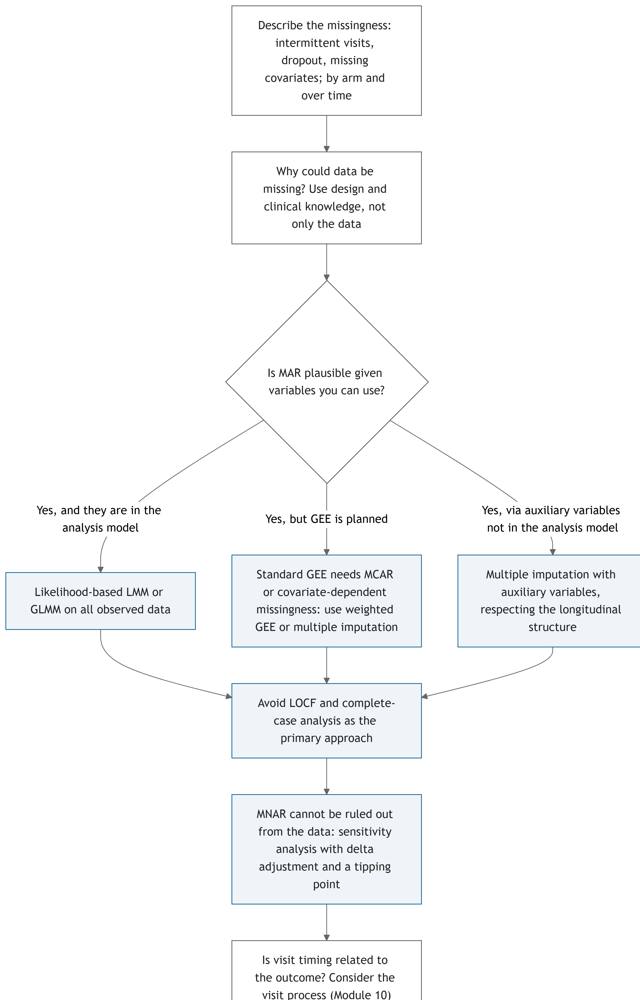

# Advanced extensions {#sec-m13}

```{r}
#| include: false
here::i_am("book/en/chapters/13-advanced.qmd")
options(width = 76)
```


```{r}
#| label: setup
#| include: true
source(here::here("R", "setup.R"))
suppressPackageStartupMessages({
  library(ordinal)      # cumulative-link mixed models (this module only)
  library(survival)     # survival objects and Cox models (this module only)
  library(JMbayes2)     # joint models (this module only)
})
# These packages mask a few functions used in the course; restore them
slice <- dplyr::slice
lme   <- nlme::lme
coxph <- survival::coxph

walk   <- load_walk()
clear  <- load_clear() |> mutate(id = factor(id), age10 = (age - 45) / 10)
kid_long <- load_kidney("long") |> mutate(age10 = (age - 60) / 10) |>
  as.data.frame()
kid_ev   <- load_kidney("events") |> mutate(age10 = (age - 60) / 10) |>
  as.data.frame()
```

```{r}
#| label: helpers
#| include: false
f0 <- function(x) formatC(x, format = "f", digits = 0)
f1 <- function(x) formatC(x, format = "f", digits = 1)
f2 <- function(x) formatC(x, format = "f", digits = 2)
f3 <- function(x) formatC(x, format = "f", digits = 3)
pct <- function(x) paste0(formatC(100 * x, format = "f", digits = 0), "%")
walk_truth   <- readRDS(here("data", "walk_truth.rds"))
clear_truth  <- readRDS(here("data", "clear_truth.rds"))
kidney_truth <- readRDS(here("data", "kidney_truth.rds"))
```

Modules 1 to 12 give a complete toolkit for the most common longitudinal problem: a continuous, binary or count outcome measured repeatedly on participants, analysed with a mixed model or generalized estimating equations. Real studies often go a little beyond that toolkit. The outcome may be an ordered rating scale. Participants may be grouped within clinics as well as measured repeatedly. The trajectory may follow a curve with a biological meaning, such as a response that levels off. Measurements may be cut short by an event that is itself related to the outcome. And in observational data a treatment may change over time in response to the very measurements that predict the outcome. Each of these situations has a specialist method. This module introduces five of them with worked analyses of the course datasets. The aim is that you can recognise each situation, fit a first model, read the output correctly and know when to bring in a statistician who works with the method regularly.

::: {.callout-note title="Advanced extension"}
All of Module 13 is [Advanced]{.advanced-tag}. The five sections are independent: read the ones you need. Each section begins with a sentence saying when the specialist method is needed, and ends with advice on when to involve a specialist.
:::

## Learning outcomes {.unnumbered}

By the end of this module participants will be able to:

1. **13.1** Fit and interpret a cumulative-logit mixed model for a repeated ordinal outcome, and describe multinomial alternatives.
2. **13.2** Fit a three-level model (visits within participants within clinics) and partition the variance.
3. **13.3** Fit a nonlinear mixed-effects model with interpretable parameters.
4. **13.4** Describe the structure of a joint model for longitudinal and time-to-event data, and fit one with `JMbayes2`.
5. **13.5** Explain time-varying confounding and why standard regression adjustment fails, and outline marginal structural models with inverse probability weighting.
6. **13.6** Recognise when a specialist method or specialist collaborator is needed.

## Prerequisites {.unnumbered}

Module 4 (linear mixed models) for all sections. Module 8 (generalized linear mixed models, conditional and marginal effects) for Section 1. Module 9 (time-varying covariates and nonlinear time) for Sections 3 and 5. Module 10 (missing data) for Section 4. Section 4 also assumes that you have met the Cox proportional hazards model.

::: {.callout-warning title="Simulated data"}
All examples use simulated data from fictional studies. Results illustrate methods; they are not empirical findings.
:::

Because the data are simulated, we know the values that generated them and can check whether each method recovers them. Every such comparison in this module is labelled. In a real analysis the truth is unknown, and these comparisons are possible only because the data are simulated.

## Ordinal and multinomial repeated outcomes [Advanced]{.advanced-tag}

*When it is needed:* use a cumulative-logit mixed model when the repeated outcome is an ordered category with more than two levels (a severity rating, a Likert item, a disease stage) and collapsing it to a binary outcome would waste information or force an arbitrary cut-off.

### The research question and estimand

CLEAR is a fictional randomised trial in `r n_distinct(clear$id)` participants with a chronic itchy skin condition, comparing an active topical treatment with placebo. Itch severity was rated at weeks 0, 2, 4, 6, 8 and 12 on a four-point ordered scale: none, mild, moderate, severe. Modules 7 and 8 analysed the binary indicator "moderate or severe". The ordinal outcome keeps the distinction between none and mild, and between moderate and severe.

The research question is whether itch severity falls faster with active treatment than with placebo. The estimand in a cumulative-logit mixed model is a **subject-specific (conditional)** quantity: the ratio, per week, of the odds of being in a higher severity category rather than a lower one, comparing active treatment with placebo for the same participant (the same value of the random effect). Its **population-average (marginal)** counterpart, the change in the probability of each category in the whole trial population, is obtained afterwards from the fitted model by averaging over participants.

### Data structure and outcome types

```{r}
#| label: clear-table
clear |>
  count(week, severity_f) |>
  pivot_wider(names_from = severity_f, values_from = n)
```

The data are in long format, one row per attended visit, with `severity_f` an ordered factor. There are `r nrow(clear)` observations. Dropout depends on the last observed severity, so the data are missing at random (MAR) given observed severity, and a likelihood-based model that uses all observed visits is appropriate (Module 10).

```{r}
#| label: fig-m13-clear-bars
#| fig-cap: "Observed distribution of itch severity by week and arm in CLEAR (participants seen at each visit). Darker shading is more severe itch."
#| fig-height: 3.6
clear |>
  count(arm, week, severity_f) |>
  group_by(arm, week) |>
  mutate(prop = n / sum(n)) |>
  ggplot(aes(factor(week), prop, fill = severity_f)) +
  geom_col(width = 0.75) +
  facet_wrap(~ arm) +
  scale_fill_manual(values = c("#F0F0F0", "#BDBDBD", "#6B6B6B", "#222222"),
                    name = "Itch severity") +
  labs(x = "Week", y = "Proportion of observed participants")
```

@fig-m13-clear-bars shows the whole distribution shifting towards milder categories over time in both arms, with a larger shift in the active arm.

### Intuition

Imagine that each participant has an unobserved continuous "itch intensity" at each visit, and that they report a category according to where that intensity falls relative to three fixed thresholds (cut-points). Treatment and time move the intensity up or down; the thresholds stay where they are. A single coefficient for week therefore shifts the probability of crossing every threshold in the same direction and by the same amount on the logit scale. This is the **proportional odds** assumption: one odds ratio describes "higher versus lower" severity at every cut-off. The random intercept says that some participants' intensity is persistently higher than others', which induces the correlation between repeated ratings.

### The model

Let $Y_{ij} \in \{0, 1, 2, 3\}$ be the severity of participant $i$ at occasion $j$, at week $t_{ij}$. The cumulative-logit mixed model is

$$
\operatorname{logit} P(Y_{ij} \le k \mid b_{0i}) = \theta_k - \left(\beta_1 t_{ij} + \beta_2 \text{Active}_i + \beta_3 t_{ij}\,\text{Active}_i + b_{0i}\right), \qquad k = 0, 1, 2,
$$

with $b_{0i} \sim N(0, \tau_0^2)$, independent between participants. Here $\theta_0 < \theta_1 < \theta_2$ are the cut-points (thresholds) between none|mild, mild|moderate and moderate|severe. $\beta_1$ is the change per week in the log-odds of higher severity in the placebo arm, $\beta_2$ is the difference between arms at week 0, and $\beta_3$ is the additional change per week in the active arm. $b_{0i}$ is the participant's random intercept and $\tau_0^2$ its variance. The minus sign is the parameterisation used by the `ordinal` package [@christensen2026]: a positive $\beta$ moves the participant towards **higher** categories. Note that there is no separate intercept: the cut-points play that role.

The model is equivalent to a latent-variable model $Y_{ij}^* = \beta_1 t_{ij} + \dots + b_{0i} + \varepsilon_{ij}$ with $\varepsilon_{ij}$ following a standard logistic distribution, and $Y_{ij} = k$ when $\theta_{k-1} < Y_{ij}^* \le \theta_k$. CLEAR was simulated exactly this way, with cut-points `r paste(clear_truth$cuts, collapse = ", ")`, placebo slope `r clear_truth$beta_week`, extra active slope `r clear_truth$beta_trtweek`, random-intercept SD `r clear_truth$sd_b`, age effect `r clear_truth$beta_age` per 10 years (centred at 45) and female effect `r clear_truth$beta_female`.

### Assumptions and limitations

The model assumes (1) proportional odds: each covariate has the same effect at every cut-point; (2) a logistic latent error (a probit link is an alternative); (3) normally distributed random intercepts, independent of covariates; (4) a correctly specified mean, here linear in week on the logit scale; and (5) missing data that are MAR. The coefficients are conditional on the random effect, so, as for the binary GLMM in Module 8, they are larger in magnitude than the population-average effects. With large between-participant variation (here $\tau_0$ near 2) the difference is substantial. The model does not suit outcomes whose categories have no natural order; see the multinomial subsection below.

### Fitting the model in R

`ordinal::clmm()` fits the model by maximum likelihood. With a single random intercept it can use adaptive Gauss-Hermite quadrature (`nAGQ`), which is more accurate than the default Laplace approximation when the random-effect variance is large.

```{r}
#| label: clmm-fit
m_clmm <- clmm(severity_f ~ week * arm + (1 | id), data = clear, nAGQ = 7)
summary(m_clmm)
```

```{r}
#| label: clmm-extract
#| include: false
cf  <- coef(summary(m_clmm))
b_w   <- cf["week", 1];           se_w <- cf["week", 2]
b_wa  <- cf["week:armActive", 1]; se_wa <- cf["week:armActive", 2]
p_wa  <- cf["week:armActive", 4]
b_a   <- cf["armActive", 1]
sd_b  <- sqrt(as.numeric(VarCorr(m_clmm)$id))
th    <- m_clmm$Theta
# active-arm slope and its SE from the covariance matrix
V <- vcov(m_clmm)
b_act  <- b_w + b_wa
se_act <- sqrt(V["week", "week"] + V["week:armActive", "week:armActive"] +
               2 * V["week", "week:armActive"])
or12_pl  <- exp(12 * b_w)
or12_act <- exp(12 * b_act)
or12_rat <- exp(12 * b_wa)
or12_rat_lo <- exp(12 * (b_wa - 1.96 * se_wa))
or12_rat_hi <- exp(12 * (b_wa + 1.96 * se_wa))
```

### Interpreting the output

| Output line | What it means | Value here |
|---|---|---|
| `id (Intercept)` Std.Dev. | SD of participants' random intercepts on the logit scale | `r f2(sd_b)` |
| `week` | Change per week in log-odds of higher severity, placebo | `r f3(b_w)` (SE `r f3(se_w)`) |
| `armActive` | Arm difference in log-odds at week 0 (randomised, so expected near 0) | `r f3(b_a)` |
| `week:armActive` | Extra change per week in the active arm | `r f3(b_wa)` (SE `r f3(se_wa)`), `r fmt_p(p_wa)` |
| Threshold coefficients | Cut-points $\theta_k$ on the logit scale | `r f2(th[1])`, `r f2(th[2])`, `r f2(th[3])` |

On the odds scale, over 12 weeks the odds of being in a higher rather than a lower severity category are multiplied by `r f2(or12_pl)` for a placebo participant and by `r f2(or12_act)` for an active participant, holding the random effect fixed. The ratio of these, `r f2(or12_rat)` (95% CI `r f2(or12_rat_lo)` to `r f2(or12_rat_hi)`), is the treatment effect on the cumulative odds ratio scale over 12 weeks: an active-treated participant's odds of more severe itch at week 12 are about `r pct(1 - or12_rat)` lower than they would be on placebo, for the same participant and the same baseline odds. Because of the proportional odds assumption, this single ratio applies to "mild or worse versus none", "moderate or worse versus none or mild" and "severe versus the rest" alike.

The model above does not include age and sex, which were part of the generating model. To compare with the truth we refit with them, centring age at 45 years as the simulation did.

```{r}
#| label: clmm-truth
m_clmm_adj <- clmm(severity_f ~ week * arm + age10 + sex + (1 | id),
                   data = clear, nAGQ = 7)
ca <- coef(summary(m_clmm_adj))
cmp <- data.frame(
  parameter = c(rownames(ca), "SD(random intercept)"),
  estimate = c(ca[, 1], sqrt(as.numeric(VarCorr(m_clmm_adj)$id))),
  se = c(ca[, 2], NA),
  truth = c(clear_truth$cuts, clear_truth$beta_week, 0, clear_truth$beta_age,
            clear_truth$beta_female, clear_truth$beta_trtweek,
            clear_truth$sd_b))
cmp$lower <- cmp$estimate - 1.96 * cmp$se
cmp$upper <- cmp$estimate + 1.96 * cmp$se
cmp$covers <- with(cmp, truth >= lower & truth <= upper)
knitr::kable(cmp, digits = 3, row.names = FALSE,
             caption = "Adjusted cumulative-logit mixed model compared with the generating values (possible only because the data are simulated).")
```

```{r}
#| label: clmm-truth-extract
#| include: false
n_cover <- sum(cmp$covers, na.rm = TRUE)
n_par   <- sum(!is.na(cmp$covers))
```

Every one of the `r n_par` fixed parameters has a 95% Wald interval that contains its generating value (`r n_cover` of `r n_par`). The placebo slope is estimated at `r f3(ca["week", 1])` against a true `r clear_truth$beta_week`, and the extra active slope at `r f3(ca["week:armActive", 1])` against `r clear_truth$beta_trtweek`. Their sum, the slope in the active arm, is close to the true `r clear_truth$beta_week + clear_truth$beta_trtweek`: the data pin down the active-arm slope better than the split between "placebo" and "extra". The female effect (`r f2(ca["sexFemale", 1])`, true `r clear_truth$beta_female`) is imprecise, as baseline covariate effects in a trial of this size usually are. The random-intercept SD, `r f2(sqrt(as.numeric(VarCorr(m_clmm_adj)$id)))`, is close to the true `r clear_truth$sd_b`. Adjusting for age and sex changes the treatment coefficients very little, because they are balanced by randomisation and their effects are modest.

**Predicted category probabilities.** Odds ratios are hard to communicate, so report predicted probabilities as well. Two kinds are available. The **conditional** probability is for a "typical" participant with random intercept $b_{0i} = 0$. The **marginal** probability averages over the distribution of $b_{0i}$ and describes the trial population. The `ordinal` package does not compute the marginal version for `clmm` fits, so we integrate over the random effect with Gauss-Hermite quadrature ourselves.

```{r}
#| label: clmm-probs
# Gauss-Hermite nodes and weights (Golub-Welsch algorithm)
gh_rule <- function(n) {
  i <- seq_len(n - 1)
  J <- matrix(0, n, n)
  J[cbind(i, i + 1)] <- sqrt(i / 2); J[cbind(i + 1, i)] <- sqrt(i / 2)
  e <- eigen(J, symmetric = TRUE)
  list(x = e$values, w = sqrt(pi) * e$vectors[1, ]^2)
}
# Category probabilities from a clmm fit with formula ~ week * arm
pred_probs <- function(m, newdata, marginal = FALSE, n_gh = 30) {
  X   <- model.matrix(~ week * arm, newdata)[, -1, drop = FALSE]
  eta <- as.vector(X %*% m$beta[colnames(X)])
  if (marginal) {
    gh <- gh_rule(n_gh)
    nodes <- sqrt(2) * sqrt(as.numeric(VarCorr(m)$id)) * gh$x
    w <- gh$w / sqrt(pi)
  } else { nodes <- 0; w <- 1 }
  cum <- sapply(m$Theta, function(t)
    sapply(eta, function(e) sum(w * plogis(t - e - nodes))))
  cum <- matrix(cum, nrow = length(eta))
  p <- cbind(cum, 1) - cbind(0, cum)
  colnames(p) <- levels(clear$severity_f)
  cbind(newdata, p)
}
grid <- expand.grid(week = c(0, 2, 4, 6, 8, 12),
                    arm = factor(c("Placebo", "Active"),
                                 levels = c("Placebo", "Active")))
pp <- bind_rows(
  pred_probs(m_clmm, grid) |> mutate(type = "Conditional (b = 0)"),
  pred_probs(m_clmm, grid, marginal = TRUE) |>
    mutate(type = "Marginal (population)")
)
pp |> filter(week %in% c(0, 12)) |>
  mutate(across(None:Severe, \(x) round(x, 3)))
```

```{r}
#| label: fig-m13-clmm-probs
#| fig-cap: "Predicted probability of each itch severity category by week and arm from the cumulative-logit mixed model. Top row: a participant with random intercept 0 (conditional). Bottom row: averaged over the random-intercept distribution (marginal, the trial population)."
#| fig-height: 4.6
#| fig-width: 8
pp |>
  pivot_longer(None:Severe, names_to = "severity", values_to = "prob") |>
  mutate(severity = factor(severity, levels = levels(clear$severity_f))) |>
  ggplot(aes(week, prob, colour = arm)) +
  geom_line(linewidth = 0.8) + geom_point(size = 1.3) +
  facet_grid(type ~ severity) +
  scale_colour_arm(name = NULL) +
  scale_x_continuous(breaks = c(0, 4, 8, 12)) +
  labs(x = "Week", y = "Predicted probability")
```

```{r}
#| label: clmm-probs-extract
#| include: false
gp <- function(type, arm, week, cat) {
  pp[[cat]][pp$type == type & pp$arm == arm & pp$week == week]
}
mod_sev <- function(type, arm, week)
  gp(type, arm, week, "Moderate") + gp(type, arm, week, "Severe")
m_pl12  <- mod_sev("Marginal (population)", "Placebo", 12)
m_act12 <- mod_sev("Marginal (population)", "Active", 12)
c_pl12  <- mod_sev("Conditional (b = 0)", "Placebo", 12)
c_act12 <- mod_sev("Conditional (b = 0)", "Active", 12)
m_none_pl12  <- gp("Marginal (population)", "Placebo", 12, "None")
m_none_act12 <- gp("Marginal (population)", "Active", 12, "None")
```

@fig-m13-clmm-probs translates the model into statements a clinician can use. In the trial population at week 12, the model predicts that `r pct(m_pl12)` of placebo participants and `r pct(m_act12)` of active participants have moderate or severe itch, and that `r pct(m_none_pl12)` and `r pct(m_none_act12)` respectively have none. For the typical participant ($b_{0i} = 0$) the corresponding moderate-or-severe figures are `r pct(c_pl12)` and `r pct(c_act12)`. The marginal curves are flatter than the conditional ones because averaging over participants with very different baseline risk dilutes the change on the probability scale. This is the same conditional versus marginal distinction as in Module 8.

### Checking the model

The key assumption to check is proportional odds. Two practical checks are available.

First, fit a binary random-intercept logistic model to each cumulative split (severity at least mild, at least moderate, severe) and compare the slopes. Under proportional odds the slopes should agree apart from sampling error; only the intercepts should differ.

```{r}
#| label: po-splits
splits <- lapply(1:3, function(k) {
  g <- glmer(I(severity >= k) ~ week * arm + (1 | id), family = binomial,
             data = clear, nAGQ = 7)
  s <- coef(summary(g))
  data.frame(split = paste0("severity >= ", k), term = rownames(s)[-1],
             estimate = s[-1, 1], se = s[-1, 2], row.names = NULL)
})
po_check <- bind_rows(splits)
po_check |>
  mutate(across(c(estimate, se), \(x) round(x, 3))) |>
  pivot_wider(names_from = split, values_from = c(estimate, se))
```

```{r}
#| label: po-splits-extract
#| include: false
gs <- function(k, term) po_check$estimate[po_check$split == paste0("severity >= ", k) & po_check$term == term]
gse <- function(k, term) po_check$se[po_check$split == paste0("severity >= ", k) & po_check$term == term]
n_sev12 <- sum(clear$severity == 3 & clear$week == 12)
```

The placebo week slopes are `r f3(gs(1, "week"))`, `r f3(gs(2, "week"))` and `r f3(gs(3, "week"))` and the extra active slopes `r f3(gs(1, "week:armActive"))`, `r f3(gs(2, "week:armActive"))` and `r f3(gs(3, "week:armActive"))`. They vary more than one might like, but their standard errors are large (up to `r f3(gse(3, "week:armActive"))` for the "severe" split, where only `r n_sev12` participants were rated severe at week 12), and the estimates from different splits are correlated because they use the same data. Informal comparison of this kind is useful for spotting gross violations, not for a formal test.

Second, a formal test: `ordinal::clmm2()` allows **nominal effects**, which let a covariate have a different coefficient at each cut-point (a partial proportional odds model). Comparing it with the proportional odds model by a likelihood-ratio test asks whether the extra flexibility is needed. To avoid a redundant parameter we code the extra active slope as a separate variable, `week_act`.

```{r}
#| label: po-lrt
clear_df <- as.data.frame(clear) |>
  mutate(week_act = week * (arm == "Active"))
m_po  <- clmm2(severity_f ~ week + arm + week_act, random = id,
               data = clear_df, Hess = TRUE, nAGQ = 7)
m_npo <- clmm2(severity_f ~ arm, nominal = ~ week + week_act, random = id,
               data = clear_df, Hess = TRUE, nAGQ = 7)
po_lrt <- anova(m_po, m_npo)
po_lrt
```

`clmm2()` may warn that the optimiser stopped with a small non-zero gradient (of the order of $10^{-5}$). The gradient is tiny and the log-likelihood agrees with `clmm()`, so the warning can be noted and set aside here. The likelihood-ratio statistic is `r f2(po_lrt[2, "LR stat."])` on `r po_lrt[2, 5]` degrees of freedom (`r fmt_p(po_lrt[2, "Pr(Chi)"])`), so there is no evidence against proportional odds. This agrees with how the data were generated. Remember that failing to reject is not proof: a test with 4 degrees of freedom in a trial of 200 participants has limited power, and the substantive question is whether any departure would change the conclusions.

Other checks follow Module 11: compare the observed and model-predicted category proportions by arm and week (the marginal predictions in @fig-m13-clmm-probs against @fig-m13-clear-bars), and check sensitivity to the number of quadrature points (refit with `nAGQ = 1` and `nAGQ = 11`).

### Reporting

```{r}
#| label: clmm-report
#| include: false
ci_wa <- fmt_ci(b_wa, b_wa - 1.96 * se_wa, b_wa + 1.96 * se_wa, 3)
```

::: {.callout-tip title="Reporting example"}
Itch severity (none, mild, moderate, severe) was analysed with a cumulative-logit (proportional odds) mixed model including week, arm and their interaction, and a random intercept for participant, fitted by maximum likelihood with adaptive Gauss-Hermite quadrature (7 points) using the `ordinal` package [@christensen2026]. All `r nrow(clear)` observed ratings from `r n_distinct(clear$id)` participants were analysed under a missing-at-random assumption. The log cumulative odds of more severe itch fell by an additional `r f3(-b_wa)` per week in the active arm compared with placebo (`r ci_wa`; `r fmt_p(p_wa)`), corresponding to a cumulative odds ratio of `r f2(or12_rat)` (`r f2(or12_rat_lo)` to `r f2(or12_rat_hi)`) over 12 weeks for a given participant. The model-predicted proportion of participants with moderate or severe itch at week 12 was `r pct(m_pl12)` with placebo and `r pct(m_act12)` with active treatment. A likelihood-ratio test of non-proportional (nominal) week effects gave `r fmt_p(po_lrt[2, "Pr(Chi)"])`.
:::

### Common mistakes

::: {.callout-important title="Common mistakes"}
- **Getting the sign wrong.** In `ordinal`, a positive coefficient means higher categories are more likely. Other software (for example some SAS procedures) models $P(Y \le k)$ with a plus sign, which reverses every sign. Check the parameterisation before interpreting.
- **Treating the rating as continuous** with an LMM. With four categories and floor effects (many "none" ratings at week 12), the mean of the codes 0 to 3 has no clear meaning and the residuals are far from normal.
- **Dichotomising without reason.** Collapsing to "moderate or severe" throws away information and makes the result depend on the chosen cut-off.
- **Reporting conditional odds ratios as if they were population effects.** Give marginal predicted probabilities as well.
- **Using the Laplace approximation (`nAGQ = 1`) with a large random-intercept variance** and few observations per participant, which can bias the variance and the coefficients. Check with more quadrature points.
- **Ignoring the proportional odds assumption.** Check it, and if it fails consider partial proportional odds or a model for nominal outcomes.
:::

### Multinomial (nominal) repeated outcomes

Some repeated categorical outcomes have no natural order: the type of treatment used at each visit (none, tablet, injection), the reason for a missed dose, or a diagnosis category. Ordering them for a cumulative-logit model would be meaningless. The standard model is the **baseline-category logit** (multinomial logit) model. With categories $k = 0, 1, \dots, K$ and category 0 as reference,

$$
\log \frac{P(Y_{ij} = k \mid \mathbf{b}_i)}{P(Y_{ij} = 0 \mid \mathbf{b}_i)} = \mathbf{x}_{ij}^\top \boldsymbol\beta_k + b_{ik}, \qquad k = 1, \dots, K,
$$

so each non-reference category has its own vector of fixed effects $\boldsymbol\beta_k$, and its own random intercept $b_{ik}$. The random intercepts for the same participant are usually allowed to be correlated: $\mathbf{b}_i = (b_{i1}, \dots, b_{iK})^\top \sim N(\mathbf{0}, G)$, with $G$ a $K \times K$ covariance matrix. A participant who tends to use tablets may also tend to use injections, for example. This model has many more parameters than the ordinal model ($K$ coefficients for every covariate instead of one), which is the price for not imposing an order.

There are several practical options, and the right one depends on the question and the available software:

- **A full baseline-category logit GLMM**, fitted by maximum likelihood or by Bayesian methods. Specialist packages and general Bayesian multilevel software support this. None of the packages used in this course fits it, so treat it as a specialist analysis.
- **Separate binary random-intercept GLMMs**, each comparing one category with the reference category among observations in those two categories. This is simple to fit with `glmer()` and gives approximately the same coefficients, but it ignores the correlation between the random effects of different categories and cannot give joint tests or predicted probabilities that sum to one.
- **A marginal (population-average) model** for the nominal outcome estimated with generalized estimating equations for multinomial responses, when the question is about the population rather than individuals.
- **Partial proportional odds, adjacent-category or continuation-ratio models**, if the categories do have an order but the proportional odds assumption fails. The nominal effects fitted above with `clmm2()` are one example.

**When to involve a specialist.** Fit the cumulative-logit mixed model yourself when the outcome is ordered and proportional odds is plausible. Bring in a specialist when the outcome is nominal, when proportional odds fails for the treatment effect, when there are random slopes as well as random intercepts (the computation becomes harder), or when the ordinal outcome is the primary endpoint of a trial and the analysis must be pre-specified in detail.

## Multilevel longitudinal data: visits within participants within clinics [Advanced]{.advanced-tag}

*When it is needed:* add a third level when participants are grouped (in clinics, schools, practices or families) and the grouping could explain part of the variation in the outcome, and especially when the treatment or exposure is assigned at the group level.

### The research question and estimand

WALK participants were recruited at 8 clinics. Patients at the same clinic may share a referral population, measurement equipment and staff, so their blood pressures may be more alike than those of patients at different clinics. Two questions follow. How is the variation in SBP split between clinics, participants within clinics, and visits within participants? And does accounting for clinic change the primary estimand, the difference in mean change in SBP from baseline to month 12 between each programme and usual care?

### Data structure and outcome types

```{r}
#| label: clinic-summary
walk |>
  filter(visit == 1) |>
  group_by(clinic) |>
  summarise(participants = n(), mean_sbp0 = round(mean(sbp), 1),
            UC = sum(arm == "UC"), SP = sum(arm == "SP"),
            EP = sum(arm == "EP"))
```

The data have three nested levels: `r nrow(walk)` visits (level 1) within `r n_distinct(walk$id)` participants (level 2) within `r n_distinct(walk$clinic)` clinics (level 3). Each clinic recruited 45 participants and all three arms are represented in every clinic, because randomisation was stratified by clinic. Treatment therefore varies **within** clinics. This design feature turns out to be central. Mean baseline SBP ranges from about 142 to 154 mmHg across clinics.

### Intuition

A two-level model says that each participant's trajectory varies around the arm's average trajectory. A three-level model adds one more layer: each clinic's average sits above or below the overall average by a clinic effect, and each participant varies around their clinic's average. The total variance is divided into three parts. The clinic part creates correlation between different participants at the same clinic; the clinic and participant parts together create the correlation between repeated visits of the same participant.

### The model

Index clinics by $c = 1, \dots, 8$. For visit $j$ of participant $i$ in clinic $c$,

$$
y_{ij} = \mathbf{x}_{ij}^\top \boldsymbol\beta + u_{c} + b_{0i} + b_{1i} t_{ij} + \varepsilon_{ij}, \qquad
u_c \sim N(0, \tau_c^2), \quad
\begin{pmatrix} b_{0i} \\ b_{1i} \end{pmatrix} \sim N(\mathbf{0}, G), \quad
\varepsilon_{ij} \sim N(0, \sigma^2).
$$

$\mathbf{x}_{ij}^\top \boldsymbol\beta$ is the primary model's mean (scheduled visit as a factor, arm, and their interaction). $u_c$ is the random intercept of the participant's clinic, with between-clinic variance $\tau_c^2$. $b_{0i}$ and $b_{1i}$ are the participant's random intercept and random slope on actual time $t_{ij}$ (months), with covariance matrix $G$ (elements $\tau_0^2$, $\tau_1^2$, $\tau_{01}$). $\varepsilon_{ij}$ is the residual error with variance $\sigma^2$. The three sets of random effects are independent of each other.

For the variance partition it is simplest to use random intercepts only ($b_{1i} = 0$). Then the variance of one observation is $\tau_c^2 + \tau_0^2 + \sigma^2$, and two intraclass correlations describe the clustering:

$$
\rho_{\text{clinic}} = \frac{\tau_c^2}{\tau_c^2 + \tau_0^2 + \sigma^2}, \qquad
\rho_{\text{participant}} = \frac{\tau_c^2 + \tau_0^2}{\tau_c^2 + \tau_0^2 + \sigma^2}.
$$

$\rho_{\text{clinic}}$ is the correlation between two different participants at the same clinic; $\rho_{\text{participant}}$ is the correlation between two visits of the same participant.

### Assumptions and limitations

In addition to the assumptions of Module 4, the model assumes that clinic effects are normally distributed, independent of the covariates, and come from a population of clinics. With only 8 clinics, the normality of $u_c$ cannot be checked, and $\tau_c^2$ is estimated from effectively 8 values, so its uncertainty is large. The model also assumes the treatment effect is the same in every clinic; a random arm-by-clinic interaction could relax this, but 8 clinics are too few to estimate it well.

### Fitting the model in R

In `lme4` a third level is one more random-effects term. Participant identifiers in WALK are unique across clinics, so `(1 | id)` is automatically nested within clinic. (If participant numbers restarted at 1 in each clinic, you would need `(1 | clinic:id)`.)

```{r}
#| label: three-level-ri
m3_ri <- lmer(sbp ~ visit_f * arm + (1 | clinic) + (1 | id),
              data = walk, control = lmer_ctrl)
VarCorr(m3_ri)
```

```{r}
#| label: three-level-partition
vc <- as.data.frame(VarCorr(m3_ri))
vpart <- data.frame(level = c("Clinic", "Participant (within clinic)",
                              "Visit (residual)"),
                    variance = vc$vcov[match(c("clinic", "id", "Residual"),
                                             vc$grp)]) |>
  mutate(sd = sqrt(variance), share = variance / sum(variance))
knitr::kable(vpart, digits = 3,
             caption = "Variance partition from the three-level random-intercept model.")
icc_clin <- vpart$variance[1] / sum(vpart$variance)
icc_part <- sum(vpart$variance[1:2]) / sum(vpart$variance)
```

### Interpreting the output

Clinics account for `r pct(vpart$share[1])` of the total variance of SBP (SD `r f1(vpart$sd[1])` mmHg), participants within clinics for `r pct(vpart$share[2])` (SD `r f1(vpart$sd[2])` mmHg) and visit-to-visit variation for `r pct(vpart$share[3])` (SD `r f1(vpart$sd[3])` mmHg). The correlation between two participants at the same clinic is therefore `r f3(icc_clin)`, and between two visits of the same participant `r f2(icc_part)`. The clinic correlation looks tiny, but with 45 participants and about 5 visits each per clinic it is not negligible for statistics that compare clinics, which is why it matters so much in cluster-randomised designs. The true between-clinic SD used in the simulation is `r walk_truth$sd_clinic` mmHg; the 8 clinic effects that were actually drawn have SD `r f2(sd(walk_truth$clinic_eff))` mmHg (possible to know only because the data are simulated).

Now the primary model with a clinic random intercept added:

```{r}
#| label: three-level-primary
m2_primary <- lmer(sbp ~ visit_f * arm + (1 + month | id),
                   data = walk, control = lmer_ctrl)
m3_primary <- lmer(sbp ~ visit_f * arm + (1 + month | id) + (1 | clinic),
                   data = walk, control = lmer_ctrl)
VarCorr(m3_primary)
lrt_clinic <- lr_test(m2_primary, m3_primary)
lrt_clinic$p_boundary <- p_boundary_mixture(lrt_clinic$chisq)
lrt_clinic
```

The likelihood-ratio statistic for the clinic variance is `r f2(lrt_clinic$chisq)`. Because the null value $\tau_c^2 = 0$ lies on the boundary of the parameter space, the p-value comes from an equal mixture of $\chi^2_0$ and $\chi^2_1$ distributions [@self1987], giving `r fmt_p(lrt_clinic$p_boundary)`. A point estimate and a test are not enough, though. With 8 clinics the interval for $\tau_c$ is what matters:

```{r}
#| label: three-level-profile
ci_clin <- confint(m3_primary, parm = "sd_(Intercept)|clinic",
                   method = "profile", signames = FALSE)
ci_clin
sd_clin <- as.data.frame(VarCorr(m3_primary)) |>
  filter(grp == "clinic") |> pull(sdcor)
```

The profile-likelihood 95% interval for the between-clinic SD runs from `r f1(ci_clin[1, 1])` to `r f1(ci_clin[1, 2])` mmHg around an estimate of `r f1(sd_clin)` mmHg: the upper limit is more than four times the lower. Eight clinics simply do not carry much information about the variation between clinics.

**Clinic as fixed or random?** There are three ways to handle clinic, and with 8 clinics the choice deserves thought.

```{r}
#| label: three-level-compare
m3_fixed <- lmer(sbp ~ visit_f * arm + clinic + (1 + month | id),
                 data = walk, control = lmer_ctrl)
contrast_m12 <- function(m, label) {
  emm <- emmeans(m, ~ visit_f | arm, at = list(visit_f = c("0", "12")))
  chg <- contrast(emm, list(change = c(-1, 1)), by = "arm")
  s <- summary(contrast(chg, "trt.vs.ctrl", by = NULL, ref = 1),
               infer = TRUE)
  data.frame(model = label, contrast = s$contrast, estimate = s$estimate,
             se = s$SE, df = s$df, lower = s$lower.CL, upper = s$upper.CL)
}
trt_tab <- bind_rows(
  contrast_m12(m2_primary, "Two-level (clinic ignored)"),
  contrast_m12(m3_primary, "Three-level (clinic random)"),
  contrast_m12(m3_fixed,   "Clinic as fixed effect"))
knitr::kable(trt_tab, digits = 2,
             caption = "Difference in mean change from baseline to month 12 (programme minus usual care, mmHg) under three ways of handling clinic.")
```

```{r}
#| label: three-level-compare-extract
#| include: false
ep <- trt_tab |> filter(grepl("EP", contrast))
```

All three give practically the same answer: the EP versus UC difference in mean change is `r f2(ep$estimate[1])`, `r f2(ep$estimate[2])` and `r f2(ep$estimate[3])` mmHg, with the same standard error (`r f2(ep$se[2])` mmHg) in every case. The reason is the design. Every clinic contributes participants to every arm, so the clinic effect cancels out of the comparison between arms, just as the participant effect cancels out of a within-participant comparison. Clinic variation is then a nuisance that moves the overall level of SBP but not the treatment contrast. (In the truth the difference in mean change at month 12 is `r f1(walk_truth$true_change$change[walk_truth$true_change$arm == "EP" & walk_truth$true_change$month == 12] - walk_truth$true_change$change[walk_truth$true_change$arm == "UC" & walk_truth$true_change$month == 12])` mmHg for EP and `r f1(walk_truth$true_change$change[walk_truth$true_change$arm == "SP" & walk_truth$true_change$month == 12] - walk_truth$true_change$change[walk_truth$true_change$arm == "UC" & walk_truth$true_change$month == 12])` mmHg for SP; all three models estimate it with the same error.)

The general guidance is:

- **Clinic as a fixed effect** (7 dummy variables) makes no assumption about how clinics are distributed, and is the natural choice with few clusters when the clinics are the only ones of interest and the treatment varies within clinic. It is common for stratification factors in trials [@senn2006]. It cannot estimate the effect of anything that is constant within clinic (such as a clinic-level intervention), because the clinic dummies absorb it.
- **Clinic as a random effect** treats the clinics as a sample from a larger population, gives a variance component and allows clinic-level covariates. With fewer than about 10 clusters the variance is poorly estimated (as the interval above shows) and may be estimated as zero, and inference about clinic-level effects depends heavily on small-sample corrections of the degrees of freedom.
- **Ignoring clinic** is acceptable for a within-clinic comparison like this one, as the table shows, but standard errors for any between-clinic comparison would be too small.

The situation changes completely in a **cluster-randomised** design, where whole clinics are allocated to arms. The treatment is then constant within clinic, the effective sample size for the treatment comparison is close to the number of clinics, and with 8 clinics (say 4 per arm) the clinic variance dominates the standard error. Ignoring clinic would give far too narrow intervals; treating clinic as fixed would make the treatment effect inestimable; and a random clinic effect needs small-sample degrees of freedom (Satterthwaite or Kenward-Roger) and careful thought.

### Checking the model

The participant-level checks are those of Module 11. For the clinic level, compare the predicted clinic effects (BLUPs) with what the data show, and look for a clinic that is very different from the rest. Here we can also compare them with the true clinic effects.

```{r}
#| label: fig-m13-clinic-blup
#| fig-cap: "Predicted clinic random effects from the three-level primary model against the true clinic effects used in the simulation (possible only because the data are simulated). The dashed line is equality."
#| fig-width: 4.8
#| fig-height: 4.6
#| out-width: "55%"
clin_re <- data.frame(clinic = factor(1:8),
                      predicted = ranef(m3_primary)$clinic[, 1],
                      true = walk_truth$clinic_eff)
ggplot(clin_re, aes(true, predicted, label = clinic)) +
  geom_abline(linetype = 2, colour = "#9A9A9A") +
  geom_text(size = 3.8) +
  coord_equal(xlim = c(-5, 5), ylim = c(-5, 5)) +
  labs(x = "True clinic effect (mmHg)", y = "Predicted clinic effect (mmHg)")
```

The predicted and true clinic effects are correlated (`r f2(cor(clin_re$true, clin_re$predicted))`) but far from identical. Each clinic effect is estimated from 45 participants whose own random intercepts have an SD of about 12 mmHg, so a clinic mean is uncertain by roughly $12/\sqrt{45} \approx 1.8$ mmHg, which is comparable to the clinic SD itself. With 8 points a normal quantile plot of the BLUPs says little; instead, refit the model without any clinic that looks extreme and see whether the treatment contrast changes.

### Reporting

::: {.callout-tip title="Reporting example"}
To account for recruitment at `r n_distinct(walk$clinic)` clinics, the primary model was extended with a random intercept for clinic. Between-clinic variation accounted for `r pct(vpart$share[1])` of the total variance in SBP (between-clinic SD `r f1(sd_clin)` mmHg, profile-likelihood 95% CI `r f1(ci_clin[1, 1])` to `r f1(ci_clin[1, 2])` mmHg). Because randomisation was stratified by clinic, the estimated difference in mean change from baseline to month 12 was unaffected: `r f1(ep$estimate[2])` mmHg (95% CI `r f1(ep$lower[2])` to `r f1(ep$upper[2])`) for the enhanced programme versus usual care, compared with `r f1(ep$estimate[1])` mmHg without the clinic term and `r f1(ep$estimate[3])` mmHg with clinic as a fixed effect.
:::

### Common mistakes

::: {.callout-important title="Common mistakes"}
- **Non-unique identifiers.** If participant IDs restart in each clinic, `(1 | id)` wrongly pools different people. Use unique IDs or `(1 | clinic:id)`.
- **Trusting a variance estimated from very few clusters.** With 8 clinics report an interval for $\tau_c$, not just the estimate, and do not over-interpret a zero estimate.
- **Ignoring clinic when treatment is assigned by clinic.** In a cluster-randomised trial this gives standard errors that are far too small.
- **Making clinic fixed in a cluster-randomised trial.** The clinic dummies then absorb the treatment effect.
- **Interpreting clinic BLUPs as league-table rankings.** They are shrunk and uncertain; with 8 clinics the ranking is unreliable.
:::

**When to involve a specialist.** Fit a third level yourself when, as here, treatment varies within clusters and the extra level is a nuisance. Involve a specialist for cluster-randomised or stepped-wedge designs, for fewer than about 10 to 15 clusters when cluster-level effects are of interest, for cross-classified structures (for example participants who change clinic, or measurements made by different raters), and for sample size calculations that must account for clustering at two levels.

## Nonlinear mixed-effects models [Advanced]{.advanced-tag}

*When it is needed:* use a nonlinear mixed-effects model when theory or clear empirical evidence says the trajectory follows a specific curve (an exponential approach to a plateau, a logistic growth curve, a pharmacokinetic profile) and the curve's parameters, such as the plateau or the rate of approach, are themselves the quantities of interest.

### The research question and estimand

In WALK the observed means (Module 6) suggest that blood pressure falls quickly after randomisation and then levels off. Module 9 described such shapes with splines, which are flexible but whose coefficients have no direct meaning. An asymptotic exponential curve describes the same shape with three interpretable parameters: the starting level, the size of the eventual fall (the plateau change) and how quickly the fall develops. The estimands are the mean plateau change in each arm, the differences in plateau change between programmes and usual care, and the time constant of the response.

### Data structure and outcome types

The data are the WALK long-format data with continuous SBP and actual time since randomisation (`month`), `r nrow(walk)` observations on `r n_distinct(walk$id)` participants. Nonlinear models use actual time naturally, so irregular visit times are no problem.

### Intuition

Picture each participant's blood pressure starting at their own baseline and then falling towards a new, lower level. Most of the fall happens in the first few months. The curve $1 - e^{-t/\kappa}$ rises from 0 at $t = 0$ towards 1, reaching $1 - e^{-1} \approx 63\%$ of the way at $t = \kappa$ and 95% at $t = 3\kappa$. Multiply it by the plateau change $A$ and subtract from the baseline, and you have the trajectory. Different arms have different plateau changes; participants have different baselines and, possibly, different plateau changes. The key difference from a linear mixed model is that the parameters enter the model nonlinearly: $\kappa$ sits inside an exponential, so the model cannot be written as $X\boldsymbol\beta + Z\mathbf{b}$.

### The model

$$
y_{ij} = \phi_{0i} - \phi_{1i}\left(1 - e^{-t_{ij}/\kappa}\right) + \varepsilon_{ij}, \qquad
\phi_{0i} = \beta_0 + b_{0i}, \quad
\phi_{1i} = \beta_{\text{UC}}\,\text{UC}_i + \beta_{\text{SP}}\,\text{SP}_i + \beta_{\text{EP}}\,\text{EP}_i + b_{1i},
$$

with $b_{0i} \sim N(0, \tau_0^2)$, $b_{1i} \sim N(0, \tau_1^2)$ independent of each other, and $\varepsilon_{ij} \sim N(0, \sigma^2)$. Here $y_{ij}$ is SBP and $t_{ij}$ actual months since randomisation. $\phi_{0i}$ is participant $i$'s baseline SBP: $\beta_0$ is the mean baseline and $b_{0i}$ the participant's deviation. $\phi_{1i}$ is the participant's plateau change (the eventual fall in SBP): $\beta_{\text{UC}}$, $\beta_{\text{SP}}$ and $\beta_{\text{EP}}$ are the mean plateau changes in the three arms, and $b_{1i}$ is the participant's deviation. $\kappa$ (called `tau` in the code) is the time constant in months, common to all participants. $\text{UC}_i$, $\text{SP}_i$, $\text{EP}_i$ are arm indicators. $\varepsilon_{ij}$ is residual error.

This is the structure of the WALK simulation, in which the part of the programme effect that does not act through steps follows $-A(1 - e^{-t/2})$ with $A$ = `r walk_truth$A[1]`, `r walk_truth$A[2]` and `r walk_truth$A[3]` mmHg in UC, SP and EP, and $\kappa = `r walk_truth$tau`$ months. The simulation adds a second, smaller component: the programmes increase walking, and each extra 1,000 steps/day lowers SBP by `r abs(walk_truth$beta_steps_within)` mmHg within a person. A model without steps estimates the **total** effect, whose plateau is `r paste(f1(walk_truth$A - walk_truth$beta_steps_within * walk_truth$steps_inc), collapse = ", ")` mmHg in UC, SP and EP.

### Assumptions and limitations

The model assumes that the chosen curve is the right shape for every participant, that the random effects and residuals are normal, that residuals are independent within a participant, and that missing data are MAR. Estimation by `nlme` uses an approximation to the likelihood, which linearises the model around the current random-effect predictions [@lindstrom1990]; it works well when the residual variance is small relative to the curvature but can be inaccurate otherwise. Nonlinear models are harder to fit than linear ones: they need starting values, can fail to converge, and some parameters (such as $\kappa$) may be poorly determined if the visits do not cover the period in which the change happens. WALK has visits at months 1 and 3, inside the period of fastest change, which is what makes $\kappa$ estimable here.

### Fitting the model in R

`nlme::nlme()` [@pinheiro2000] takes the model formula with named parameters, a `fixed` list saying how each parameter depends on covariates, a `random` specification, and starting values for the fixed effects in the order they appear in `fixed`. Writing `A ~ arm - 1` gives one plateau parameter per arm.

Good **starting values** come from the data. The mean baseline SBP is a natural start for $\beta_0$, the observed fall in mean SBP from month 0 to month 12 in each arm is a start for the plateau changes, and since most of the fall in the observed means has happened by month 3, $\kappa = 2$ months is a reasonable guess.

```{r}
#| label: nlme-start
walk_df <- as.data.frame(walk)
obs_means <- walk |>
  group_by(arm, month_sched) |>
  summarise(sbp = mean(sbp)) |>
  ungroup()
start_A <- obs_means |>
  group_by(arm) |>
  summarise(A = sbp[month_sched == 0] - sbp[month_sched == 12]) |>
  pull(A)
start_vals <- c(base = mean(walk$sbp[walk$visit == 1]),
                A = round(start_A, 1), tau = 2)
start_vals
```

We fit two models: random baseline only, then random baseline and random plateau change.

```{r}
#| label: nlme-fit
m_nl1 <- nlme(sbp ~ base - A * (1 - exp(-month / tau)),
              data   = walk_df,
              fixed  = list(base ~ 1, A ~ arm - 1, tau ~ 1),
              random = list(id = pdSymm(base ~ 1)),
              start  = start_vals)
m_nl2 <- nlme(sbp ~ base - A * (1 - exp(-month / tau)),
              data   = walk_df,
              fixed  = list(base ~ 1, A ~ arm - 1, tau ~ 1),
              random = list(id = pdDiag(base + A ~ 1)),
              start  = start_vals)
summary(m_nl2)
nl_lrt <- anova(m_nl1, m_nl2)
nl_lrt
```

### Interpreting the output

```{r}
#| label: nlme-extract
#| include: false
fe_nl <- nlme::fixef(m_nl2)
ci_nl <- intervals(m_nl2, which = "fixed")$fixed
re_sd <- as.numeric(VarCorr(m_nl2)[, "StdDev"])
V_nl <- vcov(m_nl2)
L <- rbind(SP = c(0, -1, 1, 0, 0), EP = c(0, -1, 0, 1, 0))
d_est <- -as.vector(L %*% fe_nl)
d_se  <- sqrt(diag(L %*% V_nl %*% t(L)))
d_lo  <- d_est - 1.96 * d_se; d_hi <- d_est + 1.96 * d_se
fe_nl1 <- nlme::fixef(m_nl1)
truth_total <- walk_truth$A - walk_truth$beta_steps_within * walk_truth$steps_inc
```

| Output line | What it means | Value here |
|---|---|---|
| `base` | Mean baseline SBP, $\beta_0$ | `r f1(fe_nl["base"])` mmHg |
| `A.armUC`, `A.armSP`, `A.armEP` | Mean plateau fall in SBP in each arm | `r f2(fe_nl["A.armUC"])`, `r f2(fe_nl["A.armSP"])`, `r f2(fe_nl["A.armEP"])` mmHg |
| `tau` | Time constant $\kappa$: months to reach 63% of the plateau | `r f2(fe_nl["tau"])` (95% CI `r f2(ci_nl["tau", 1])` to `r f2(ci_nl["tau", 3])`) |
| Random effects `base` | SD of participants' baselines, $\tau_0$ | `r f1(re_sd[1])` mmHg |
| Random effects `A.(Intercept)` | SD of participants' plateau changes, $\tau_1$ | `r f1(re_sd[2])` mmHg |
| `Residual` | Within-participant SD, $\sigma$ | `r f1(re_sd[3])` mmHg |

The estimated mean plateau falls are `r f1(fe_nl["A.armUC"])` mmHg with usual care, `r f1(fe_nl["A.armSP"])` mmHg with the standard programme and `r f1(fe_nl["A.armEP"])` mmHg with the enhanced programme. Expressed as differences in eventual change versus usual care, the standard programme lowers SBP by a further `r f1(-d_est[1])` mmHg (95% CI `r f1(-d_hi[1])` to `r f1(-d_lo[1])`) and the enhanced programme by `r f1(-d_est[2])` mmHg (`r f1(-d_hi[2])` to `r f1(-d_lo[2])`). The time constant of `r f1(fe_nl["tau"])` months means that about 63% of the eventual fall is present by month `r f1(fe_nl["tau"])` and about 95% by month `r f1(3 * fe_nl["tau"])`. The SD of the plateau change between participants, `r f1(re_sd[2])` mmHg, says that the size of the response varies considerably from person to person even within an arm.

Compared with the generating values (possible only because the data are simulated), the plateau estimates are close to the **total** plateau changes of `r paste(f1(truth_total), collapse = ", ")` mmHg rather than to the direct parameters $A$ = `r paste(walk_truth$A, collapse = ", ")`, which is what we should expect: the model does not include steps, so it estimates the whole effect of each programme, including the part that acts through increased walking. The estimate of $\kappa$ is close to the true `r walk_truth$tau` months. Note that the comparison is not exact, because the steps-mediated part of the effect develops with a different time constant (1 month) from the direct part.

The likelihood-ratio test comparing the models with and without a random plateau change gives a statistic of `r f1(nl_lrt[2, "L.Ratio"])` (`r fmt_p(nl_lrt[2, "p-value"])` even before halving for the boundary), so participants do differ in the size of their response. Adding the random plateau also changed the fixed effects: with a random baseline only, $\kappa$ was `r f2(fe_nl1["tau"])` and the UC plateau `r f2(fe_nl1["A.armUC"])`. In nonlinear models, unlike linear ones, the random-effects structure affects the fixed-effect estimates, because the average of nonlinear individual curves is not the curve with average parameters.

```{r}
#| label: fig-m13-nlme-curves
#| fig-cap: "Population curves from the asymptotic exponential mixed model (lines) and observed mean SBP at each scheduled visit (points) by arm."
#| fig-height: 3.8
curve <- expand.grid(month = seq(0, 12, by = 0.1),
                     arm = factor(c("UC", "SP", "EP"),
                                  levels = c("UC", "SP", "EP"))) |>
  mutate(sbp = fe_nl["base"] - fe_nl[paste0("A.arm", arm)] *
           (1 - exp(-month / fe_nl["tau"])))
ggplot() +
  geom_line(data = curve, aes(month, sbp, colour = arm), linewidth = 0.9) +
  geom_point(data = obs_means, aes(month_sched, sbp, colour = arm), size = 2) +
  scale_colour_arm(name = NULL, labels = walk_arm_labels) +
  scale_x_continuous(breaks = c(0, 1, 3, 6, 9, 12)) +
  labs(x = "Months since randomisation", y = "SBP (mmHg)")
```

@fig-m13-nlme-curves shows that the fitted population curves pass close to the observed means. The observed means after month 3 are affected by dropout that depends on SBP, so a small gap between curve and points is not by itself a sign of misfit.

### Checking the model

Convergence comes first. `nlme` reports an error if the iterations fail; if that happens, try better starting values, rescale parameters so they are of similar size, reparameterise ($\log\kappa$ instead of $\kappa$ keeps the time constant positive), simplify the random effects, or increase `maxIter` and `pnlsMaxIter` in `nlmeControl()`. After a fit, check that the estimates do not depend on the starting values by refitting from a different start (for example $\kappa = 1$ and $\kappa = 4$).

```{r}
#| label: nlme-restart
fit_from <- function(tau0) {
  sv <- start_vals; sv["tau"] <- tau0
  nlme::fixef(update(m_nl2, start = sv))
}
round(rbind(start_tau_1 = fit_from(1), start_tau_2 = fe_nl,
            start_tau_4 = fit_from(4)), 3)
```

The three starts agree to within about 0.01 (mmHg for the plateaus, months for the time constant); differences this small reflect the convergence tolerance of the algorithm, not different solutions, so the fit is not a local optimum near the starting values. Then check residuals as for any mixed model:

```{r}
#| label: fig-m13-nlme-resid
#| fig-cap: "Normalised residuals against fitted values from the asymptotic exponential mixed model, with a loess smoother."
#| fig-height: 3.5
walk_df |>
  mutate(fitted = fitted(m_nl2), resid = resid(m_nl2, type = "normalized")) |>
  ggplot(aes(fitted, resid)) +
  geom_point(alpha = 0.25, size = 0.8) +
  geom_smooth(method = "loess", formula = y ~ x, se = FALSE,
              colour = course_colours[["orange"]]) +
  labs(x = "Fitted SBP (mmHg)", y = "Normalised residual")
```

The residuals scatter evenly around zero with no trend. Residuals against time, and a comparison with a flexible spline model from Module 9 (by AIC, both fitted by ML), check the shape of the curve. Finally, residual serial correlation can be modelled with a `correlation = corExp(form = ~ month | id)` argument exactly as in `lme()` (Module 5); here the random plateau already absorbs much of the within-person correlation.

### Reporting

::: {.callout-tip title="Reporting example"}
To describe the shape of the response, SBP was modelled with an asymptotic exponential nonlinear mixed-effects model, $\text{SBP}_{ij} = \phi_{0i} - \phi_{1i}(1 - e^{-t_{ij}/\kappa})$, with arm-specific mean plateau changes, a common time constant $\kappa$, and independent normal random effects for each participant's baseline and plateau change, fitted by maximum likelihood with `nlme` [@pinheiro2000]. The estimated mean plateau fall in SBP was `r f1(fe_nl["A.armUC"])` mmHg (95% CI `r f1(ci_nl["A.armUC", 1])` to `r f1(ci_nl["A.armUC", 3])`) with usual care, `r f1(fe_nl["A.armSP"])` mmHg (`r f1(ci_nl["A.armSP", 1])` to `r f1(ci_nl["A.armSP", 3])`) with the standard programme and `r f1(fe_nl["A.armEP"])` mmHg (`r f1(ci_nl["A.armEP", 1])` to `r f1(ci_nl["A.armEP", 3])`) with the enhanced programme. The time constant was `r f1(fe_nl["tau"])` months (`r f1(ci_nl["tau", 1])` to `r f1(ci_nl["tau", 3])`), so most of the response developed within the first six months. Estimates were essentially unchanged when the model was refitted from different starting values.
:::

### Common mistakes

::: {.callout-important title="Common mistakes"}
- **Poor starting values**, leading to failure to converge or to a local optimum. Derive them from plots and observed means, and refit from several starts.
- **Too many random effects.** A random effect on $\kappa$ as well as on baseline and plateau is often not identifiable from 6 visits. Start simple and add random effects one at a time.
- **Forgetting the order of the starting values.** `start` must list the fixed effects in the order of the `fixed` list, with one value per coefficient (here 1 + 3 + 1 = 5).
- **Using a nonlinear model when a spline would do.** If the parameters have no scientific meaning, a linear mixed model with splines (Module 9) is easier to fit and check.
- **Interpreting the plateau as a direct effect when part of the effect acts through a mediator.** Here the plateau includes the effect of increased walking.
:::

**When to involve a specialist.** Fit a simple nonlinear mixed model yourself when a well-known curve with few parameters fits the data. Involve a specialist for pharmacokinetic and pharmacodynamic models, models defined by differential equations, curves with more than about four parameters or random effects on several of them, and whenever convergence is fragile or results depend on starting values.

## Joint models for longitudinal and time-to-event outcomes [Advanced]{.advanced-tag}

*When it is needed:* use a joint model when the question concerns how a repeatedly measured, error-prone biomarker relates to the risk of an event, or when the event (death, failure, withdrawal for clinical reasons) stops the measurements and is related to the biomarker's trajectory.

### The research question and estimand

KIDNEY is a fictional cohort of `r nrow(kid_ev)` adults with chronic kidney disease followed for up to 5 years. eGFR was measured at irregular clinic visits, and `r sum(kid_ev$failure)` participants reached kidney failure. The question is: how strongly is the current level of kidney function associated with the hazard of kidney failure? The estimand is the association parameter $\alpha$: the log hazard ratio of kidney failure per 1 mL/min/1.73m² higher **true current** eGFR, at the same time and given diabetes status. Joint models also give a second kind of answer: **dynamic predictions** of the risk of failure for an individual, updated each time a new eGFR is measured.

### Data structure and outcome types

Two linked datasets are needed: the longitudinal data in long format (`kidney_long.csv`, one row per visit with `years` and `egfr`) and the event data (`kidney_events.csv`, one row per participant with `time` to failure or censoring and the `failure` indicator).

```{r}
#| label: fig-m13-kidney-traj
#| fig-cap: "eGFR trajectories of 12 randomly chosen KIDNEY participants: six who reached kidney failure and six who did not. Measurements stop at kidney failure or censoring."
#| fig-height: 3.6
set.seed(13)
show_ids <- c(sample(kid_ev$id[kid_ev$failure == 1], 6),
              sample(kid_ev$id[kid_ev$failure == 0], 6))
kid_long |>
  filter(id %in% show_ids) |>
  left_join(kid_ev |> select(id, failure), by = "id") |>
  mutate(status = ifelse(failure == 1, "Kidney failure", "No failure")) |>
  ggplot(aes(years, egfr, group = id)) +
  geom_line(colour = "#555555", alpha = 0.7) +
  geom_point(size = 0.9, colour = "#555555") +
  facet_wrap(~ status) +
  labs(x = "Years since entry", y = "eGFR (mL/min/1.73m²)")
```

@fig-m13-kidney-traj shows the three features that make an ordinary analysis difficult. eGFR is measured with error, so a single reading is a noisy version of the true kidney function. It is measured only at visits, so between visits its value is unknown. And measurements stop at failure, and failure happens to people whose eGFR is falling, so the longitudinal data are cut short informatively. Visits are also more frequent after a low eGFR, but because visit timing depends only on observed values, a likelihood-based analysis remains valid.

### Intuition

A joint model has two parts that share the same participant-specific random effects. The **longitudinal submodel** is a linear mixed model that estimates each participant's underlying true eGFR trajectory $m_i(t)$, separating it from measurement error and filling in the gaps between visits. The **survival submodel** is a proportional hazards model in which the hazard at time $t$ depends on that participant's estimated true eGFR at the same time $t$. Because both parts are estimated together, people who fail contribute their information to the trajectory estimates in the right way, and the uncertainty in each person's trajectory is carried into the hazard model.

Compare the usual alternative, a Cox model with eGFR as a time-dependent covariate. It uses the **last observed** eGFR, carried forward until the next visit. That value is measured with error, and it becomes out of date as the time since the last visit grows. Both problems weaken the estimated association towards zero (regression dilution).

### The model

The longitudinal submodel is

$$
y_{ij} = m_i(t_{ij}) + \varepsilon_{ij}, \qquad
m_i(t) = \mathbf{x}_i(t)^\top \boldsymbol\beta + \mathbf{z}_i(t)^\top \mathbf{b}_i, \qquad
\mathbf{b}_i \sim N(\mathbf{0}, G), \quad \varepsilon_{ij} \sim N(0, \sigma^2),
$$

and the survival submodel is

$$
h_i(t) = h_0(t) \exp\left\{\gamma\, \text{Diabetes}_i + \alpha\, m_i(t)\right\}.
$$

$y_{ij}$ is the observed eGFR of participant $i$ at visit $j$, at time $t_{ij}$ (years since entry). $m_i(t)$ is the true (error-free) eGFR at any time $t$. $\mathbf{x}_i(t)^\top \boldsymbol\beta$ is the mean trajectory: here a natural cubic spline in time (two basis functions, one interior knot at 2.5 years), diabetes, a diabetes-by-time interaction and age. $\mathbf{z}_i(t) = (1, t)^\top$ and $\mathbf{b}_i = (b_{0i}, b_{1i})^\top$ are a random intercept and random linear slope with covariance matrix $G$. $\varepsilon_{ij}$ is measurement error with variance $\sigma^2$. In the survival part, $h_i(t)$ is the hazard of kidney failure, $h_0(t)$ is the baseline hazard (modelled flexibly with penalised B-splines by `JMbayes2`), $\gamma$ is the log hazard ratio for diabetes, and $\alpha$ is the **association parameter**, the log hazard ratio per unit of current true eGFR. KIDNEY was simulated from this structure (with a quadratic in time) and $\alpha = `r kidney_truth$alpha`$.

The term $\alpha\, m_i(t)$ is called the **current value** functional form. Others are possible: the current slope $m_i'(t)$ (is the speed of decline predictive?), the area under the trajectory (cumulative exposure), or combinations [@rizopoulos2012].

### Assumptions and limitations

The joint model assumes that both submodels are correctly specified, including the shape of the mean trajectory and the functional form linking it to the hazard; that the random effects are normal; that, given the random effects, the measurement errors and the event process are independent (the random effects carry all the dependence); that censoring is non-informative given the model; and proportional hazards for the covariates. The association is still an association: in an observational cohort it does not mean that raising eGFR would lower the hazard by the same amount. `JMbayes2` fits the model by Markov chain Monte Carlo (MCMC), so the results are posterior summaries that depend on the chains having converged and, slightly, on the priors.

### Fitting the model in R

`JMbayes2` [@rizopoulos2026] fits the joint model from the two separately fitted submodels: an `nlme::lme()` fit for eGFR and a `survival::coxph()` fit for the event. The `time_var` argument names the time variable in the longitudinal data, and `functional_forms` sets the link (the current value is the default). The spline uses fixed knots so that the same basis is used when the model evaluates $m_i(t)$ at event times.

```{r}
#| label: jm-submodels
lme_egfr <- lme(egfr ~ ns(years, knots = 2.5, Boundary.knots = c(0, 5)) +
                  diabetes + diabetes:years + age10,
                random = ~ years | id, data = kid_long,
                control = lmeControl(opt = "optim"))
cox_fail <- coxph(Surv(time, failure) ~ diabetes, data = kid_ev)
```

The MCMC run takes several minutes, so the script `scripts/13d_joint_model.R` fits it and saves it, and the notes load the saved fit. The code that fits it is:

```{r}
#| label: jm-fit-code
#| eval: false
jm_fit <- jm(cox_fail, lme_egfr, time_var = "years",
             functional_forms = ~ value(egfr),
             n_chains = 3L, n_iter = 25000L, n_burnin = 5000L, seed = 2026L)
```

```{r}
#| label: jm-load
jm_file <- here("outputs", "models", "m13_jm.rds")
if (!file.exists(jm_file)) source(here("scripts", "13d_joint_model.R"),
                                  local = new.env())
jm_fit <- readRDS(jm_file)
summary(jm_fit)
```

```{r}
#| label: jm-extract
#| include: false
s_jm <- summary(jm_fit)
sv  <- s_jm$Survival
a_hat <- sv["value(egfr)", "Mean"]
a_lo  <- sv["value(egfr)", "2.5%"]; a_hi <- sv["value(egfr)", "97.5%"]
a_rhat <- sv["value(egfr)", "Rhat"]
g_hat <- sv["diabetes", "Mean"]
g_lo  <- sv["diabetes", "2.5%"]; g_hi <- sv["diabetes", "97.5%"]
rhat_all <- c(s_jm$Survival$Rhat, s_jm$Outcome1$Rhat)
n_iter   <- jm_fit$control$n_iter
n_burnin <- jm_fit$control$n_burnin
n_chains <- jm_fit$control$n_chains
```

### Interpreting the output

| Output line | What it means | Value here |
|---|---|---|
| `value(egfr)` | $\alpha$: log HR per 1 unit higher current true eGFR | `r f3(a_hat)` (95% credible interval `r f3(a_lo)` to `r f3(a_hi)`) |
| `diabetes` (survival) | $\gamma$: log HR for diabetes given current eGFR | `r f2(g_hat)` (`r f2(g_lo)` to `r f2(g_hi)`) |
| Longitudinal `diabetes:years` | Extra eGFR decline per year with diabetes | `r f2(s_jm$Outcome1["diabetes:years", "Mean"])` units/year |
| Random-effects covariance | SDs of random intercept and slope, and their correlation | as printed |
| `Rhat` | Convergence diagnostic; close to 1 when chains agree | `r f2(min(rhat_all))` to `r f2(max(rhat_all))` |

The posterior mean of $\alpha$ is `r f3(a_hat)`. Each 1-unit lower current true eGFR multiplies the hazard of kidney failure by $e^{`r f3(-a_hat)`} = `r f2(exp(-a_hat))`$, and a 10-unit lower eGFR multiplies it by `r f1(exp(-10 * a_hat))` (95% credible interval `r f1(exp(-10 * a_hi))` to `r f1(exp(-10 * a_lo))`). The true value of $\alpha$ is `r kidney_truth$alpha` (known only because the data are simulated), well inside the interval. Given current eGFR, diabetes is associated with a further increase in hazard (HR `r f2(exp(g_hat))`), with a wide interval that includes no effect; the true value of $\gamma$ is `r kidney_truth$gamma_dm`. The `P` column is a two-sided tail probability for the posterior crossing zero, which plays the role of a p-value.

**Comparison with a naive time-dependent Cox model.** The usual alternative carries the last observed eGFR forward between visits. We build the counting-process data with `survival::tmerge()`.

```{r}
#| label: jm-naive
td <- tmerge(kid_ev |> select(id, diabetes, time, failure),
             kid_ev |> select(id, time, failure),
             id = id, fail = event(time, failure))
td <- tmerge(td, kid_long |> select(id, years, egfr), id = id,
             egfr = tdc(years, egfr))
cox_naive <- coxph(Surv(tstart, tstop, fail) ~ egfr + diabetes, data = td)
summary(cox_naive)$coefficients
```

```{r}
#| label: jm-compare
#| include: false
nv <- summary(cox_naive)$coefficients
n_hat <- nv["egfr", "coef"]
n_lo  <- n_hat - 1.96 * nv["egfr", "se(coef)"]
n_hi  <- n_hat + 1.96 * nv["egfr", "se(coef)"]
```

```{r}
#| label: fig-m13-jm-compare
#| fig-cap: "Estimated association between eGFR and the hazard of kidney failure (log hazard ratio per 1 unit higher eGFR, with 95% intervals) from the joint model and the naive time-dependent Cox model. The dashed line is the true value used in the simulation."
#| fig-height: 2.4
data.frame(model = c("Joint model (current true eGFR)",
                     "Time-dependent Cox (last observed eGFR)"),
           est = c(a_hat, n_hat), lo = c(a_lo, n_lo), hi = c(a_hi, n_hi)) |>
  ggplot(aes(est, model)) +
  geom_vline(xintercept = kidney_truth$alpha, linetype = 2, colour = "#6B6B6B") +
  geom_pointrange(aes(xmin = lo, xmax = hi)) +
  labs(x = "Log hazard ratio per 1 unit higher eGFR", y = NULL)
```

The naive model estimates $\alpha$ as `r f3(n_hat)` (95% CI `r f3(n_lo)` to `r f3(n_hi)`), `r pct(1 - n_hat / a_hat)` closer to zero than the joint model's `r f3(a_hat)`. On the hazard ratio scale per 10 units lower eGFR, that is `r f1(exp(-10 * n_hat))` against `r f1(exp(-10 * a_hat))`. The attenuation is exactly what measurement error and carrying old values forward should produce. With `r sum(kid_ev$failure)` events, the intervals overlap, and in a single dataset one should not read too much into the size of the difference; the direction is systematic.

**Dynamic prediction.** A joint model can update an individual's predicted risk as their measurements accrue. Below, a participant who later failed is followed using only their first two years of eGFR values, and the model predicts their eGFR path and their probability of kidney failure over the next three years.

```{r}
#| label: fig-m13-jm-dynamic
#| fig-cap: "Dynamic prediction for one KIDNEY participant using eGFR measured up to year 2 (points). Left: predicted true eGFR after year 2 with 95% interval. Right: predicted cumulative probability of kidney failure after year 2. The dotted line marks when this participant actually reached kidney failure."
#| fig-height: 3.4
dyn <- readRDS(here("outputs", "models", "m13_jm_dynamic_prediction.rds"))
obs_pts <- kid_long |> filter(id == dyn$id, years <= 2)
pl <- dyn$long$newdata2               # predictions after the last visit
ps <- dyn$surv |> filter(years >= 2)
p1 <- ggplot() +
  geom_ribbon(data = pl, aes(years, ymin = low_egfr, ymax = upp_egfr),
              fill = "#D9D9D9") +
  geom_line(data = pl, aes(years, pred_egfr)) +
  geom_point(data = obs_pts, aes(years, egfr)) +
  geom_vline(xintercept = dyn$true_time, linetype = 3) +
  labs(x = "Years since entry", y = "eGFR (mL/min/1.73m²)")
p2 <- ggplot(ps, aes(years, pred_CIF)) +
  geom_ribbon(aes(ymin = low_CIF, ymax = upp_CIF), fill = "#D9D9D9") +
  geom_line() +
  geom_vline(xintercept = dyn$true_time, linetype = 3) +
  scale_y_continuous(limits = c(0, 1)) +
  labs(x = "Years since entry", y = "P(kidney failure)")
p1 + p2
```

```{r}
#| label: jm-dyn-extract
#| include: false
cif_at <- function(t) ps$pred_CIF[which.min(abs(ps$years - t))]
```

For this participant, whose eGFR was in the mid-30s and falling at year 2, the model predicts a probability of kidney failure of `r pct(cif_at(3))` by year 3 and `r pct(cif_at(5))` by year 5. They actually reached kidney failure at `r f1(dyn$true_time)` years. Such predictions are the main clinical use of joint models, but they need validation (discrimination and calibration over time) before they are used for decisions.

### Checking the model

**MCMC convergence.** The fit used `r n_chains` chains of `r format(n_iter, big.mark = ",")` iterations each, discarding the first `r format(n_burnin, big.mark = ",")` as burn-in, so `r format(n_chains * (n_iter - n_burnin), big.mark = ",")` draws are summarised. The Gelman-Rubin statistics (Rhat) range from `r f2(min(rhat_all))` to `r f2(max(rhat_all))`; for the association parameter Rhat is `r f2(a_rhat)`. Values below about 1.05 indicate that the chains agree; values above 1.1 mean the chains should be run longer or the model reparameterised. Getting here took two steps, both typical. A first version of this model used a quadratic in time instead of a spline; its two time coefficients were strongly correlated, and their Rhat values were between 1.1 and 1.4 with 6,000 iterations because the chains moved slowly along the ridge of that correlation. The spline basis, which is much closer to orthogonal, fixed this. With the spline and 10,000 iterations (3,000 burn-in) every longitudinal parameter had Rhat below 1.02, but the association parameter still had Rhat of about 1.12; it mixes slowly, and only longer chains (25,000 iterations) brought it close to 1. The posterior mean of $\alpha$ hardly changed between these runs (about −0.140 to −0.143), but a reader could not have known that without the diagnostics. Trace plots show whether the chains mix:

```{r}
#| label: fig-m13-jm-trace
#| fig-cap: "Trace plot of the association parameter alpha for the three MCMC chains after burn-in. The dashed line is the true value used in the simulation."
#| fig-height: 3
alpha_chains <- jm_fit$mcmc$alphas
bind_rows(lapply(seq_along(alpha_chains), function(k)
  data.frame(iteration = seq_len(nrow(alpha_chains[[k]])),
             value = as.numeric(alpha_chains[[k]][, 1]), chain = factor(k)))) |>
  ggplot(aes(iteration, value, colour = chain)) +
  geom_line(linewidth = 0.25, alpha = 0.8) +
  geom_hline(yintercept = kidney_truth$alpha, linetype = 2) +
  scale_colour_manual(values = unname(course_colours[c("blue", "orange", "green")])) +
  labs(x = "Iteration after burn-in", y = "alpha", colour = "Chain")
```

The three chains overlap and move rapidly around the same region, which is what good mixing looks like.

**Model specification.** Check the longitudinal submodel as an LMM (Module 11: residuals against time, the fitted mean trajectory against a smooth of the data). Compare functional forms (current value, current slope, both) with the information criteria printed by `summary()` (DIC, WAIC, LPML), and refit with a different spline (more knots) to see whether $\alpha$ changes. For the survival part, check proportional hazards for the baseline covariates.

### Reporting

::: {.callout-tip title="Reporting example"}
The association between kidney function and kidney failure was estimated with a Bayesian joint model [@rizopoulos2012] fitted with `JMbayes2` [@rizopoulos2026]. The longitudinal submodel was a linear mixed model for eGFR with a natural cubic spline in time (one interior knot at 2.5 years), diabetes, a diabetes-by-time interaction and age, with a random intercept and random slope. The survival submodel was a proportional hazards model with a penalised spline baseline hazard, diabetes, and the current underlying eGFR. Three MCMC chains of `r format(n_iter, big.mark = ",")` iterations (`r format(n_burnin, big.mark = ",")` burn-in) were run; all Rhat values were at most `r f2(max(rhat_all))`. Each 10 mL/min/1.73m² lower current eGFR was associated with a `r f1(exp(-10 * a_hat))`-fold higher hazard of kidney failure (95% credible interval `r f1(exp(-10 * a_hi))` to `r f1(exp(-10 * a_lo))`). A time-dependent Cox model using the last observed eGFR gave a weaker association (`r f1(exp(-10 * n_hat))`-fold per 10 units lower), consistent with attenuation from measurement error.
:::

### Common mistakes

::: {.callout-important title="Common mistakes"}
- **Using the last observed biomarker value as a time-dependent covariate** and interpreting its coefficient as the effect of true current level. It is attenuated.
- **Using data-dependent spline bases** (for example `poly()` or `ns()` without fixed knots) in the longitudinal submodel. The joint model evaluates the trajectory at new times, and the basis must be the same.
- **Ignoring MCMC diagnostics.** Report the number of chains, iterations, burn-in and Rhat; look at trace plots.
- **Mismatched data.** The `id` variable must match between the two datasets, and the longitudinal data must not contain measurements after the event time.
- **Interpreting the association causally.** In an observational cohort the joint model describes how risk depends on the trajectory; it does not estimate the effect of intervening on eGFR.
:::

**When to involve a specialist.** A joint model with one biomarker and a current-value association, like this one, is within reach of an analyst who knows mixed models and Cox models. Involve a specialist for competing risks or recurrent events, several biomarkers, choice between functional forms that matters for the conclusions, dynamic prediction tools intended for clinical use (which need formal validation), and for joint models used as a sensitivity analysis for missing-not-at-random dropout in trials (Module 10).

## Time-varying confounding and marginal structural models [Advanced]{.advanced-tag}

*When it is needed:* use the methods of this section when, in observational longitudinal data, a treatment or exposure changes over time and the decision to treat at each time depends on measurements that were themselves affected by earlier treatment.

### The research question and estimand

Suppose a clinic follows patients over two periods. At the start of each period a doctor decides whether to treat, based on how unwell the patient currently is. Treatment improves the patient's condition, so a patient treated in period 1 tends to be less unwell at the start of period 2, which makes them less likely to be treated again. We want to know the effect of the **treatment strategy** on the final outcome: how would the average outcome differ if everyone were treated in both periods, compared with if no one were treated? The estimand is the set of mean **potential outcomes** $E[Y^{a_0, a_1}]$ under each fixed treatment history $(a_0, a_1)$, summarised by a marginal structural model [@robins1995; @hernan2020].

### Data structure and outcome types

For each participant we observe, in time order: a baseline covariate $L_0$ (severity), treatment $A_0$, an updated covariate $L_1$ (severity at time 1), treatment $A_1$, and a final continuous outcome $Y$ (higher is worse). In long format this is two rows per participant (one per decision time) plus the outcome; for the simulation below a one-row-per-participant (wide) layout is simpler. Real applications have many decision times, and the outcome may be binary or a survival time.

### Intuition

The difficulty is that $L_1$ plays two roles at once. It is a **confounder** of the second treatment: sicker patients are more likely to get $A_1$ and also have worse outcomes, so we must adjust for $L_1$ to estimate the effect of $A_1$. But it is also a **mediator** of the first treatment: $A_0$ lowers $L_1$, which lowers $Y$, so part of the effect of $A_0$ passes through $L_1$, and adjusting for $L_1$ removes that part. Worse, if some unmeasured factor $U$ (for example general frailty) affects both $L_1$ and $Y$, conditioning on $L_1$ opens a non-causal path $A_0 \rightarrow L_1 \leftarrow U \rightarrow Y$ (collider bias). So a regression that adjusts for $L_1$ is biased for $A_0$, and a regression that does not is biased for $A_1$. No choice of covariates in a single standard regression gives the right answer for both.

{#fig-m13-dag width=95%}

Inverse probability weighting avoids conditioning on $L_1$. Each participant is weighted by the inverse of the probability of the treatment history they actually received, given their covariate history. In the weighted data (the "pseudo-population") treatment at each time is no longer associated with the measured confounders, so a simple regression of $Y$ on the treatment history estimates the marginal structural model. Because $L_1$ is used only to build the weights and not as a regression covariate, the part of the effect of $A_0$ that passes through $L_1$ is retained and no collider path is opened.

### The model

The marginal structural model (MSM) for two times is

$$
E\left[Y^{a_0, a_1}\right] = \beta_0 + \beta_1 a_0 + \beta_2 a_1,
$$

where $Y^{a_0, a_1}$ is the potential outcome had the participant followed treatment history $(a_0, a_1)$, $\beta_1$ is the effect of treatment at time 0 (including its effects through $L_1$) with time-1 treatment held fixed, and $\beta_2$ is the effect of treatment at time 1. The effect of "always treat" versus "never treat" is $\beta_1 + \beta_2$.

It is estimated by weighted regression of $Y$ on $A_0$ and $A_1$ with the **stabilised weights**

$$
SW_i = \prod_{t=0}^{1} \frac{P(A_{t} = a_{it} \mid \bar{A}_{t-1} = \bar{a}_{i,t-1})}{P(A_{t} = a_{it} \mid \bar{A}_{t-1} = \bar{a}_{i,t-1}, \bar{L}_{t} = \bar{l}_{it})},
$$

where $a_{it}$ is the treatment participant $i$ actually received at time $t$, $\bar{A}_{t-1}$ the treatment history before $t$ and $\bar{L}_t$ the covariate history up to $t$. The denominator is the propensity of the received treatment given the full past, and the numerator the same given treatment history only. The numerator does not affect consistency but keeps the weights near 1 and makes them less variable than the unstabilised version $1/\text{denominator}$.

### Assumptions and limitations

Valid estimation requires: (1) **sequential exchangeability**: at each time, given the measured past, treatment is as good as randomised (no unmeasured confounders of treatment and outcome; note that $U$ in the DAG affects $L_1$ and $Y$ but not treatment directly, so it does not violate this); (2) **positivity**: every participant has a non-zero probability of each treatment at each time given their history; (3) **consistency**: the observed outcome equals the potential outcome for the treatment received; and (4) correctly specified treatment models for the weights and a correctly specified MSM. Extreme weights signal near-violations of positivity and make estimates unstable. These assumptions are about the study design and the subject matter, and they cannot be verified from the data alone.

### Fitting the model in R

The simulation below follows @fig-m13-dag. The true MSM coefficients are known from the generating equations: $A_0$ lowers $Y$ by 2 directly and by $0.8 \times 1.5 = 1.2$ through $L_1$, so $\beta_1 = -3.2$; $A_1$ lowers $Y$ by 2, so $\beta_2 = -2$.

```{r}
#| label: msm-sim
sim_tvc <- function(n, seed) {
  set.seed(seed)
  L0 <- rnorm(n)                                   # baseline severity
  U  <- rnorm(n)                                   # unmeasured frailty
  A0 <- rbinom(n, 1, plogis(-0.3 + 0.8 * L0))      # sicker -> treated
  L1 <- 0.5 * L0 - 0.8 * A0 + 0.8 * U + rnorm(n, 0, 0.6)  # A0 lowers L1
  A1 <- rbinom(n, 1, plogis(-0.5 + 1.0 * L1 + 1.0 * A0))
  Y  <- 50 + 3 * L0 + 1.5 * L1 - 2 * A0 - 2 * A1 + 4 * U + rnorm(n, 0, 3)
  data.frame(id = seq_len(n), L0, A0, L1, A1, Y)
}
msm_truth <- c(A0 = -2 - 0.8 * 1.5, A1 = -2)
dat <- sim_tvc(n = 5000, seed = 2026)
head(dat, 4)
```

First, the standard regressions:

```{r}
#| label: msm-standard
fit_unadj <- lm(Y ~ A0 + A1, data = dat)
fit_L0    <- lm(Y ~ A0 + A1 + L0, data = dat)
fit_L01   <- lm(Y ~ A0 + A1 + L0 + L1, data = dat)
```

Next, the stabilised weights, computed by hand from four logistic regressions:

```{r}
#| label: msm-weights
ps0_den <- glm(A0 ~ L0,           family = binomial, data = dat)
ps0_num <- glm(A0 ~ 1,            family = binomial, data = dat)
ps1_den <- glm(A1 ~ A0 + L0 + L1, family = binomial, data = dat)
ps1_num <- glm(A1 ~ A0,           family = binomial, data = dat)
# probability of the treatment actually received
p_received <- function(model, a) {
  p <- fitted(model)
  ifelse(a == 1, p, 1 - p)
}
dat <- dat |>
  mutate(sw = p_received(ps0_num, A0) / p_received(ps0_den, A0) *
              p_received(ps1_num, A1) / p_received(ps1_den, A1))
summary(dat$sw)
```

Finally the MSM: a weighted regression of $Y$ on the treatment history only. Fitting it with `geeglm()` with one participant per cluster gives a robust (sandwich) standard error, which is needed because the weights make the model-based standard error wrong. (The sandwich standard error treats the weights as known and is slightly conservative.)

```{r}
#| label: msm-fit
fit_msm <- geeglm(Y ~ A0 + A1, data = dat, id = id, weights = sw,
                  corstr = "independence")
coef(summary(fit_msm))
```

### Interpreting the output

```{r}
#| label: msm-table
grab <- function(m, label) {
  s <- coef(summary(m))
  data.frame(method = label, term = c("A0", "A1"),
             estimate = s[c("A0", "A1"), 1], se = s[c("A0", "A1"), 2],
             truth = msm_truth, row.names = NULL)
}
msm_tab <- bind_rows(
  grab(fit_unadj, "Unadjusted regression"),
  grab(fit_L0,    "Adjusted for L0"),
  grab(fit_L01,   "Adjusted for L0 and L1"),
  grab(fit_msm,   "MSM, stabilised IPW")) |>
  mutate(lower = estimate - 1.96 * se, upper = estimate + 1.96 * se)
knitr::kable(msm_tab, digits = 2,
             caption = "Estimated effects of A0 and A1 on Y by four methods, with the true MSM values.")
```

```{r}
#| label: msm-extract
#| include: false
ge <- function(meth, term) msm_tab$estimate[msm_tab$method == meth & msm_tab$term == term]
gl <- function(meth, term) msm_tab$lower[msm_tab$method == meth & msm_tab$term == term]
gu <- function(meth, term) msm_tab$upper[msm_tab$method == meth & msm_tab$term == term]
```

```{r}
#| label: fig-m13-msm
#| fig-cap: "Estimates of the effects of treatment at time 0 (A0) and time 1 (A1) with 95% confidence intervals, from three standard regressions and the stabilised-IPW marginal structural model. The dashed lines are the true values."
#| fig-height: 3.2
#| fig-width: 8
ggplot(msm_tab, aes(estimate, method)) +
  geom_vline(aes(xintercept = truth), linetype = 2, colour = "#6B6B6B") +
  geom_pointrange(aes(xmin = lower, xmax = upper)) +
  facet_wrap(~ term, labeller = labeller(term = c(
    A0 = "Treatment at time 0 (A0)", A1 = "Treatment at time 1 (A1)"))) +
  labs(x = "Estimated effect on Y", y = NULL)
```

The table and @fig-m13-msm show the problem and the solution:

- The **unadjusted** regression is confounded at both times: sicker participants are treated, so treatment looks harmful for $A_1$ (`r f2(ge("Unadjusted regression", "A1"))`, true `r msm_truth["A1"]`).
- **Adjusting for $L_0$** removes confounding of $A_0$ (`r f2(ge("Adjusted for L0", "A0"))`, true `r msm_truth["A0"]`) but leaves $A_1$ confounded by $L_1$ (`r f2(ge("Adjusted for L0", "A1"))`).
- **Adjusting for $L_0$ and $L_1$** fixes $A_1$ (`r f2(ge("Adjusted for L0 and L1", "A1"))`) but now $A_0$ is badly biased (`r f2(ge("Adjusted for L0 and L1", "A0"))`, 95% CI `r f2(gl("Adjusted for L0 and L1", "A0"))` to `r f2(gu("Adjusted for L0 and L1", "A0"))`): adjusting for $L_1$ blocks the part of the effect of $A_0$ that acts through $L_1$ and opens the collider path through $U$. The estimate even has the wrong sign.
- The **MSM** estimates both effects without serious bias: `r f2(ge("MSM, stabilised IPW", "A0"))` (95% CI `r f2(gl("MSM, stabilised IPW", "A0"))` to `r f2(gu("MSM, stabilised IPW", "A0"))`) for $A_0$ and `r f2(ge("MSM, stabilised IPW", "A1"))` (`r f2(gl("MSM, stabilised IPW", "A1"))` to `r f2(gu("MSM, stabilised IPW", "A1"))`) for $A_1$. Its standard errors are larger: weighting costs precision.

A single dataset could be lucky. Repeating the simulation 200 times with 1,000 participants each shows that the pattern is systematic.

```{r}
#| label: msm-repeat
rep_est <- bind_rows(lapply(1:200, function(r) {
  d <- sim_tvc(1000, seed = r)
  w <- p_received(glm(A0 ~ 1, binomial, d), d$A0) /
       p_received(glm(A0 ~ L0, binomial, d), d$A0) *
       p_received(glm(A1 ~ A0, binomial, d), d$A1) /
       p_received(glm(A1 ~ A0 + L0 + L1, binomial, d), d$A1)
  data.frame(method = rep(c("Adjusted for L0 and L1", "MSM, stabilised IPW"),
                          each = 2),
             term = c("A0", "A1"),
             estimate = c(coef(lm(Y ~ A0 + A1 + L0 + L1, d))[c("A0", "A1")],
                          coef(lm(Y ~ A0 + A1, d, weights = w))[c("A0", "A1")]))
}))
rep_summary <- rep_est |>
  group_by(method, term) |>
  summarise(mean_estimate = mean(estimate), empirical_se = sd(estimate),
            mcse = sd(estimate) / sqrt(n())) |>
  ungroup() |>
  mutate(truth = msm_truth[term], bias = mean_estimate - truth)
knitr::kable(rep_summary, digits = 3,
             caption = "Mean estimate, empirical SE, Monte Carlo SE of the mean and bias over 200 simulated datasets of 1,000 participants.")
```

```{r}
#| label: msm-rep-extract
#| include: false
rb <- function(meth, term) rep_summary$bias[rep_summary$method == meth & rep_summary$term == term]
rm_ <- function(meth, term) rep_summary$mcse[rep_summary$method == meth & rep_summary$term == term]
rse <- function(meth, term) rep_summary$empirical_se[rep_summary$method == meth & rep_summary$term == term]
```

The bias of the conditional estimate of $A_0$ is `r f2(rb("Adjusted for L0 and L1", "A0"))`, more than a hundred Monte Carlo standard errors from zero. The MSM biases (`r f3(rb("MSM, stabilised IPW", "A0"))` and `r f3(rb("MSM, stabilised IPW", "A1"))`) are within about one Monte Carlo standard error (`r f3(rm_("MSM, stabilised IPW", "A0"))`) of zero. The price is variability: the empirical SE of the MSM estimate of $A_0$ is `r f2(rse("MSM, stabilised IPW", "A0"))` against `r f2(rse("Adjusted for L0 and L1", "A0"))` for the (biased) conditional estimate. Module 12 explains how to report simulation results with Monte Carlo errors [@morris2019].

### Checking the model

Three checks are routine.

**Weight distribution.** The stabilised weights should have a mean close to 1. Here the mean is `r f3(mean(dat$sw))`, the range `r f2(min(dat$sw))` to `r f2(max(dat$sw))`. A mean far from 1 or a few very large weights point to a misspecified treatment model or to near-violations of positivity. Truncating weights at, say, the 1st and 99th percentiles is a common pragmatic remedy that trades a little bias for less variance; report it if used.

**Covariate balance.** In the weighted pseudo-population, $L_1$ should no longer predict $A_1$ given treatment history:

```{r}
#| label: msm-balance
bal <- rbind(
  unweighted = coef(summary(glm(A1 ~ A0 + L1, family = binomial,
                                data = dat)))["L1", 1:2],
  weighted   = coef(summary(glm(A1 ~ A0 + L1, family = quasibinomial,
                                data = dat, weights = sw)))["L1", 1:2])
round(bal, 3)
```

Before weighting the log-odds ratio for $L_1$ is `r f2(bal["unweighted", 1])`; after weighting it is `r f3(bal["weighted", 1])`, so the weights have removed the association.

**Sensitivity.** Refit with different treatment models (adding interactions or splines) and with truncated weights, and check that conclusions are stable.

### Reporting

::: {.callout-tip title="Reporting example"}
Because treatment at time 1 depended on severity at time 1, which was itself affected by treatment at time 0, the effects of the treatment history were estimated with a marginal structural model [@robins1995; @hernan2020]. Stabilised inverse probability of treatment weights were computed from logistic regressions of treatment at each time on baseline and current severity and previous treatment (numerators: previous treatment only). The weights had mean `r f2(mean(dat$sw))` and range `r f2(min(dat$sw))` to `r f2(max(dat$sw))`. In the weighted regression with robust standard errors, treatment at time 0 lowered the outcome by `r f2(-ge("MSM, stabilised IPW", "A0"))` units (95% CI `r f2(-gu("MSM, stabilised IPW", "A0"))` to `r f2(-gl("MSM, stabilised IPW", "A0"))`) and treatment at time 1 by `r f2(-ge("MSM, stabilised IPW", "A1"))` units (`r f2(-gu("MSM, stabilised IPW", "A1"))` to `r f2(-gl("MSM, stabilised IPW", "A1"))`). These estimates assume no unmeasured confounding of treatment decisions, positivity and correctly specified treatment models.
:::

### Common mistakes

::: {.callout-important title="Common mistakes"}
- **Adjusting for a time-varying confounder that is affected by earlier treatment** in an ordinary regression or mixed model, and interpreting the treatment coefficients as total effects.
- **Using model-based standard errors** from the weighted regression. Use robust (sandwich) or bootstrap standard errors.
- **Putting the confounders in the numerator** of the stabilised weights. The numerator may include baseline covariates (which must then also be in the MSM), but never time-varying confounders.
- **Ignoring extreme weights.** Inspect the distribution; very large weights point to positivity problems.
- **Thinking IPW fixes unmeasured confounding.** It handles measured time-varying confounding only.
- **Confusing this with a randomised trial with a time-varying covariate.** In WALK, arm is randomised once and steps are affected by arm. Adjusting the treatment comparison for post-randomisation steps would remove the part of the programme effect that acts through walking (Module 9), but there is no time-varying treatment decision, so MSMs are not needed for the primary analysis.
:::

**When to involve a specialist.** Always involve a specialist in causal inference before using these methods for a substantive question. MSMs with IPW are one of several "g-methods"; the others, the parametric g-formula and g-estimation of structural nested models, can be more efficient or better suited to particular questions [@hernan2020]. Real applications involve many time points, censoring that needs its own weights, survival outcomes, dynamic treatment strategies ("treat when eGFR falls below 30") and careful definition of the target trial. This section is a conceptual introduction, not a recipe.

## When to involve a specialist [Advanced]{.advanced-tag}

Each section above ends with specific advice. The table below brings it together. The common thread is that a specialist is most useful **early**, when the design, the estimand and the analysis plan are being written (Module 12), rather than after the data have been collected.

| Situation | You can usually do it yourself | Involve a specialist when |
|---|---|---|
| Ordered categorical outcome | Cumulative-logit mixed model with a random intercept; check proportional odds | Outcome is nominal; proportional odds fails for the treatment effect; random slopes; primary trial endpoint |
| Clustering above the participant | Clinic random intercept or fixed effect when treatment varies within clinic | Cluster-randomised or stepped-wedge design; few clusters with cluster-level effects of interest; cross-classification |
| Curved trajectory with meaningful parameters | Simple asymptotic or logistic curve with one or two random effects | Pharmacokinetic models, differential equations, fragile convergence |
| Biomarker and event | Single-biomarker joint model with current value, checked convergence | Competing risks, several biomarkers, clinical prediction tools, MNAR sensitivity analyses |
| Treatment changes over time in observational data | Recognise the problem; draw the DAG | Always, before analysis: MSMs, g-formula, target trial emulation |

## Summary {.unnumbered}

The five methods in this module extend the mixed-model framework of the course in different directions. A cumulative-logit mixed model replaces the normal outcome distribution with ordered categories, keeping a random intercept for within-participant correlation; its proportional odds assumption can be checked and relaxed. A three-level model adds a clinic random effect; whether it matters for the treatment comparison depends on whether treatment varies within or between clinics, and with 8 clinics the clinic variance is poorly determined. A nonlinear mixed model lets the trajectory follow a curve whose parameters (here a plateau and a time constant) answer the scientific question directly, at the cost of starting values and convergence checks. A joint model links a mixed model for a biomarker to a hazard model for an event through shared random effects, correcting the attenuation that comes from using noisy, out-of-date measurements. And when treatment itself changes over time in response to a confounder that it affects, standard adjustment fails and inverse probability weighting of a marginal structural model can recover the effect of a treatment strategy. In every case the simulated truth showed that the right model recovers the generating values, and the naive alternative does not or answers a different question.

## Further reading {.unnumbered}

- @hedeker2006 has accessible chapters on mixed models for ordinal and nominal outcomes and on three-level models.
- @pinheiro2000 is the reference for nonlinear mixed-effects models in `nlme`, building on the estimation method of @lindstrom1990.
- @rizopoulos2012 explains joint models for longitudinal and time-to-event data; @rizopoulos2026 documents `JMbayes2`.
- @hernan2020 introduces time-varying confounding, marginal structural models and the other g-methods; @robins1995 is a foundational paper on weighting methods for longitudinal data.
- @fitzmaurice2008 contains chapters on all the topics of this module.

## Exercises {.unnumbered}

The exercises for this module are in the workbook `workbook/wb13-advanced.qmd`, with one guided exercise for each section and independent exercises that combine them. Solutions are in `answer-key/ak13-advanced.qmd`.
